# hot100【Python】

## **数组**

#### **双指针**

###### [283. 移动零](https://leetcode.cn/problems/move-zeroes/)**💚**

给定一个数组nums，编写一个函数将所有0移动到数组的末尾，同时保持非零元素的相对顺序。

**请注意**，必须在不复制数组的情况下原地对数组进行操作。

```text
Plain Text
输入: nums = [0,1,0,3,12]
输出: [1,3,12,0,0]
```

```python
Python
class Solution:
    def moveZeroes(self, nums):
        left, right = 0, 0
        while right < len(nums):
            if nums[right] != 0:
                nums[left], nums[right] = nums[right], nums[left]
                left += 1
            right += 1
```

###### [11. 盛最多水的容器](https://leetcode.cn/problems/container-with-most-water/)

给定一个长度为n的整数数组height。有n条垂线，第i条线的两个端点是(i, 0)和(i, height[i])。

找出其中的两条线，使得它们与x轴共同构成的容器可以容纳最多的水。

返回容器可以储存的最大水量。

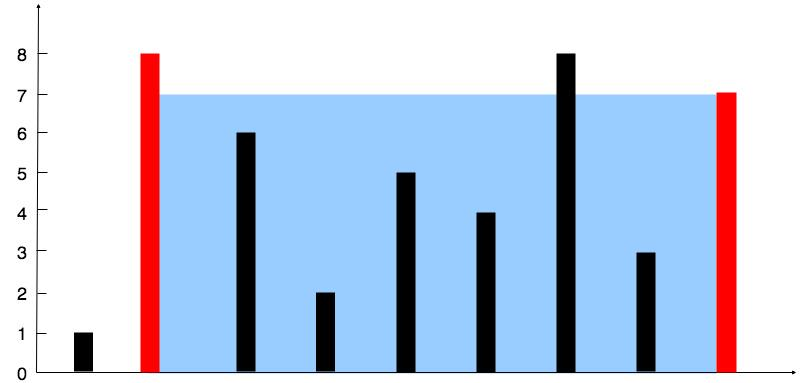

```text
输入: [1,8,6,2,5,4,8,3,7]
输出: 49
```

```python
Python
# 双指针，每次淘汰掉短边
class Solution:
    def maxArea(self, height):
        res = 0
        left = 0
        right = len(height) - 1

        while left < right:
            cur_area = (right - left) * min(height[left], height[right])
            res = max(res, cur_area)
            if height[left] < height[right]:
                left += 1
            else:
                right -= 1

        return res
# 通过双指针法（Two Pointer Approach），这段代码从数组的两端开始向中间靠拢，每次都计算当前可能的最大面积，更新结果，并根据高度调整左右指针，以确保不会遗漏任何潜在的最大面积。
```

###### [15. 三数之和](https://leetcode.cn/problems/3sum/)

给你一个整数数组nums，判断是否存在三元组[nums[i], nums[j], nums[k]]满足i != j、i != k且j != k，同时还满足nums[i] + nums[j] + nums[k] == 0。请你返回所有和为0且不重复的三元组。

注意：答案中不可以包含重复的三元组。

```text
Plain Text
输入：nums = [-1,0,1,2,-1,-4]
输出：[[-1,-1,2],[-1,0,1]]
解释：
nums[0] + nums[1] + nums[2] = (-1) + 0 + 1 = 0 。
nums[1] + nums[2] + nums[4] = 0 + 1 + (-1) = 0 。
nums[0] + nums[3] + nums[4] = (-1) + 2 + (-1) = 0 。
不同的三元组是 [-1,0,1] 和 [-1,-1,2] 。
注意，输出的顺序和三元组的顺序并不重要。
```

```python
# 双指针，每次淘汰掉短边
class Solution:
    def maxArea(self, height):
        res = 0
        left = 0
        right = len(height) - 1

        while left < right:
            cur_area = (right - left) * min(height[left], height[right])
            res = max(res, cur_area)
            if height[left] < height[right]:
                left += 1
            else:
                right -= 1

        return res
# 通过双指针法（Two Pointer Approach），这段代码从数组的两端开始向中间靠拢，每次都计算当前可能的最大面积，更新结果，并根据高度调整左右指针，以确保不会遗漏任何潜在的最大面积。
```

###### [42. 接雨水](https://leetcode.cn/problems/trapping-rain-water/)**⭕**

给定n个非负整数表示每个宽度为1的柱子的高度图，计算按此排列的柱子，下雨之后能接多少雨水。

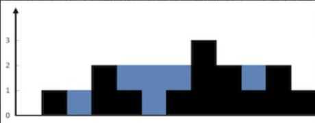

```text
Plain Text
输入：height = [0,1,0,2,1,0,1,3,2,1,2,1]
输出：6
解释：上面是由数组 [0,1,0,2,1,0,1,3,2,1,2,1] 表示的高度图，在这种情况下，可以接 6 个单位的雨水（蓝色部分表示雨水）。
```

```python
class Solution:
    def trap(self, height):
        # 如果 height 的长度小于 3，则无法形成能够容纳任何雨水的坑洞（至少需要三个柱子才能形成一个坑洞）
        if len(height) < 3:
            return 0

        ans = 0 # 用于累积能捕获的雨水总量。
        max_index = height.index(max(height)) #  height中最高柱子的索引位置。找到最高点后分开左右两边进行计算

        # 从左边到最高点计算雨水
        left = height[0]
        for i in range(1, max_index):
            if height[i] >= left:
                left = height[i]
            else:
                ans += left - height[i]

        # 从右边到最高点计算雨水
        right = height[-1]
        for i in range(len(height) - 2, max_index, -1):
            if height[i] >= right:
                right = height[i]
            else:
                ans += right - height[i]

        return ans

# 测试代码
sol = Solution()
print(sol.trap([0,1,0,2,1,0,1,3,2,1,2,1]))  # 输出: 6
```

#### **滑动窗口**

###### [3. 无重复字符的最长子串](https://leetcode.cn/problems/longest-substring-without-repeating-characters/)

给定一个字符串s，请你找出其中不含有重复字符的**最长子串**的长度。

```text
Plain Text
输入: s = "abcabcbb"
输出: 3
解释: 因为无重复字符的最长子串是 "abc"，所以其长度为 3。
```

```python
class Solution:
    def lengthOfLongestSubstring(self, s: str) -> int:
        char_map = {}
        left = 0
        res = 0

        for right in range(len(s)):
            cur = s[right]
            if cur in char_map:
                res = max(res, right - left)
                # 注意这一步，非常重要！排除了虽然存在，但在窗口之外的
                left = max(left, char_map[cur] + 1)
            char_map[cur] = right

        return max(res, len(s) - left)

# 测试代码
sol = Solution()
print(sol.lengthOfLongestSubstring("abcabcbb"))  # 输出: 3
print(sol.lengthOfLongestSubstring("bbbbb"))  # 输出: 1
print(sol.lengthOfLongestSubstring("pwwkew"))  # 输出: 3
```

###### [438. 找到字符串中所有字母异位词](https://leetcode.cn/problems/find-all-anagrams-in-a-string/)

给定两个字符串s和p，找到s中所有p的**异位词**的子串，返回这些子串的起始索引。不考虑答案输出的顺序。

**异位词**指由相同字母重排列形成的字符串（包括相同的字符串）。

```text
Plain Text
输入: s = "cbaebabacd", p = "abc"
输出: [0,6]
解释:
起始索引等于 0 的子串是 "cba", 它是 "abc" 的异位词。
起始索引等于 6 的子串是 "bac", 它是 "abc" 的异位词。
```

```python
# 普通的固定大小窗口，但思路比较简单
class Solution:
    def findAnagrams(self, s: str, p: str):
        if len(s) < len(p):
            return []

        p_count = [0] * 26
        s_count = [0] * 26
        res = []

        # 初始化计数器
        for i in range(len(p)):
            p_count[ord(p[i]) - ord('a')] += 1
            s_count[ord(s[i]) - ord('a')] += 1

        if p_count == s_count:
            res.append(0)

        # 滑动窗口
        for right in range(len(p), len(s)):
            s_count[ord(s[right - len(p)]) - ord('a')] -= 1  # 左边出窗口的字符
            s_count[ord(s[right]) - ord('a')] += 1  # 右边入窗口的字符

            if s_count == p_count:
                res.append(right - len(p) + 1)

        return res

# 测试代码
sol = Solution()
print(sol.findAnagrams("cbaebabacd", "abc"))  # 输出: [0, 6]
print(sol.findAnagrams("abab", "ab"))  # 输出: [0, 1, 2]
```

```python
# 一种优雅的滑动窗口
class Solution:
    def findAnagrams(self, s: str, p: str):
        if len(s) < len(p):
            return []

        dict_count = [0] * 26
        for ch in p:
            dict_count[ord(ch) - ord('a')] += 1

        res = []
        left = 0
        for right in range(len(s)):
            dict_count[ord(s[right]) - ord('a')] -= 1

            # 保证当前窗口中所有字符的计数非负
            while dict_count[ord(s[right]) - ord('a')] < 0:
                dict_count[ord(s[left]) - ord('a')] += 1
                left += 1

            if right - left + 1 == len(p):
                res.append(left)

        return res

# 测试代码
sol = Solution()
print(sol.findAnagrams("cbaebabacd", "abc"))  # 输出: [0, 6]
print(sol.findAnagrams("abab", "ab"))        # 输出: [0, 1, 2]
```

#### **子串**

###### [560. 和为 K 的子数组](https://leetcode.cn/problems/subarray-sum-equals-k/)

给你一个整数数组nums和一个整数k，请你统计并返回 该数组中和为k的子数组的个数。

子数组是数组中元素的连续非空序列。

```text
Plain Text
输入：nums = [1,1,1], k = 2
输出：2
```

```python
class Solution:
    def subarraySum(self, nums, k):
        res = 0
        prefix_sum = 0
        prefix_counts = {0: 1}  # 每个前缀和的出现次数，不要忘了初始条件

        for num in nums:
            prefix_sum += num

            # 寻找prefix_target，使prefix_sum - prefix_target = k
            if (prefix_sum - k) in prefix_counts:
                res += prefix_counts[prefix_sum - k]

            if prefix_sum in prefix_counts:
                prefix_counts[prefix_sum] += 1
            else:
                prefix_counts[prefix_sum] = 1

        return res

# 测试代码
sol = Solution()
print(sol.subarraySum([1, 1, 1], 2))  # 输出: 2
print(sol.subarraySum([1, 2, 3], 3))  # 输出: 2
```

###### [239. 滑动窗口最大值](https://leetcode.cn/problems/sliding-window-maximum/)**⭕**

给你一个整数数组nums，有一个大小为k的滑动窗口从数组的最左侧移动到数组的最右侧。你只可以看到在滑动窗口内的k个数字。滑动窗口每次只向右移动一位。

返回*滑动窗口中的最大值*。

```text
Plain Text
输入：nums = [1,3,-1,-3,5,3,6,7], k = 3
输出：[3,3,5,5,6,7]
解释：
滑动窗口的位置                最大值
---------------               -----
[1  3  -1] -3  5  3  6  7       3
 1 [3  -1  -3] 5  3  6  7       3
 1  3 [-1  -3  5] 3  6  7       5
 1  3  -1 [-3  5  3] 6  7       5
 1  3  -1  -3 [5  3  6] 7       6
 1  3  -1  -3  5 [3  6  7]      7
```

```python
import heapq

# 简单调库 heapq
# O(nlogn)

class Solution:
    def maxSlidingWindow(self, nums, k):
        # 堆中存储 值-索引，使用负值来模拟最大堆
        max_heap = [(-nums[i], i) for i in range(k)]
        heapq.heapify(max_heap)

        res = [-max_heap[0][0]]

        for right in range(k, len(nums)):
            heapq.heappush(max_heap, (-nums[right], right))
            # 若堆中最大值不在窗口里
            while max_heap[0][1] <= right - k:
                heapq.heappop(max_heap)
            res.append(-max_heap[0][0])

        return res

# 测试代码
sol = Solution()
print(sol.maxSlidingWindow([1,3,-1,-3,5,3,6,7], 3))  # 输出: [3, 3, 5, 5, 6, 7]
print(sol.maxSlidingWindow([1], 1))  # 输出: [1]
```

```python
# 维护双向队列，使队首为窗口最大值
from collections import deque

class Solution:
    def maxSlidingWindow(self, nums, k):
        q = deque()  # 存储下标，对应的值递减，保证队首为最大值
        res = []

        for i in range(k):
            while q and nums[i] >= nums[q[-1]]:
                q.pop()
            q.append(i)

        res.append(nums[q[0]])

        for right in range(k, len(nums)):
            # 确保队列中的元素从大到小排列
            while q and nums[right] >= nums[q[-1]]:
                q.pop()
            q.append(right)
            # 队首元素为最大值，检查是否在窗口内
            while q[0] < right - k + 1:
                q.popleft()
            res.append(nums[q[0]])

        return res

# 测试代码
sol = Solution()
print(sol.maxSlidingWindow([1,3,-1,-3,5,3,6,7], 3))  # 输出: [3, 3, 5, 5, 6, 7]
print(sol.maxSlidingWindow([1], 1))  # 输出: [1]
```

###### [76. 最小覆盖子串](https://leetcode.cn/problems/minimum-window-substring/)**⭕**

给你一个字符串s、一个字符串t。返回s中涵盖t所有字符的最小子串。如果s中不存在涵盖t所有字符的子串，则返回空字符串""。

**注意：**

- •对于t中重复字符，我们寻找的子字符串中该字符数量必须不少于t中该字符数量。

- •如果s中存在这样的子串，我们保证它是唯一的答案。

```sql
Plain Text
输入：s = "ADOBECODEBANC", t = "ABC"
输出："BANC"
解释：最小覆盖子串 "BANC" 包含来自字符串 t 的 'A'、'B' 和 'C'。
```

```python
# 哈希表记录字母个数，每次检查窗口是否valid
# O(kn)
from collections import Counter, defaultdict

class Solution:
    def isValid(self, cur, target):
        for char, count in target.items():
            if cur[char] < count:
                return False
        return True

    def minWindow(self, s: str, t: str) -> str:
        cur = defaultdict(int)  # 记录当前窗口字母出现次数
        target = Counter(t)     # t串字母出现次数

        left = 0
        right = -1  # 因为后面会先进行 `right + 1`
        min_len = float('inf')
        ans_left = 0
        s_len = len(s)

        while right < s_len:
            right += 1
            if right < s_len and s[right] in target:
                cur[s[right]] += 1

            # 循环收缩左边界
            while self.isValid(cur, target) and left <= right:
                cur_len = right - left + 1
                if cur_len < min_len:
                    min_len = cur_len
                    ans_left = left

                if s[left] in target:
                    cur[s[left]] -= 1

                left += 1

        if min_len == float('inf'):
            return ""
        return s[ans_left: ans_left + min_len]

# 测试代码
sol = Solution()
print(sol.minWindow("ADOBECODEBANC", "ABC"))  # 输出: "BANC"
print(sol.minWindow("A", "A"))  # 输出: "A"
print(sol.minWindow("A", "AA"))  # 输出: ""
```

#### **普通数组**

###### [53. 最大子数组和](https://leetcode.cn/problems/maximum-subarray/)

给你一个整数数组nums，请你找出一个具有最大和的连续子数组（子数组最少包含一个元素），返回其最大和。

**子数组**是数组中的一个连续部分。

```text
Plain Text
输入：nums = [-2,1,-3,4,-1,2,1,-5,4]
输出：6
解释：连续子数组 [4,-1,2,1] 的和最大，为 6 。
```

```python
# dp，但只用保存前一个状态
class Solution:
    def maxSubArray(self, nums) -> int:
        pre_max = 0
        max_sum = float('-inf')

        # 对每个i，维护一个以i结尾的最大和
        for i in range(len(nums)):
            pre_max = max(pre_max + nums[i], nums[i])
            max_sum = max(max_sum, pre_max)

        return max_sum

# 测试代码
sol = Solution()
print(sol.maxSubArray([-2,1,-3,4,-1,2,1,-5,4]))  # 输出: 6, 对应子数组为 [4,-1,2,1]
print(sol.maxSubArray([1]))  # 输出: 1
print(sol.maxSubArray([5,4,-1,7,8]))  # 输出: 23
```

###### [56. 合并区间](https://leetcode.cn/problems/merge-intervals/)

以数组intervals表示若干个区间的集合，其中单个区间为intervals[i] = [starti, endi]。请你合并所有重叠的区间，并返回*一个不重叠的区间数组，该数组需恰好覆盖输入中的所有区间*。

```text
Plain Text
输入：intervals = [[1,3],[2,6],[8,10],[15,18]]
输出：[[1,6],[8,10],[15,18]]
解释：区间 [1,3] 和 [2,6] 重叠, 将它们合并为 [1,6].
```

```python
# 排序
class Solution:
    def merge(self, intervals):
        if not intervals:
            return []

        # 对区间按左端点进行排序
        intervals.sort(key=lambda x: x[0])
        res = [intervals[0]]

        for i in range(1, len(intervals)):
            # 若左端点小于等于res中最后一个区间的右端点，则代表可以合并
            if intervals[i][0] <= res[-1][1]:
                # 更新右端点
                res[-1][1] = max(res[-1][1], intervals[i][1])
            else:
                # 不能合并，加入新区间
                res.append(intervals[i])

        return res

# 测试代码
sol = Solution()
print(sol.merge([[1,3],[2,6],[8,10],[15,18]]))  # 输出: [[1, 6], [8, 10], [15, 18]]
print(sol.merge([[1,4],[4,5]]))  # 输出: [[1, 5]]
```

###### [189. 轮转数组](https://leetcode.cn/problems/rotate-array/)

给定一个整数数组nums，将数组中的元素向右轮转k个位置，其中k是非负数。

```text
Plain Text
输入: nums = [1,2,3,4,5,6,7], k = 3
输出: [5,6,7,1,2,3,4]
解释:
向右轮转 1 步: [7,1,2,3,4,5,6]
向右轮转 2 步: [6,7,1,2,3,4,5]
向右轮转 3 步: [5,6,7,1,2,3,4]
```

```python
# 使用额外空间temp存储
class Solution:
    def rotate(self, nums, k):
        n = len(nums)
        k %= n  # 处理k大于数组长度的情况

        # 将最后k个元素存储在临时列表中
        temp = nums[-k:]

        # 将前n-k个元素向右移动k个位置
        for i in range(n-k-1, -1, -1):
            nums[i + k] = nums[i]

        # 将temp中的元素移动到数组的开始处
        nums[:k] = temp

# 测试代码
sol = Solution()
nums1 = [1,2,3,4,5,6,7]
k1 = 3
sol.rotate(nums1, k1)
print(nums1)  # 输出: [5, 6, 7, 1, 2, 3, 4]

nums2 = [-1,-100,3,99]
k2 = 2
sol.rotate(nums2, k2)
print(nums2)  # 输出: [3, 99, -1, -100]
```

###### [238. 除自身以外数组的乘积](https://leetcode.cn/problems/product-of-array-except-self/)

给你一个整数数组nums，返回 数组answer，其中answer[i]等于nums中除nums[i]之外其余各元素的乘积 。

题目数据**保证**数组nums之中任意元素的全部前缀元素和后缀的乘积都在**32 位**整数范围内。

请 不要使用除法，且在O(n)时间复杂度内完成此题。

```text
Plain Text
输入: nums = [1,2,3,4]
输出: [24,12,8,6]
```

```python
# 使用额外空间，存储从左到右乘积和从右到左乘积
class Solution:
    def productExceptSelf(self, nums):
        n = len(nums)

        left_prod = [1] * n
        right_prod = [1] * n

        # Calculate prefixes products
        for i in range(1, n):
            left_prod[i] = left_prod[i - 1] * nums[i - 1]

        # Calculate suffixes products
        for i in range(n - 2, -1, -1):
            right_prod[i] = right_prod[i + 1] * nums[i + 1]

        # Calculate final result
        res = [1] * n
        for i in range(n):
            res[i] = left_prod[i] * right_prod[i]

        return res

# 测试代码
sol = Solution()
print(sol.productExceptSelf([1, 2, 3, 4]))  # 输出: [24, 12, 8, 6]
print(sol.productExceptSelf([4, 5, 6, 7]))  # 输出: [210, 168, 140, 120]
```

```python
# 不使用额外空间
class Solution:
    def productExceptSelf(self, nums):
        n = len(nums)
        left = 1
        right = 1
        res = [1] * n

        for i in range(n):
            res[i] *= left
            res[n - i - 1] *= right
            left *= nums[i]
            right *= nums[n - i - 1]

        return res

# 测试代码
sol = Solution()
print(sol.productExceptSelf([1, 2, 3, 4]))  # 输出: [24, 12, 8, 6]
print(sol.productExceptSelf([4, 5, 6, 7]))  # 输出: [210, 168, 140, 120]
```

[41. 缺失的第一个正数](https://leetcode.cn/problems/first-missing-positive/)**⭕**

给你一个未排序的整数数组nums，请你找出其中没有出现的最小的正整数。

请你实现时间复杂度为O(n)并且只使用常数级别额外空间的解决方案。

```text
Plain Text
输入：nums = [3,4,-1,1]
输出：2
解释：1 在数组中，但 2 没有。
```

```python
class Solution:
    def firstMissingPositive(self, nums):
        n = len(nums)

        for i in range(n):
            # 将nums[i]放置到正确的位置nums[nums[i] - 1]上
            while 0 < nums[i] <= n and nums[nums[i] - 1] != nums[i]:
                nums[nums[i] - 1], nums[i] = nums[i], nums[nums[i] - 1]

        for i in range(n):
            if nums[i] != i + 1:
                return i + 1

        return n + 1

# 测试代码
sol = Solution()
print(sol.firstMissingPositive([1, 2, 0]))       # 输出: 3
print(sol.firstMissingPositive([3, 4, -1, 1]))   # 输出: 2
print(sol.firstMissingPositive([7, 8, 9, 11, 12]))  # 输出: 1
```

#### **矩阵**

###### [73. 矩阵置零](https://leetcode.cn/problems/set-matrix-zeroes/)

给定一个m x n的矩阵，如果一个元素为**0**，则将其所在行和列的所有元素都设为**0**。请使用[原地](http://baike.baidu.com/item/%E5%8E%9F%E5%9C%B0%E7%AE%97%E6%B3%95)算法。

```python
# O(m+n)空间
class Solution:
    def setZeroes(self, matrix):
        rows = set()
        columns = set()

        # 找出要置零的行和列
        for i in range(len(matrix)):
            for j in range(len(matrix[0])):
                if matrix[i][j] == 0:
                    rows.add(i)
                    columns.add(j)

        # 将这些行的所有元素设为0
        for i in rows:
            for j in range(len(matrix[0])):
                matrix[i][j] = 0

        # 将这些列的所有元素设为0
        for j in columns:
            for i in range(len(matrix)):
                matrix[i][j] = 0

# 测试代码
sol = Solution()
matrix1 = [
    [1, 1, 1],
    [1, 0, 1],
    [1, 1, 1]
]
sol.setZeroes(matrix1)
print(matrix1)  # 输出: [[1, 0, 1], [0, 0, 0], [1, 0, 1]]

matrix2 = [
    [0, 1, 2, 0],
    [3, 4, 5, 2],
    [1, 3, 1, 5]
]
sol.setZeroes(matrix2)
print(matrix2)  # 输出: [[0, 0, 0, 0], [0, 4, 5, 0], [0, 3, 1, 0]]
```

```python
# O(1)空间，用matrix的第一行和第一列来记录0
class Solution:
    def setZeroes(self, matrix):
        m = len(matrix)
        n = len(matrix[0])
        flag_col0 = False
        flag_row0 = False

        # 检查第一列是否需要置零
        for i in range(m):
            if matrix[i][0] == 0:
                flag_col0 = True

        # 检查第一行是否需要置零
        for j in range(n):
            if matrix[0][j] == 0:
                flag_row0 = True

        # 使用第一行和第一列作为标记
        for i in range(1, m):
            for j in range(1, n):
                if matrix[i][j] == 0:
                    matrix[i][0] = 0
                    matrix[0][j] = 0

        # 根据标记将对应的行和列置零
        for i in range(1, m):
            for j in range(1, n):
                if matrix[i][0] == 0 or matrix[0][j] == 0:
                    matrix[i][j] = 0

        # 处理第一列
        if flag_col0:
            for i in range(m):
                matrix[i][0] = 0

        # 处理第一行
        if flag_row0:
            for j in range(n):
                matrix[0][j] = 0

# 测试代码
sol = Solution()
matrix1 = [
    [1, 1, 1],
    [1, 0, 1],
    [1, 1, 1]
]
sol.setZeroes(matrix1)
print(matrix1)  # 输出: [[1, 0, 1], [0, 0, 0], [1, 0, 1]]

matrix2 = [
    [0, 1, 2, 0],
    [3, 4, 5, 2],
    [1, 3, 1, 5]
]
sol.setZeroes(matrix2)
print(matrix2)  # 输出: [[0, 0, 0, 0], [0, 4, 5, 0], [0, 3, 1, 0]]
```

###### [54. 螺旋矩阵](https://leetcode.cn/problems/spiral-matrix/)

给你一个m行n列的矩阵matrix，请按照**顺时针螺旋顺序**，返回矩阵中的所有元素。

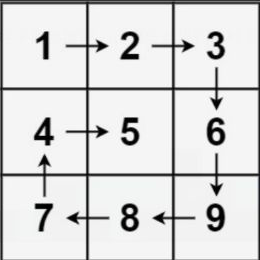

```text
Plain Text
输入：matrix = [[1,2,3],[4,5,6],[7,8,9]]
输出：[1,2,3,6,9,8,7,4,5]
```

```python
# 按圈模拟
class Solution:
    def spiralOrder(self, matrix):
        res = []
        cur_loop = 0
        column_num = len(matrix[0])
        row_num = len(matrix)

        while True:
            # 从左到右
            for j in range(cur_loop, column_num - cur_loop):
                res.append(matrix[cur_loop][j])
            if len(res) >= column_num * row_num:
                break

            # 从上到下
            for i in range(cur_loop + 1, row_num - cur_loop):
                res.append(matrix[i][column_num - cur_loop - 1])
            if len(res) >= column_num * row_num:
                break

            # 从右到左
            for j in range(column_num - cur_loop - 2, cur_loop - 1, -1):
                res.append(matrix[row_num - cur_loop - 1][j])
            if len(res) >= column_num * row_num:
                break

            # 从下到上
            for i in range(row_num - cur_loop - 2, cur_loop, -1):
                res.append(matrix[i][cur_loop])
            if len(res) >= column_num * row_num:
                break

            cur_loop += 1

        return res

# 测试代码
sol = Solution()
matrix1 = [
    [1, 2, 3],
    [4, 5, 6],
    [7, 8, 9]
]
print(sol.spiralOrder(matrix1))  # 输出: [1, 2, 3, 6, 9, 8, 7, 4, 5]

matrix2 = [
    [1, 2, 3, 4],
    [5, 6, 7, 8],
    [9, 10, 11, 12]
]
print(sol.spiralOrder(matrix2))  # 输出: [1, 2, 3, 4, 8, 12, 11, 10, 9, 5, 6, 7]
```

###### [48. 旋转图像](https://leetcode.cn/problems/rotate-image/)

给定一个*n*×*n*的二维矩阵matrix表示一个图像。请你将图像顺时针旋转 90 度。

你必须在[原地](https://baike.baidu.com/item/%E5%8E%9F%E5%9C%B0%E7%AE%97%E6%B3%95)旋转图像，这意味着你需要直接修改输入的二维矩阵。请不要使用另一个矩阵来旋转图像。

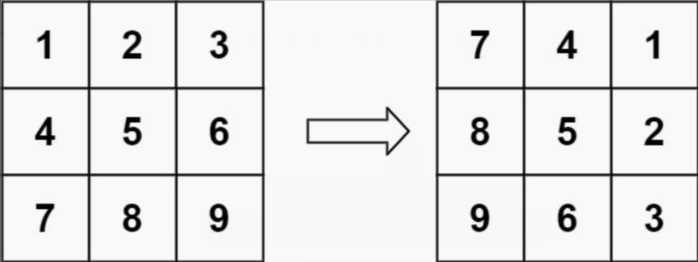

```text
Plain Text
输入：matrix = [[1,2,3],[4,5,6],[7,8,9]]
输出：[[7,4,1],[8,5,2],[9,6,3]]
```

```python
# 先逆序再转置
class Solution:
    def rotate(self, matrix):
        # 先上下翻转矩阵
        matrix.reverse()

        # 再对矩阵进行转置
        n = len(matrix)
        for i in range(n):
            for j in range(i):
                matrix[i][j], matrix[j][i] = matrix[j][i], matrix[i][j]

# 测试代码
sol = Solution()
matrix1 = [
    [1, 2, 3],
    [4, 5, 6],
    [7, 8, 9]
]
sol.rotate(matrix1)
print(matrix1)  # 输出: [[7, 4, 1], [8, 5, 2], [9, 6, 3]]

matrix2 = [
    [ 5, 1, 9,11],
    [ 2, 4, 8,10],
    [13, 3, 6, 7],
    [15,14,12,16]
]
sol.rotate(matrix2)
print(matrix2)  # 输出: [[15, 13,  2,  5], [14,  3,  4,  1], [12,  6,  8,  9], [16,  7, 10, 11]]
```

###### **:star:**[240. 搜索二维矩阵 II](https://leetcode.cn/problems/search-a-2d-matrix-ii/)

编写一个高效的算法来搜索m x n矩阵matrix中的一个目标值target。该矩阵具有以下特性：

- •每行的元素从左到右升序排列。

- •每列的元素从上到下升序排列。

```python
# 按行二分查找，O(mlogn)
class Solution:
    def searchMatrix(self, matrix, target):
        for row in matrix:
            left, right = 0, len(row) - 1
            while left <= right:
                mid = left + (right - left) // 2
                if row[mid] == target:
                    return True
                elif row[mid] < target:
                    left = mid + 1
                else:
                    right = mid - 1
        return False

# 测试代码
sol = Solution()
matrix1 = [
    [1, 3, 5, 7],
    [10, 11, 16, 20],
    [23, 30, 34, 60]
]
print(sol.searchMatrix(matrix1, 3))  # 输出: True
print(sol.searchMatrix(matrix1, 13))  # 输出: False

matrix2 = [[1, 3]]
print(sol.searchMatrix(matrix2, 3))  # 输出: True
print(sol.searchMatrix(matrix2, 2))  # 输出: False
```

```python
# 优化，每次检查右上角，O(m+n)
class Solution:
    def searchMatrix(self, matrix, target):
        m, n = len(matrix), len(matrix[0])
        x, y = 0, n - 1

        while x < m and y >= 0:
            if matrix[x][y] == target:
                return True
            elif matrix[x][y] > target:
                y -= 1
            else:
                x += 1

        return False

# 测试代码
sol = Solution()
matrix1 = [
    [1, 3, 5, 7],
    [10, 11, 16, 20],
    [23, 30, 34, 60]
]
print(sol.searchMatrix(matrix1, 3))  # 输出: True
print(sol.searchMatrix(matrix1, 13))  # 输出: False
```

## **哈希表**

###### [1. 两数之和](https://leetcode.cn/problems/two-sum/)**💚**

给定一个整数数组nums和一个整数目标值target，请你在该数组中找出**和为目标值**target的那**两个**整数，并返回它们的数组下标。

你可以假设每种输入只会对应一个答案。但是，数组中同一个元素在答案里不能重复出现。

你可以按任意顺序返回答案。

```python
class Solution:
    def twoSum(self, nums, target):
        num_to_index = {}  # 记录数值到其下标的映射

        for i, num in enumerate(nums):
            complement = target - num
            if complement in num_to_index:
                return [num_to_index[complement], i]
            num_to_index[num] = i

        return []

# 测试代码
sol = Solution()
print(sol.twoSum([2, 7, 11, 15], 9))  # 输出: [0, 1]
print(sol.twoSum([3, 2, 4], 6))       # 输出: [1, 2]
print(sol.twoSum([3, 3], 6))          # 输出: [0, 1]
```

###### [49. 字母异位词分组](https://leetcode.cn/problems/group-anagrams/)

给你一个字符串数组，请你将**字母异位词**组合在一起。可以按任意顺序返回结果列表。

**字母异位词**是由重新排列源单词的所有字母得到的一个新单词。

```
Plain Text
输入: strs = ["eat", "tea", "tan", "ate", "nat", "bat"]
输出: [["bat"],["nat","tan"],["ate","eat","tea"]]
```

```python
# 字母排序
class Solution:
    def groupAnagrams(self, strs):
        res = []
        dict = {}  # 字母组合到其在res中的索引的映射

        for str in strs:
            temp = ''.join(sorted(str))  # 字母异位词排序后是同一个词
            if temp in dict:
                res[dict[temp]].append(str)
            else:
                dict[temp] = len(res)
                res.append([str])

        return res

# 测试代码
sol = Solution()
print(sol.groupAnagrams(["eat", "tea", "tan", "ate", "nat", "bat"]))
# 输出: [['eat', 'tea', 'ate'], ['tan', 'nat'], ['bat']]
```

###### [128. 最长连续序列](https://leetcode.cn/problems/longest-consecutive-sequence/)

给定一个未排序的整数数组nums，找出数字连续的最长序列（不要求序列元素在原数组中连续）的长度。

请你设计并实现时间复杂度为O(n)的算法解决此问题。

```text
Plain Text
输入：nums = [100,4,200,1,3,2]
输出：4
解释：最长数字连续序列是 [1, 2, 3, 4]。它的长度为 4。
```

```python
# 一般哈希
class Solution:
    def longestConsecutive(self, nums):
        num_set = set(nums)  # 使用集合去重并优化查找

        res = 0

        for num in num_set:
            # 只检查不存在前驱连续的num，保证每个num只会被遍历一次
            if num - 1 not in num_set:
                cur_num = num
                cur_len = 1

                while cur_num + 1 in num_set:
                    cur_num += 1
                    cur_len += 1

                res = max(res, cur_len)

        return res

# 测试代码
sol = Solution()
print(sol.longestConsecutive([100, 4, 200, 1, 3, 2]))  # 输出: 4
print(sol.longestConsecutive([0,3,7,2,5,8,4,6,0,1]))  # 输出: 9
```

```python
# 动态规划
# 用哈希表存储每个端点值对应连续区间的长度
# 若数已在哈希表中：跳过不做处理
# 若是新数加入：
#  取出其左右相邻数已有的连续区间长度 left 和 right
#  计算当前数的区间长度为：cur_length = left + right + 1
#  根据 cur_length 更新最大长度 max_length 的值
#  更新区间两端点的长度值
class Solution:
    def longestConsecutive(self, nums):
        res = 0
        # 使用字典来存储每个数所在的连续区间长度
        num_dict = {}

        for num in nums:
            if num not in num_dict:
                # 获取左侧和右侧相邻数字的连续区间长度
                left_len = num_dict.get(num - 1, 0)
                right_len = num_dict.get(num + 1, 0)
                # 当前数的连续区间长度
                length = left_len + right_len + 1
                # 更新结果，记录最长的连续区间长度
                res = max(res, length)
                # 更新字典
                num_dict[num] = length
                num_dict[num - left_len] = length
                num_dict[num + right_len] = length

        return res
```

## **链表**

###### [160. 相交链表](https://leetcode.cn/problems/intersection-of-two-linked-lists/)**💚**

给你两个单链表的头节点headA和headB，请你找出并返回两个单链表相交的起始节点。如果两个链表不存在相交节点，返回null。

```python
class ListNode:
    def __init__(self, val=0, next=None):
        self.val = val
        self.next = next

class Solution:
    def getIntersectionNode(self, headA, headB):
        # 计算两个链表的长度
        lenA, lenB = 0, 0
        cur = headA
        while cur:
            lenA += 1
            cur = cur.next

        cur = headB
        while cur:
            lenB += 1
            cur = cur.next

        # 调整起点使得两个链表剩余长度相等
        if lenA <= lenB:
            for _ in range(lenB - lenA):
                headB = headB.next
        else:
            for _ in range(lenA - lenB):
                headA = headA.next

        # 同时遍历两个链表，查找相交点
        while headA and headB:
            if headA == headB:
                return headA
            headA = headA.next
            headB = headB.next

        return None  # 没有相交点

# 测试代码
# 创建链表节点
node1 = ListNode(1)
node2 = ListNode(2)
node3 = ListNode(3)
node4 = ListNode(4)
node5 = ListNode(5)

# 创建两个相交的链表
# 链表 A: 1 -> 2
#                      \
#                       3 -> 4 -> 5
#                      /
# 链表 B:       6 -> 7
node1.next = node2
node2.next = node3
node3.next = node4
node4.next = node5

node6 = ListNode(6)
node7 = ListNode(7)
node6.next = node7
node7.next = node3

sol = Solution()
intersection_node = sol.getIntersectionNode(node1, node6)
if intersection_node:
    print(intersection_node.val)  # 输出: 3
else:
    print("No intersection")
```

###### [206. 反转链表](https://leetcode.cn/problems/reverse-linked-list/)**💚**

给你单链表的头节点head，请你反转链表，并返回反转后的链表。

```python
class ListNode:
    def __init__(self, val=0, next=None):
        self.val = val
        self.next = next

class Solution:
    def reverseNode(self, pre, cur):
        if not cur:
            return pre
        next_node = cur.next  # 记录下一节点
        cur.next = pre        # 转向
        return self.reverseNode(cur, next_node)

    def reverseList(self, head):
        return self.reverseNode(None, head)

# 测试代码
def printList(head):
    while head:
        print(head.val, end=" -> ")
        head = head.next
    print("None")

# 创建链表：1 -> 2 -> 3 -> 4 -> 5
node1 = ListNode(1)
node2 = ListNode(2)
node3 = ListNode(3)
node4 = ListNode(4)
node5 = ListNode(5)
node1.next = node2
node2.next = node3
node3.next = node4
node4.next = node5

# 测试递归反转
sol = Solution()
print("Original list:")
printList(node1)

reversed_list = sol.reverseList(node1)
print("\nReversed list (recursive):")
printList(reversed_list)
```

###### [234. 回文链表](https://leetcode.cn/problems/palindrome-linked-list/)**💚**

给你一个单链表的头节点head，请你判断该链表是否为回文链表。如果是，返回true；否则，返回false。

```python
# 双指针？
class ListNode:
    def __init__(self, val=0, next=None):
        self.val = val
        self.next = next

class Solution:
    def __init__(self):
        self.temp = None
        self.flag = True

    def getTail(self, cur):
        if not cur:
            return
        self.getTail(cur.next)
        if cur.val != self.temp.val:
            self.flag = False
        self.temp = self.temp.next

    def isPalindrome(self, head):
        self.temp = head
        self.getTail(head)
        return self.flag

# 测试代码
def create_list(arr):
    if not arr:
        return None
    head = ListNode(arr[0])
    current = head
    for val in arr[1:]:
        current.next = ListNode(val)
        current = current.next
    return head

# 创建链表：1 -> 2 -> 2 -> 1
list1 = create_list([1, 2, 2, 1])
sol = Solution()
print(sol.isPalindrome(list1))  # 输出: True


# 创建链表：1 -> 2
list3 = create_list([1, 2])
sol = Solution()
print(sol.isPalindrome(list3))  # 输出: False
```

###### [141. 环形链表](https://leetcode.cn/problems/linked-list-cycle/)**💚**

给你一个链表的头节点head，判断链表中是否有环。

如果链表中有某个节点，可以通过连续跟踪next指针再次到达，则链表中存在环。 为了表示给定链表中的环，评测系统内部使用整数pos来表示链表尾连接到链表中的位置（索引从 0 开始）。注意：pos不作为参数进行传递 。仅仅是为了标识链表的实际情况。

*如果链表中存在环*，则返回true。 否则，返回false。

```python
class ListNode:
    def __init__(self, val=0, next=None):
        self.val = val
        self.next = next

class Solution:
    def hasCycle(self, head):
        if not head or not head.next:
            return False

        slow = head
        fast = head

        while fast and fast.next:
            slow = slow.next
            fast = fast.next.next
            if slow == fast:
                return True

        return False

# 测试代码
def create_list(arr, pos):
    if not arr:
        return None
    head = ListNode(arr[0])
    current = head
    nodes = [head]
    for val in arr[1:]:
        current.next = ListNode(val)
        current = current.next
        nodes.append(current)
    if pos != -1:
        current.next = nodes[pos]
    return head

sol = Solution()

# 创建链表：3 -> 2 -> 0 -> -4，其中最后一个节点指向第二个节点（形成环）
list1 = create_list([3, 2, 0, -4], 1)
print(sol.hasCycle(list1))  # 输出: True

# 创建链表：1 -> 2，其中最后一个节点指向第一个节点（形成环）
list2 = create_list([1, 2], 0)
print(sol.hasCycle(list2))  # 输出: True

# 创建链表：1，没有环
list3 = create_list([1], -1)
print(sol.hasCycle(list3))  # 输出: False
```

###### [142. 环形链表 II](https://leetcode.cn/problems/linked-list-cycle-ii/)

给定一个链表的头节点head，返回链表开始入环的第一个节点。 如果链表无环，则返回null*。*

如果链表中有某个节点，可以通过连续跟踪next指针再次到达，则链表中存在环。 为了表示给定链表中的环，评测系统内部使用整数pos来表示链表尾连接到链表中的位置（索引从 0 开始）。如果pos是-1，则在该链表中没有环。注意：pos不作为参数进行传递，仅仅是为了标识链表的实际情况。

**不允许修改**链表。

```python
class ListNode:
    def __init__(self, val=0, next=None):
        self.val = val
        self.next = next

class Solution:
    def detectCycle(self, head):
        if not head or not head.next:
            return None

        slow = head
        fast = head

        # 先用快慢指针找到相遇点
        while fast and fast.next:
            slow = slow.next
            fast = fast.next.next
            if slow == fast:
                # 此时说明有环
                while head != slow:
                    head = head.next
                    slow = slow.next
                return head

        return None

# 测试代码
def create_list(arr, pos):
    if not arr:
        return None
    head = ListNode(arr[0])
    current = head
    nodes = [head]
    for val in arr[1:]:
        current.next = ListNode(val)
        current = current.next
        nodes.append(current)
    if pos != -1:
        current.next = nodes[pos]
    return head

sol = Solution()

# 创建链表：3 -> 2 -> 0 -> -4，其中最后一个节点指向第二个节点（形成环）
list1 = create_list([3, 2, 0, -4], 1)
print(sol.detectCycle(list1).val if sol.detectCycle(list1) else "No cycle")  # 输出: 2

# 创建链表：1 -> 2，其中最后一个节点指向第一个节点（形成环）
list2 = create_list([1, 2], 0)
print(sol.detectCycle(list2).val if sol.detectCycle(list2) else "No cycle")  # 输出: 1

# 创建链表：1，没有环
list3 = create_list([1], -1)
print(sol.detectCycle(list3).val if sol.detectCycle(list3) else "No cycle")  # 输出: No cycle
```

###### [21. 合并两个有序链表](https://leetcode.cn/problems/merge-two-sorted-lists/)**💚**

将两个升序链表合并为一个新的**升序**链表并返回。新链表是通过拼接给定的两个链表的所有节点组成的。

```text
Plain Text
输入：l1 = [1,2,4], l2 = [1,3,4]
输出：[1,1,2,3,4,4]
```

```python
# 用pre记录上一个节点
class ListNode:
    def __init__(self, val=0, next=None):
        self.val = val
        self.next = next

class Solution:
    def recursion(self, list1, list2, pre):
        if not list1 and not list2:
            return
        elif not list1:
            pre.next = list2
            return
        elif not list2:
            pre.next = list1
            return

        if list1.val < list2.val:
            pre.next = list1
            self.recursion(list1.next, list2, list1)
        else:
            pre.next = list2
            self.recursion(list1, list2.next, list2)

    def mergeTwoLists(self, list1, list2):
        dummy_head = ListNode()
        self.recursion(list1, list2, dummy_head)
        return dummy_head.next

# 测试代码
def create_list(arr):
    if not arr:
        return None
    head = ListNode(arr[0])
    current = head
    for val in arr[1:]:
        current.next = ListNode(val)
        current = current.next
    return head

def print_list(head):
    while head:
        print(head.val, end=" -> ")
        head = head.next
    print("None")

# 创建链表：1 -> 2 -> 4
list1 = create_list([1, 2, 4])
# 创建链表：1 -> 3 -> 4
list2 = create_list([1, 3, 4])

sol = Solution()

print("List1:")
print_list(list1)
print("List2:")
print_list(list2)

merged_list = sol.mergeTwoLists(list1, list2)
print("Merged List:")
print_list(merged_list)
```

###### [2. 两数相加](https://leetcode.cn/problems/add-two-numbers/)

给你两个**非空**的链表，表示两个非负的整数。它们每位数字都是按照**逆序**的方式存储的，并且每个节点只能存储**一位**数字。

请你将两个数相加，并以相同形式返回一个表示和的链表。

你可以假设除了数字 0 之外，这两个数都不会以 0 开头。

```text
Plain Text
输入：l1 = [2,4,3], l2 = [5,6,4]
输出：[7,0,8]
解释：342 + 465 = 807.
```

```python
# 重点在处理进位
class ListNode:
    def __init__(self, val=0, next=None):
        self.val = val
        self.next = next

class Solution:
    def addTwoNumbers(self, l1, l2):
        dummy_head = ListNode()
        cur = dummy_head
        carry = 0

        while l1 or l2:
            temp = carry
            if l1:
                temp += l1.val
                l1 = l1.next
            if l2:
                temp += l2.val
                l2 = l2.next

            cur.next = ListNode(temp % 10)
            cur = cur.next
            carry = temp // 10  # 计算进位

        if carry == 1:
            cur.next = ListNode(1)

        return dummy_head.next

# 辅助函数：创建链表
def create_list(arr):
    if not arr:
        return None
    head = ListNode(arr[0])
    current = head
    for val in arr[1:]:
        current.next = ListNode(val)
        current = current.next
    return head

# 辅助函数：打印链表
def print_list(head):
    while head:
        print(head.val, end=" -> ")
        head = head.next
    print("None")

# 测试代码
list1 = create_list([2, 4, 3])
list2 = create_list([5, 6, 4])

sol = Solution()
result = sol.addTwoNumbers(list1, list2)

print("List 1:")
print_list(list1)
print("List 2:")
print_list(list2)
print("Sum:")
print_list(result)
```

###### [19. 删除链表的倒数第 N 个结点](https://leetcode.cn/problems/remove-nth-node-from-end-of-list/)

给你一个链表，删除链表的倒数第n个结点，并且返回链表的头结点。

```python
# 递归
class ListNode:
    def __init__(self, val=0, next=None):
        self.val = val
        self.next = next

class Solution:
    def __init__(self):
        self.cnt = 0

    def recursion(self, pre, cur, n):
        if not cur:
            return
        self.recursion(cur, cur.next, n)
        self.cnt += 1
        if self.cnt == n:
            pre.next = cur.next

    def removeNthFromEnd(self, head, n):
        dummy_head = ListNode(0, head)
        self.recursion(dummy_head, head, n)
        return dummy_head.next

# 辅助函数：创建链表
def create_list(arr):
    if not arr:
        return None
    head = ListNode(arr[0])
    current = head
    for val in arr[1:]:
        current.next = ListNode(val)
        current = current.next
    return head

# 辅助函数：打印链表
def print_list(head):
    while head:
        print(head.val, end=" -> ")
        head = head.next
    print("None")

# 测试代码
list1 = create_list([1, 2, 3, 4, 5])

sol = Solution()
output = sol.removeNthFromEnd(list1, 2)

print("Original List:")
create_list([1, 2, 3, 4, 5])
print_list(output)
```

###### [24. 两两交换链表中的节点](https://leetcode.cn/problems/swap-nodes-in-pairs/)

给你一个链表，两两交换其中相邻的节点，并返回交换后链表的头节点。你必须在不修改节点内部的值的情况下完成本题（即，只能进行节点交换）。

```text
Bash
输入：head = [1,2,3,4]
输出：[2,1,4,3]
```

```python
# 递归
class ListNode:
    def __init__(self, val=0, next=None):
        self.val = val
        self.next = next

class Solution:
    def swapPairs(self, head):
        if not head or not head.next:
            return head

        new_head = head.next  # 第二个节点
        head.next = self.swapPairs(new_head.next)
        new_head.next = head

        return new_head

# 辅助函数：创建链表
def create_list(arr):
    if not arr:
        return None
    head = ListNode(arr[0])
    current = head
    for val in arr[1:]:
        current.next = ListNode(val)
        current = current.next
    return head

# 辅助函数：打印链表
def print_list(head):
    while head:
        print(head.val, end=" -> ")
        head = head.next
    print("None")

# 测试代码
list1 = create_list([1, 2, 3, 4])

sol = Solution()
output = sol.swapPairs(list1)

print("Swapped List:")
print_list(output)
```

###### [25. K 个一组翻转链表](https://leetcode.cn/problems/reverse-nodes-in-k-group/)**⭕**

给你链表的头节点head，每k个节点一组进行翻转，请你返回修改后的链表。

k是一个正整数，它的值小于或等于链表的长度。如果节点总数不是k的整数倍，那么请将最后剩余的节点保持原有顺序。

你不能只是单纯的改变节点内部的值，而是需要实际进行节点交换。

```text
Bash
示例 1：
输入：head = [1,2,3,4,5], k = 2
输出：[2,1,4,3,5]
示例 2：
输入：head = [1,2,3,4,5], k = 3
输出：[3,2,1,4,5]
```

```python
# 递归
class ListNode:
    def __init__(self, val=0, next=None):
        self.val = val
        self.next = next

class Solution:
    def reverseKGroup(self, head, k):
        next_group = head
        i = k
        while i:
            if not next_group:
                return head
            next_group = next_group.next
            i -= 1

        prev, curr = None, head
        while curr != next_group:
            temp = curr.next
            curr.next = prev
            prev = curr
            curr = temp

        head.next = self.reverseKGroup(next_group, k)
        return prev

# 辅助函数：创建链表
def create_list(arr):
    if not arr:
        return None
    head = ListNode(arr[0])
    current = head
    for val in arr[1:]:
        current.next = ListNode(val)
        current = current.next
    return head

# 辅助函数：打印链表
def print_list(head):
    while head:
        print(head.val, end=" -> ")
        head = head.next
    print("None")

# 测试代码
list1 = create_list([1, 2, 3, 4, 5])

sol = Solution()
output = sol.reverseKGroup(list1, 3)

print("Reversed List in K-group:")
print_list(output)
```

###### [138. 随机链表的复制](https://leetcode.cn/problems/copy-list-with-random-pointer/)

给你一个长度为n的链表，每个节点包含一个额外增加的随机指针random，该指针可以指向链表中的任何节点或空节点。

构造这个链表的[深拷贝](https://baike.baidu.com/item/%E6%B7%B1%E6%8B%B7%E8%B4%9D/22785317?fr=aladdin)。 深拷贝应该正好由n个**全新**节点组成，其中每个新节点的值都设为其对应的原节点的值。新节点的next指针和random指针也都应指向复制链表中的新节点，并使原链表和复制链表中的这些指针能够表示相同的链表状态。复制链表中的指针都不应指向原链表中的节点 。

```python
class Node:
    def __init__(self, val=0, next=None, random=None):
        self.val = val
        self.next = next
        self.random = random

class Solution:
    def copyRandomList(self, head):
        if not head:
            return None

        # 创建哈希表，用于存储原节点和新节点的映射关系
        node_dict = {}

        # 第一次遍历：创建所有新节点（只复制值）
        cur = head
        while cur:
            node_dict[cur] = Node(cur.val)
            cur = cur.next

        # 第二次遍历：更新节点的next和random指针
        cur = head
        while cur:
            if cur.next:
                node_dict[cur].next = node_dict[cur.next]
            if cur.random:
                node_dict[cur].random = node_dict[cur.random]
            cur = cur.next

        # 返回复制链表的头节点
        return node_dict[head]

# 辅助函数：创建链表
def create_list(arr, random_indices):
    if not arr:
        return None
    nodes = [Node(val) for val in arr]
    head = nodes[0]
    for i in range(1, len(nodes)):
        nodes[i-1].next = nodes[i]
    for i, rand_i in enumerate(random_indices):
        if rand_i != -1:
            nodes[i].random = nodes[rand_i]
    return head

# 辅助函数：打印链表（包括随机指针）
def print_list(head):
    nodes = []
    while head:
        rand_val = head.random.val if head.random else None
        nodes.append(f"Node(val: {head.val}, random_val: {rand_val})")
        head = head.next
    print(" -> ".join(nodes))

# 测试代码
arr = [7, 13, 11, 10, 1]
random_indices = [None, 0, 4, 2, 0]
list1 = create_list(arr, random_indices)

sol = Solution()
copied_list = sol.copyRandomList(list1)

print("Original list:")
print_list(list1)
print("\nCopied list:")
print_list(copied_list)
```

[148. 排序链表](https://leetcode.cn/problems/sort-list/)

给你链表的头结点head，请将其按**升序**排列并返回**排序后的链表**。

```python
# 堆排序
import heapq

class ListNode:
    def __init__(self, val=0, next=None):
        self.val = val
        self.next = next

class Solution:
    def sortList(self, head):
        if not head:
            return None

        # 使用小顶堆
        heap = []
        cur = head
        while cur:
            temp = cur.next
            cur.next = None
            heapq.heappush(heap, (cur.val, cur))
            cur = temp

        dummy_head = ListNode()
        cur = dummy_head
        while heap:
            _, node = heapq.heappop(heap)
            cur.next = node
            cur = cur.next

        return dummy_head.next

# 辅助函数：创建链表
def create_list(arr):
    if not arr:
        return None
    head = ListNode(arr[0])
    current = head
    for val in arr[1:]:
        current.next = ListNode(val)
        current = current.next
    return head

# 辅助函数：打印链表
def print_list(head):
    while head:
        print(head.val, end=" -> ")
        head = head.next
    print("None")

# 测试代码
list1 = create_list([4, 2, 1, 3])

sol = Solution()
sorted_list = sol.sortList(list1)

print("Sorted List:")
print_list(sorted_list)
```

```python
# 归并排序
class ListNode:
    def __init__(self, val=0, next=None):
        self.val = val
        self.next = next

class Solution:
    def sortList(self, head):
        if not head or not head.next:
            return head

        mid = self.findMid(head)
        newHead = mid.next
        # 这里一定记得截断
        mid.next = None

        left = self.sortList(head)
        right = self.sortList(newHead)
        return self.merge(left, right)

    def findMid(self, head):
        slow = head
        fast = head

        while fast.next and fast.next.next:
            slow = slow.next
            fast = fast.next.next

        return slow

    def merge(self, l1, l2):
        if not l1:
            return l2
        if not l2:
            return l1
        if l1.val <= l2.val:
            l1.next = self.merge(l1.next, l2)
            return l1
        else:
            l2.next = self.merge(l1, l2.next)
            return l2

# 辅助函数：创建链表
def create_list(arr):
    if not arr:
        return None
    head = ListNode(arr[0])
    current = head
    for val in arr[1:]:
        current.next = ListNode(val)
        current = current.next
    return head

# 辅助函数：打印链表
def print_list(head):
    while head:
        print(head.val, end=" -> ")
        head = head.next
    print("None")

# 测试代码
list1 = create_list([4, 2, 1, 3])

sol = Solution()
sorted_list = sol.sortList(list1)

print("Sorted List:")
print_list(sorted_list)
```

[23. 合并 K 个升序链表](https://leetcode.cn/problems/merge-k-sorted-lists/)**⭕**

给你一个链表数组，每个链表都已经按升序排列。

请你将所有链表合并到一个升序链表中，返回合并后的链表。

```python
import heapq

class ListNode:
    def __init__(self, val=0, next=None):
        self.val = val
        self.next = next

class Solution:
    def mergeKLists(self, lists):
        heap = []

        # 初始化小顶堆
        for node in lists:
            if node:
                heapq.heappush(heap, (node.val, node))

        dummy_head = ListNode()
        cur = dummy_head

        while heap:
            val, node = heapq.heappop(heap)
            cur.next = node
            cur = cur.next
            if node.next:
                heapq.heappush(heap, (node.next.val, node.next))

        return dummy_head.next

# 辅助函数：创建链表
def create_list(arr):
    if not arr:
        return None
    head = ListNode(arr[0])
    current = head
    for val in arr[1:]:
        current.next = ListNode(val)
        current = current.next
    return head

# 辅助函数：打印链表
def print_list(head):
    while head:
        print(head.val, end=" -> ")
        head = head.next
    print("None")

# 测试代码
lists = [
    create_list([1, 4, 5]),
    create_list([1, 3, 4]),
    create_list([2, 6])
]

sol = Solution()
merged_list = sol.mergeKLists(lists)

print("Merged List:")
print_list(merged_list)
```

###### [146. LRU 缓存](https://leetcode.cn/problems/lru-cache/)

请你设计并实现一个满足[LRU (最近最少使用) 缓存](https://baike.baidu.com/item/LRU)约束的数据结构。

实现LRUCache类：

- •LRUCache(int capacity)以**正整数**作为容量capacity初始化 LRU 缓存

- •int get(int key)如果关键字key存在于缓存中，则返回关键字的值，否则返回-1。

- •void put(int key, int value)如果关键字key已经存在，则变更其数据值value；如果不存在，则向缓存中插入该组key-value。如果插入操作导致关键字数量超过capacity，则应该**逐出**最久未使用的关键字。

函数get和put必须以O(1)的平均时间复杂度运行。

```python
class LinkedNode:
    def __init__(self, key=-1, value=0):
        self.key = key
        self.value = value
        self.prev = None
        self.next = None

class LRUCache:
    def __init__(self, capacity: int):
        self.capacity = capacity
        self.cur_size = 0
        self.dict = {}
        self.dummy_head = LinkedNode()
        self.dummy_tail = LinkedNode()
        self.dummy_head.next = self.dummy_tail
        self.dummy_tail.prev = self.dummy_head

    def get(self, key: int) -> int:
        if key in self.dict:
            node = self.dict[key]
            self.move_to_head(node)
            return node.value
        return -1

    def put(self, key: int, value: int) -> None:
        if key in self.dict:
            node = self.dict[key]
            node.value = value
            self.move_to_head(node)
        else:
            new_node = LinkedNode(key, value)
            self.dict[key] = new_node
            self.add_to_head(new_node)
            self.cur_size += 1
            if self.cur_size > self.capacity:
                self.delete_lru()
                self.cur_size -= 1

    def add_to_head(self, node: LinkedNode) -> None:
        node.next = self.dummy_head.next
        node.prev = self.dummy_head
        self.dummy_head.next.prev = node
        self.dummy_head.next = node

    def move_to_head(self, node: LinkedNode) -> None:
        self.remove_node(node)
        self.add_to_head(node)

    def delete_lru(self) -> None:
        lru_node = self.dummy_tail.prev
        self.remove_node(lru_node)
        del self.dict[lru_node.key]

    def remove_node(self, node: LinkedNode) -> None:
        node.prev.next = node.next
        node.next.prev = node.prev

# 测试代码
lru_cache = LRUCache(2)
lru_cache.put(1, 1)
lru_cache.put(2, 2)
print(lru_cache.get(1))  # 返回 1
lru_cache.put(3, 3)  # 该操作会使得关键字 2 作废
print(lru_cache.get(2))  # 返回 -1 (未找到)
lru_cache.put(4, 4)  # 该操作会使得关键字 1 作废
print(lru_cache.get(1))  # 返回 -1 (未找到)
print(lru_cache.get(3))  # 返回 3
print(lru_cache.get(4))  # 返回 4
```

## **二叉树**

###### [94. 二叉树的中序遍历](https://leetcode.cn/problems/binary-tree-inorder-traversal/)**💚**

给定一个二叉树的根节点root，返回它的中序遍历。

```python
# 左子树 —— 根节点 —— 右子树
class TreeNode:
    def __init__(self, val=0, left=None, right=None):
        self.val = val
        self.left = left
        self.right = right

class Solution:
    def traversal(self, cur, vec):
        if cur is None:
            return
        self.traversal(cur.left, vec)
        vec.append(cur.val)
        self.traversal(cur.right, vec)

    def inorderTraversal(self, root):
        res = []
        if root is None:
            return res
        self.traversal(root, res)
        return res

# 辅助函数：构建二叉树
def build_tree(values):
    if not values:
        return None

    nodes = [None if val is None else TreeNode(val) for val in values]
    kids = nodes[::-1]
    root = kids.pop()

    for node in nodes:
        if node:
            if kids: node.left = kids.pop()
            if kids: node.right = kids.pop()

    return root

# 辅助函数：打印二叉树的中序遍历结果
def print_inorder_traversal(values):
    tree_root = build_tree(values)
    sol = Solution()
    traversal_result = sol.inorderTraversal(tree_root)
    print(traversal_result)

# 测试代码
values = [1, None, 2, 3]
print("Inorder Traversal of the tree:")
print_inorder_traversal(values)
```

###### [104. 二叉树的最大深度](https://leetcode.cn/problems/maximum-depth-of-binary-tree/)**💚**

给定一个二叉树root，返回其最大深度。

二叉树的**最大深度**是指从根节点到最远叶子节点的最长路径上的节点数。

```python
class TreeNode:
    def __init__(self, val=0, left=None, right=None):
        self.val = val
        self.left = left
        self.right = right

class Solution:
    def __init__(self):
        self.depth = 0

    def recursion(self, cur, cur_depth):
        if cur is None:
            return
        self.recursion(cur.left, cur_depth + 1)
        self.depth = max(self.depth, cur_depth)
        self.recursion(cur.right, cur_depth + 1)

    def maxDepth(self, root):
        self.recursion(root, 1)
        return self.depth

# 辅助函数：构建二叉树
def build_tree(values):
    if not values:
        return None

    nodes = [None if val is None else TreeNode(val) for val in values]
    kids = nodes[::-1]
    root = kids.pop()

    for node in nodes:
        if node:
            if kids: node.left = kids.pop()
            if kids: node.right = kids.pop()

    return root

# 测试代码
values = [3, 9, 20, None, None, 15, 7]
tree_root = build_tree(values)

sol = Solution()
depth = sol.maxDepth(tree_root)
print("Maximum depth of the tree:", depth)
```

###### [226. 翻转二叉树](https://leetcode.cn/problems/invert-binary-tree/)**💚**

给你一棵二叉树的根节点root，翻转这棵二叉树，并返回其根节点。

```python
class TreeNode:
    def __init__(self, val=0, left=None, right=None):
        self.val = val
        self.left = left
        self.right = right

class Solution:
    def invertTree(self, root):
        if root is None:
            return root
        temp = root.left
        root.left = root.right
        root.right = temp
        self.invertTree(root.left)
        self.invertTree(root.right)
        return root

# 辅助函数：构建二叉树
def build_tree(values):
    if not values:
        return None

    nodes = [None if val is None else TreeNode(val) for val in values]
    kids = nodes[::-1]
    root = kids.pop()

    for node in nodes:
        if node:
            if kids: node.left = kids.pop()
            if kids: node.right = kids.pop()

    return root

# 辅助函数：打印二叉树的层次遍历结果
def print_tree(root):
    if not root:
        return "None"

    result = []
    queue = [root]

    while queue:
        current = queue.pop(0)
        if current:
            result.append(current.val)
            queue.append(current.left)
            queue.append(current.right)
        else:
            result.append(None)

    # 删除结果列表后面的多余的 None
    while result and result[-1] is None:
        result.pop()

    return result

# 测试代码
values = [4, 2, 7, 1, 3, 6, 9]
tree_root = build_tree(values)

sol = Solution()
inverted_tree_root = sol.invertTree(tree_root)

print("Inverted Tree in Level Order:")
print(print_tree(inverted_tree_root))
```

###### [101. 对称二叉树](https://leetcode.cn/problems/symmetric-tree/)**💚**

给你一个二叉树的根节点root， 检查它是否轴对称。

```python
class TreeNode:
    def __init__(self, val=0, left=None, right=None):
        self.val = val
        self.left = left
        self.right = right

class Solution:
    def __init__(self):
        self.flag = True

    def recursion(self, cur_1, cur_2):
        if cur_1 is None and cur_2 is None:
            return
        elif cur_1 is None or cur_2 is None:
            self.flag = False
            return

        self.recursion(cur_1.left, cur_2.right)
        if cur_1.val != cur_2.val:
            self.flag = False
            return
        self.recursion(cur_1.right, cur_2.left)

    def isSymmetric(self, root):
        if root is None:
            return True
        self.recursion(root.left, root.right)
        return self.flag

# 辅助函数：构建二叉树
def build_tree(values):
    if not values:
        return None

    nodes = [None if val is None else TreeNode(val) for val in values]
    kids = nodes[::-1]
    root = kids.pop()

    for node in nodes:
        if node:
            if kids: node.left = kids.pop()
            if kids: node.right = kids.pop()

    return root

# 辅助函数：打印二叉树的层次遍历结果
def print_tree(root):
    if not root:
        return "None"

    result = []
    queue = [root]

    while queue:
        current = queue.pop(0)
        if current:
            result.append(current.val)
            queue.append(current.left)
            queue.append(current.right)
        else:
            result.append(None)

    # 删除结果列表后面的多余的 None
    while result and result[-1] is None:
        result.pop()

    return result

# 测试代码
values = [1, 2, 2, 3, 4, 4, 3]
tree_root = build_tree(values)

sol = Solution()
symmetric = sol.isSymmetric(tree_root)
print("Is the tree symmetric?", symmetric)

```

###### [543. 二叉树的直径](https://leetcode.cn/problems/diameter-of-binary-tree/)**💚**

给你一棵二叉树的根节点，返回该树的**直径**。

二叉树的**直径**是指树中任意两个节点之间最长路径的**长度**。这条路径可能经过也可能不经过根节点root。

两节点之间路径的**长度**由它们之间边数表示。

```python
# 后序遍历
class TreeNode:
    def __init__(self, val=0, left=None, right=None):
        self.val = val
        self.left = left
        self.right = right

class Solution:
    def __init__(self):
        self.res = float('-inf')

    def traversal(self, cur, cur_depth):
        if cur is None:
            return 0
        left = self.traversal(cur.left, cur_depth + 1)
        right = self.traversal(cur.right, cur_depth + 1)
        self.res = max(self.res, left + right + 1)
        return max(left, right) + 1

    def diameterOfBinaryTree(self, root):
        self.traversal(root, 0)
        # 注意是边数，所以-1
        return self.res - 1

# 辅助函数：构建二叉树
def build_tree(values):
    if not values:
        return None

    nodes = [None if val is None else TreeNode(val) for val in values]
    kids = nodes[::-1]
    root = kids.pop()

    for node in nodes:
        if node:
            if kids: node.left = kids.pop()
            if kids: node.right = kids.pop()

    return root

# 测试代码
values = [1, 2, 3, 4, 5]
tree_root = build_tree(values)

sol = Solution()
diameter = sol.diameterOfBinaryTree(tree_root)
print("Diameter of the tree:", diameter)
```

###### [102. 二叉树的层序遍历](https://leetcode.cn/problems/binary-tree-level-order-traversal/)

给你二叉树的根节点root，返回其节点值的**层序遍历**。 （即逐层地，从左到右访问所有节点）。

```text
Plain Text
输入：root = [3,9,20,null,null,15,7]
输出：[[3],[9,20],[15,7]]
```

```python
# 队列
from collections import deque

class TreeNode:
    def __init__(self, val=0, left=None, right=None):
        self.val = val
        self.left = left
        self.right = right

class Solution:
    def levelOrder(self, root):
        res = []
        if root is None:
            return res
        q = deque([root])
        while q:
            cur_size = len(q)
            res.append([])
            # 将当前层的所有节点放到res[-1]中
            # 并把当前层的所有节点的孩子放到队列中
            for _ in range(cur_size):
                node = q.popleft()
                res[-1].append(node.val)
                if node.left:
                    q.append(node.left)
                if node.right:
                    q.append(node.right)
        return res

# 辅助函数：构建二叉树
def build_tree(values):
    if not values:
        return None

    nodes = [None if val is None else TreeNode(val) for val in values]
    kids = nodes[::-1]
    root = kids.pop()

    for node in nodes:
        if node:
            if kids: node.left = kids.pop()
            if kids: node.right = kids.pop()

    return root

# 测试代码
values = [3, 9, 20, None, None, 15, 7]
tree_root = build_tree(values)

sol = Solution()
level_order_result = sol.levelOrder(tree_root)
print("Level order traversal of the tree:", level_order_result)
```

###### [108. 将有序数组转换为二叉搜索树](https://leetcode.cn/problems/convert-sorted-array-to-binary-search-tree/)**💚**

给你一个整数数组nums，其中元素已经按**升序**排列，请你将其转换为一棵**平衡**二叉搜索树。

| | |
| --- | --- |
| 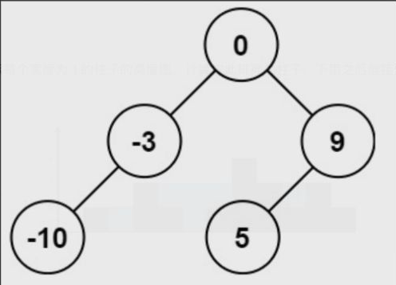 | 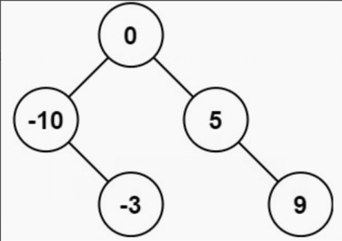 |

```text
SQL
输入：nums = [-10,-3,0,5,9]
输出：[0,-3,9,-10,null,5]
解释：[0,-10,5,null,-3,null,9] 也将被视为正确答案
```

```python
# 每次选中间的先构造
class TreeNode:
    def __init__(self, val=0, left=None, right=None):
        self.val = val
        self.left = left
        self.right = right

class Solution:
    def sortedArrayToBST(self, nums):
        if not nums:
            return None

        mid = len(nums) // 2
        root = TreeNode(nums[mid])
        root.left = self.sortedArrayToBST(nums[:mid])
        root.right = self.sortedArrayToBST(nums[mid+1:])

        return root

# 辅助函数：层次遍历输出二叉搜索树
def levelOrder(root):
    if not root:
        return []

    result = []
    queue = [root]

    while queue:
        current_level = []
        for _ in range(len(queue)):
            node = queue.pop(0)
            if node:
                current_level.append(node.val)
                queue.append(node.left)
                queue.append(node.right)
            else:
                current_level.append(None)

        result.append(current_level)

    # 清除由于完全二叉树的最后一些无效None
    while result[-1] == [None] * len(result[-1]):
        result.pop()

    return result

# 辅助函数：将层次遍历结果以紧凑形式打印
def pretty_print_level_order(level_order_result):
    output = []
    for level in level_order_result:
        output.extend(level)
    return output

# 测试代码
nums = [-10, -3, 0, 5, 9]
sol = Solution()
bst_root = sol.sortedArrayToBST(nums)

level_order_result = levelOrder(bst_root)
print("Level order traversal of the BST:", pretty_print_level_order(level_order_result))
```

###### [98. 验证二叉搜索树](https://leetcode.cn/problems/validate-binary-search-tree/)

给你一个二叉树的根节点root，判断其是否是一个有效的二叉搜索树。

**有效**二叉搜索树定义如下：

- •节点的左子树只包含**小于**当前节点的数。

- •节点的右子树只包含**大于**当前节点的数。

- •所有左子树和右子树自身必须也是二叉搜索树。

```python
# 中序遍历性质：遍历的顺序一定是从小到大
class TreeNode:
    def __init__(self, val=0, left=None, right=None):
        self.val = val
        self.left = left
        self.right = right

class Solution:
    def __init__(self):
        self.is_valid = True
        self.pre_val = float('-inf')  # 用负无穷大作为初始值

    def recursion(self, cur):
        if cur is None or not self.is_valid:
            return
        self.recursion(cur.left)
        if cur.val <= self.pre_val:
            self.is_valid = False
        self.pre_val = cur.val
        self.recursion(cur.right)

    def isValidBST(self, root):
        self.is_valid = True
        self.pre_val = float('-inf')
        self.recursion(root)
        return self.is_valid

# 辅助函数：构建二叉树
def build_tree(values):
    if not values:
        return None

    nodes = [None if val is None else TreeNode(val) for val in values]
    kids = nodes[::-1]
    root = kids.pop()

    for node in nodes:
        if node:
            if kids: node.left = kids.pop()
            if kids: node.right = kids.pop()

    return root

# 测试代码
values = [2, 1, 3]
tree_root = build_tree(values)

sol = Solution()
is_valid_bst = sol.isValidBST(tree_root)
print("Is the tree a valid BST?", is_valid_bst)
```

```python
# 普通递归
class TreeNode:
    def __init__(self, val=0, left=None, right=None):
        self.val = val
        self.left = left
        self.right = right

class Solution:
    def recursion(self, cur, lower, upper):
        if cur is None:
            return True
        if cur.val <= lower or cur.val >= upper:
            return False
        return self.recursion(cur.left, lower, cur.val) and self.recursion(cur.right, cur.val, upper)

    def isValidBST(self, root):
        return self.recursion(root, float('-inf'), float('inf'))

# 辅助函数：构建二叉树
def build_tree(values):
    if not values:
        return None

    nodes = [None if val is None else TreeNode(val) for val in values]
    kids = nodes[::-1]
    root = kids.pop()

    for node in nodes:
        if node:
            if kids: node.left = kids.pop()
            if kids: node.right = kids.pop()

    return root

# 测试代码
values = [2, 1, 3]
tree_root = build_tree(values)

sol = Solution()
is_valid_bst = sol.isValidBST(tree_root)
print("Is the tree a valid BST?", is_valid_bst)
```

###### [230. 二叉搜索树中第K小的元素](https://leetcode.cn/problems/kth-smallest-element-in-a-bst/)

给定一个二叉搜索树的根节点root，和一个整数k，请你设计一个算法查找其中第k个最小元素（从 1 开始计数）。

```python
# 中序遍历
class TreeNode:
    def __init__(self, val=0, left=None, right=None):
        self.val = val
        self.left = left
        self.right = right

class Solution:
    def __init__(self):
        self.res = -1
        self.cur_index = 0

    def traversal(self, cur, k):
        if cur is None or self.res != -1:
            return
        self.traversal(cur.left, k)
        self.cur_index += 1
        if self.cur_index == k:
            self.res = cur.val
            return
        self.traversal(cur.right, k)

    def kthSmallest(self, root, k):
        self.traversal(root, k)
        return self.res

# 辅助函数：构建二叉树
def build_tree(values):
    if not values:
        return None

    nodes = [None if val is None else TreeNode(val) for val in values]
    kids = nodes[::-1]
    root = kids.pop()

    for node in nodes:
        if node:
            if kids: node.left = kids.pop()
            if kids: node.right = kids.pop()

    return root

# 测试代码
values = [3, 1, 4, None, 2]
tree_root = build_tree(values)

sol = Solution()
k = 2
kth_smallest = sol.kthSmallest(tree_root, k)
print(f"The {k}th smallest element in the BST is:", kth_smallest)
```

###### [199. 二叉树的右视图](https://leetcode.cn/problems/binary-tree-right-side-view/)

给定一个二叉树的**根节点**root，想象自己站在它的右侧，按照从顶部到底部的顺序，返回从右侧所能看到的节点值。

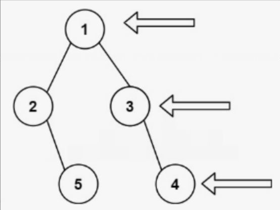

```text
Plain Text
输入: [1,2,3,null,5,null,4]
输出: [1,3,4]
```

```python
# 层序遍历，每次保存每层的back()
from collections import deque

class TreeNode:
    def __init__(self, val=0, left=None, right=None):
        self.val = val
        self.left = left
        self.right = right

class Solution:
    def rightSideView(self, root):
        if not root:
            return []

        res = []
        q = deque([root])

        while q:
            res.append(q[-1].val)  # 获取当前层最右边节点的值
            cur_size = len(q)

            for _ in range(cur_size):
                node = q.popleft()
                if node.left:
                    q.append(node.left)
                if node.right:
                    q.append(node.right)

        return res

# 辅助函数：构建二叉树
def build_tree(values):
    if not values:
        return None

    nodes = [None if val is None else TreeNode(val) for val in values]
    kids = nodes[::-1]
    root = kids.pop()

    for node in nodes:
        if node:
            if kids: node.left = kids.pop()
            if kids: node.right = kids.pop()

    return root

# 辅助函数：打印二叉树的右视图
def print_right_side_view(values):
    tree_root = build_tree(values)
    sol = Solution()
    right_side_view_result = sol.rightSideView(tree_root)
    print("Right side view of the tree:", right_side_view_result)

# 测试代码
values = [1, 2, 3, None, 5, None, 4]
print_right_side_view(values)
```

###### [114. 二叉树展开为链表](https://leetcode.cn/problems/flatten-binary-tree-to-linked-list/)

给你二叉树的根结点root，请你将它展开为一个单链表：

- •展开后的单链表应该同样使用TreeNode，其中right子指针指向链表中下一个结点，而左子指针始终为null。

- •展开后的单链表应该与二叉树[先序遍历](https://baike.baidu.com/item/%E5%85%88%E5%BA%8F%E9%81%8D%E5%8E%86/6442839?fr=aladdin)顺序相同。

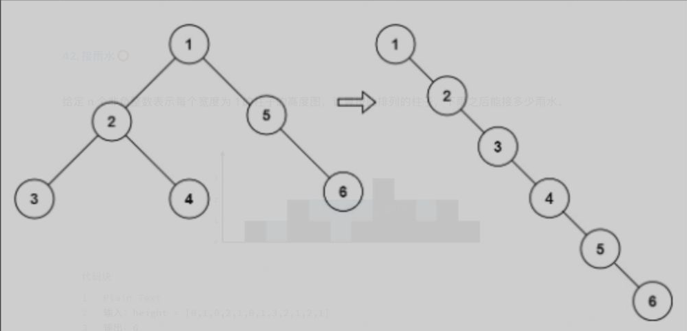

```sql
SQL
输入：root = [1,2,5,3,4,null,6]
输出：[1,null,2,null,3,null,4,null,5,null,6]
```

```python
# 常规做法，额外数组存储先序遍历节点，再连起来
class TreeNode:
    def __init__(self, val=0, left=None, right=None):
        self.val = val
        self.left = left
        self.right = right

class Solution:
    def flatten(self, root):
        record = []
        self.traversal(root, record)
        cur = TreeNode()
        for node in record:
            node.left = None
            cur.right = node
            cur = node

    def traversal(self, cur, record):
        if cur is None:
            return
        record.append(cur)
        self.traversal(cur.left, record)
        self.traversal(cur.right, record)

# 辅助函数：构建二叉树
def build_tree(values):
    if not values:
        return None

    nodes = [None if val is None else TreeNode(val) for val in values]
    kids = nodes[::-1]
    root = kids.pop()

    for node in nodes:
        if node:
            if kids:
                node.left = kids.pop()
            if kids:
                node.right = kids.pop()

    return root

# 辅助函数：打印链表形式的二叉树
def print_flatten_tree(root):
    result = []
    while root:
        result.append(root.val)
        root = root.right
    return result

# 测试代码
values = [1, 2, 5, 3, 4, None, 6]
tree_root = build_tree(values)

sol = Solution()
sol.flatten(tree_root)
flattened_tree = print_flatten_tree(tree_root)
print("Flattened tree:", flattened_tree)
```

###### [105. 从前序与中序遍历序列构造二叉树](https://leetcode.cn/problems/construct-binary-tree-from-preorder-and-inorder-traversal/)

给定两个整数数组preorder和inorder，其中preorder是二叉树的先序遍历，inorder是同一棵树的中序遍历，请构造二叉树并返回其根节点。

```python
# 递归
class TreeNode:
    def __init__(self, val=0, left=None, right=None):
        self.val = val
        self.left = left
        self.right = right

class Solution:
    def __init__(self):
        self.k = 0

    def buildTree(self, preorder, inorder):
        if not inorder:
            return None

        val = preorder[self.k]
        self.k += 1
        node = TreeNode(val)

        index = inorder.index(val)

        left_inorder = inorder[:index]
        right_inorder = inorder[index + 1:]

        node.left = self.buildTree(preorder, left_inorder)
        node.right = self.buildTree(preorder, right_inorder)

        return node

# 辅助函数：层次遍历输出二叉树
def level_order_traversal(root):
    if not root:
        return []

    result = []
    queue = [root]

    while queue:
        current_level = []
        next_queue = []

        for node in queue:
            if node:
                current_level.append(node.val)
                next_queue.append(node.left)
                next_queue.append(node.right)
            else:
                current_level.append(None)

        if any(current_level):
            result.extend(current_level)

        queue = next_queue

    return result

# 测试代码
preorder = [3, 9, 20, 15, 7]
inorder = [9, 3, 15, 20, 7]

sol = Solution()
tree_root = sol.buildTree(preorder, inorder)

# 打印构建的二叉树的层次遍历结果
level_order_result = level_order_traversal(tree_root)
print("Level order traversal of the tree:", level_order_result)
```

###### [437. 路径总和 III](https://leetcode.cn/problems/path-sum-iii/)

给定一个二叉树的根节点root，和一个整数targetSum，求该二叉树里节点值之和等于targetSum的**路径**的数目。

**路径**不需要从根节点开始，也不需要在叶子节点结束，但是路径方向必须是向下的（只能从父节点到子节点）。

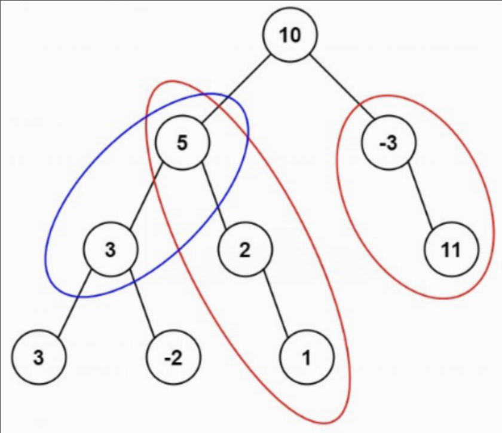

```text
Plain Text
输入：root = [10,5,-3,3,2,null,11,3,-2,null,1], targetSum = 8
输出：3
解释：和等于 8 的路径有 3 条，如图所示。
```

```python
# 前缀和，回溯，哈希
from collections import defaultdict

class TreeNode:
    def __init__(self, val=0, left=None, right=None):
        self.val = val
        self.left = left
        self.right = right

class Solution:
    def __init__(self):
        self.dict = defaultdict(int)  # 用于保存前缀和的字典
        self.target_sum = 0
        self.res = 0

    def traversal(self, cur, prefix):
        if cur is None:
            return
        prefix += cur.val
        if (prefix - self.target_sum) in self.dict:
            self.res += self.dict[prefix - self.target_sum]
        self.dict[prefix] += 1
        self.traversal(cur.left, prefix)
        self.traversal(cur.right, prefix)
        self.dict[prefix] -= 1

    def pathSum(self, root, targetSum):
        self.target_sum = targetSum
        self.res = 0
        self.dict[0] = 1
        self.traversal(root, 0)
        return self.res

# 辅助函数：构建二叉树
def build_tree(values):
    if not values:
        return None

    nodes = [None if val is None else TreeNode(val) for val in values]
    kids = nodes[::-1]
    root = kids.pop()

    for node in nodes:
        if node:
            if kids: node.left = kids.pop()
            if kids: node.right = kids.pop()

    return root

# 测试代码
values = [10,5,-3,3,2,None,11,3,-2,None,1]
tree_root = build_tree(values)
target_sum = 8

sol = Solution()
result = sol.pathSum(tree_root, target_sum)
print("Number of paths with the target sum:", result)
```

###### [236. 二叉树的最近公共祖先](https://leetcode.cn/problems/lowest-common-ancestor-of-a-binary-tree/)

给定一个二叉树, 找到该树中两个指定节点的最近公共祖先。

[百度百科](https://baike.baidu.com/item/%E6%9C%80%E8%BF%91%E5%85%AC%E5%85%B1%E7%A5%96%E5%85%88/8918834?fr=aladdin)中最近公共祖先的定义为：“对于有根树 T 的两个节点 p、q，最近公共祖先表示为一个节点 x，满足 x 是 p、q 的祖先且 x 的深度尽可能大（一个节点也可以是它自己的祖先）。”

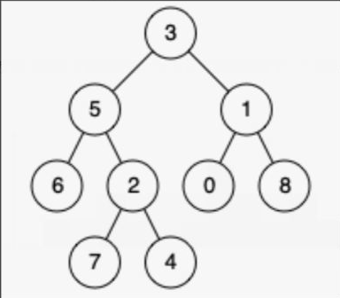

```text
Plain Text
示例 1：
输入：root = [3,5,1,6,2,0,8,null,null,7,4], p = 5, q = 1
输出：3
示例 2：
输入：root = [3,5,1,6,2,0,8,null,null,7,4], p = 5, q = 4
输出：5
```

```python
# 递归找p,q
class TreeNode:
    def __init__(self, val=0, left=None, right=None):
        self.val = val
        self.left = left
        self.right = right

class Solution:
    def lowestCommonAncestor(self, root, p, q):
        if root is None:
            return None
        # 如果找到p或q就返回，再深就没有
        if root == p or root == q:
            return root
        # 分别往左右子树找
        left = self.lowestCommonAncestor(root.left, p, q)
        right = self.lowestCommonAncestor(root.right, p, q)

        if left and right:
            return root
        if left:
            return left
        if right:
            return right
        return None

# 辅助函数：构建二叉树
def build_tree(values):
    if not values:
        return None

    nodes = [None if val is None else TreeNode(val) for val in values]
    kids = nodes[::-1]
    root = kids.pop()

    for node in nodes:
        if node:
            if kids: node.left = kids.pop()
            if kids: node.right = kids.pop()

    return root

# 测试代码
values = [3, 5, 1, 6, 2, 0, 8, None, None, 7, 4]
tree_root = build_tree(values)
p = tree_root.left  # 节点5
q = tree_root.left.right.right  # 节点4

sol = Solution()
lca = sol.lowestCommonAncestor(tree_root, p, q)
print("Lowest Common Ancestor:", lca.val if lca else None)
```

###### [124. 二叉树中的最大路径和](https://leetcode.cn/problems/binary-tree-maximum-path-sum/)**⭕**

二叉树中的**路径**被定义为一条节点序列，序列中每对相邻节点之间都存在一条边。同一个节点在一条路径序列中**至多出现一次**。该路径**至少包含一个**节点，且不一定经过根节点。

**路径和**是路径中各节点值的总和。

给你一个二叉树的根节点root，返回其**最大路径和**。

| | |
| --- | --- |
| 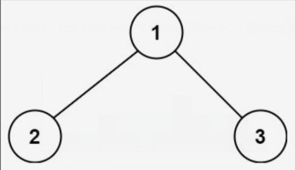 | 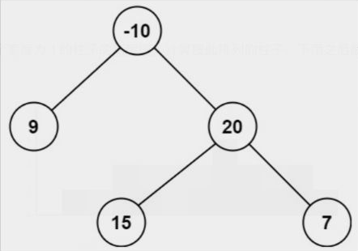 |

```text
Plain Text
示例 1：
输入：root = [1,2,3]
输出：6
解释：最优路径是 2 -> 1 -> 3 ，路径和为 2 + 1 + 3 = 6
示例 2：
输入：root = [-10,9,20,null,null,15,7]
输出：42
解释：最优路径是 15 -> 20 -> 7 ，路径和为 15 + 20 + 7 = 42
```

```python
# 递归，自底向上更新当前节点的“可用路径和”
# 和543很像
class TreeNode:
    def __init__(self, val=0, left=None, right=None):
        self.val = val
        self.left = left
        self.right = right

class Solution:
    def __init__(self):
        self.res = float('-inf')  # 使用负无穷大作为初始值

    def traversal(self, cur):
        if cur is None:
            return 0
        left = self.traversal(cur.left)
        right = self.traversal(cur.right)
        if left < 0 and right < 0:
            self.res = max(self.res, cur.val)
            return cur.val
        if left < 0:
            self.res = max(self.res, cur.val + right)
            return cur.val + right
        if right < 0:
            self.res = max(self.res, cur.val + left)
            return cur.val + left
        # if left >= 0 && right >= 0
        self.res = max(self.res, cur.val + left + right)
        # 注意这里只能选左右中较大的那个
        return cur.val + max(left, right)

    def maxPathSum(self, root):
        self.traversal(root)
        return self.res

# 辅助函数：构建二叉树
def build_tree(values):
    if not values:
        return None

    nodes = [None if val is None else TreeNode(val) for val in values]
    kids = nodes[::-1]
    root = kids.pop()

    for node in nodes:
        if node:
            if kids: node.left = kids.pop()
            if kids: node.right = kids.pop()

    return root

# 测试代码
values = [-10, 9, 20, None, None, 15, 7]
tree_root = build_tree(values)

sol = Solution()
max_path_sum = sol.maxPathSum(tree_root)
print("Maximum path sum of the tree:", max_path_sum)
```

## **图论**

###### [200. 岛屿数量](https://leetcode.cn/problems/number-of-islands/)

给你一个由'1'（陆地）和'0'（水）组成的的二维网格，请你计算网格中岛屿的数量。

岛屿总是被水包围，并且每座岛屿只能由水平方向和/或竖直方向上相邻的陆地连接形成。

此外，你可以假设该网格的四条边均被水包围。

```python
# 深度优先遍历
class Solution:
    def __init__(self):
        self.flag = 0

    def numIslands(self, grid):
        res = 0
        for row in range(len(grid)):
            for column in range(len(grid[0])):
                self.flag = 0
                self.dfs(grid, row, column)
                if self.flag > 0:
                    res += 1
        return res

    def dfs(self, grid, row, column):
        if not self.isValid(grid, row, column):
            return
        if grid[row][column] != '1':
            return
        grid[row][column] = '2'
        self.flag += 1
        self.dfs(grid, row - 1, column)
        self.dfs(grid, row + 1, column)
        self.dfs(grid, row, column - 1)
        self.dfs(grid, row, column + 1)

    def isValid(self, grid, row, column):
        return 0 <= row < len(grid) and 0 <= column < len(grid[0])

# 测试代码
grid = [
    ["1", "1", "1", "1", "0"],
    ["1", "1", "0", "1", "0"],
    ["1", "1", "0", "0", "0"],
    ["0", "0", "0", "0", "0"]
]

sol = Solution()
num_islands = sol.numIslands(grid)
print("Number of islands:", num_islands)
```

###### [695. 岛屿的最大面积](https://leetcode.cn/problems/max-area-of-island/)

给你一个大小为m x n的二进制矩阵grid。

**岛屿**是由一些相邻的1(代表土地) 构成的组合，这里的「相邻」要求两个1必须在**水平或者竖直的四个方向上**相邻。你可以假设grid的四个边缘都被0（代表水）包围着。

岛屿的面积是岛上值为1的单元格的数目。

计算并返回grid中最大的岛屿面积。如果没有岛屿，则返回面积为0。

```python
# 深度优先遍历
class Solution:
    def __init__(self):
        self.area = 0

    def maxAreaOfIsland(self, grid):
        res = 0
        for row in range(len(grid)):
            for column in range(len(grid[0])):
                self.area = 0  # 重置每次的新岛屿的面积
                self.dfs(grid, row, column)
                res = max(self.area, res)
        return res

    def dfs(self, grid, row, column):
        if not self.isValid(grid, row, column) or grid[row][column] != 1:
            return
        grid[row][column] = 2  # 标记已访问的格子
        self.area += 1
        self.dfs(grid, row - 1, column)
        self.dfs(grid, row + 1, column)
        self.dfs(grid, row, column - 1)
        self.dfs(grid, row, column + 1)

    def isValid(self, grid, row, column):
        return 0 <= row < len(grid) and 0 <= column < len(grid[0])

# 测试代码
grid = [
    [0,0,1,0,0,0,0,1,0,0,0,0,0],
    [0,0,0,0,0,0,0,1,1,1,0,0,0],
    [0,1,1,0,1,0,0,0,0,0,0,0,0],
    [0,1,0,0,1,1,0,0,1,0,1,0,0],
    [0,1,0,0,1,1,0,0,1,1,1,0,0],
    [0,0,0,0,0,0,0,0,0,0,1,0,0],
    [0,0,0,0,0,0,0,1,1,1,0,0,0],
    [0,0,0,0,0,0,0,1,1,0,0,0,0]
]

sol = Solution()
print("Maximum area of island:", sol.maxAreaOfIsland(grid))
```

###### [994. 腐烂的橘子](https://leetcode.cn/problems/rotting-oranges/)

在给定的m x n网格grid中，每个单元格可以有以下三个值之一：

- •值0代表空单元格；

- •值1代表新鲜橘子；

- •值2代表腐烂的橘子。

每分钟，腐烂的橘子**周围 4 个方向上相邻**的新鲜橘子都会腐烂。

返回直到单元格中没有新鲜橘子为止所必须经过的最小分钟数。如果不可能，返回-1。

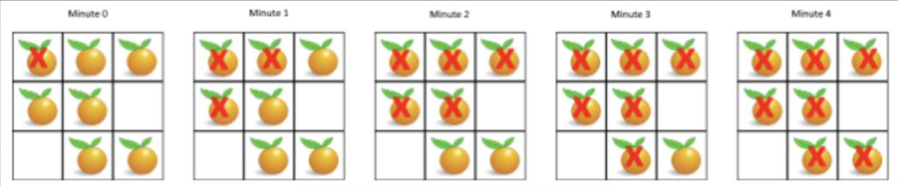

```text
Plain Text
示例 1：
输入：grid = [[2,1,1],[1,1,0],[0,1,1]]
输出：4
示例 2：
输入：grid = [[2,1,1],[0,1,1],[1,0,1]]
输出：-1
解释：左下角的橘子（第 2 行， 第 0 列）永远不会腐烂，因为腐烂只会发生在 4 个方向上。
示例 3：
输入：grid = [[0,2]]
输出：0
解释：因为 0 分钟时已经没有新鲜橘子了，所以答案就是 0 。
```

```python
# 广度优先遍历
from collections import deque

class Solution:
    def isValid(self, grid, row, column):
        if 0 <= row < len(grid) and 0 <= column < len(grid[0]) and grid[row][column] == 1:
            return True
        return False

    def orangesRotting(self, grid):
        res = 0
        cnt = 0
        time = [[0]*len(grid[0]) for _ in range(len(grid))]
        dir_x = [1, -1, 0, 0]
        dir_y = [0, 0, 1, -1]

        # 初始腐烂源加入队列
        sources = deque()
        for row in range(len(grid)):
            for column in range(len(grid[0])):
                if grid[row][column] == 2:
                    sources.append((row, column))
                if grid[row][column] != 0:
                    cnt += 1

        # 利用队列先进先出的性质，进行多源bfs，并更新time矩阵
        while sources:
            cnt -= 1
            cur = sources.popleft()
            for i in range(4):
                next_x = cur[0] + dir_x[i]
                next_y = cur[1] + dir_y[i]
                if self.isValid(grid, next_x, next_y):
                    grid[next_x][next_y] = 2
                    time[next_x][next_y] = time[cur[0]][cur[1]] + 1
                    res = max(time[next_x][next_y], res)
                    sources.append((next_x, next_y))

        if cnt > 0:
            return -1
        return res

# 测试代码
grid = [
    [2, 1, 1],
    [1, 1, 0],
    [0, 1, 1]
]

sol = Solution()
result = sol.orangesRotting(grid)
print("Minimum time to rot all oranges:", result)

# 辅助函数 isValid：
# 用于检查给定位置是否在网格范围内以及该位置是否为新鲜橙子（值为1）。
# 主函数 orangesRotting：
# 初始变量 res 用于存储所需的最少时间，cnt 用于记录非空单元格的总数。
# time 是一个与 grid 相同大小的矩阵，用于记录每个格子腐烂时刻。
# dir_x 和 dir_y 是方向向量，帮助找到上下左右四个方向的相邻格子。
# 使用双端队列 deque 来存储初始的腐烂源位置。
# 遍历每一个非空单元格，如果是腐烂橙子（值为2），将其加入队列，同时统计所有非空单元格的数量。
# 使用广度优先搜索来更新腐烂橙子的状态。如果一个新鲜橙子被腐烂橙子感染，那么将其状态变为腐烂，同时更新其腐烂时间并加入队列。
# 循环结束时如果 cnt 值不为0，则表示还有橙子未腐烂，此时返回-1。
# 返回结果 res，表示所有橙子完全腐烂所需的最短时间。

```

###### [207. 课程表](https://leetcode.cn/problems/course-schedule/)

你这个学期必须选修numCourses门课程，记为0到numCourses - 1。

在选修某些课程之前需要一些先修课程。 先修课程按数组prerequisites给出，其中prerequisites[i] = [ai, bi]，表示如果要学习课程ai则**必须**先学习课程bi。

- •例如，先修课程对[0, 1]表示：想要学习课程0，你需要先完成课程1。

请你判断是否可能完成所有课程的学习？如果可以，返回true；否则，返回false。

```text
SQL
示例 1：
输入：numCourses = 2, prerequisites = [[1,0]]
输出：true
解释：总共有 2 门课程。学习课程 1 之前，你需要完成课程 0 。这是可能的。
示例 2：
输入：numCourses = 2, prerequisites = [[1,0],[0,1]]
输出：false
解释：总共有 2 门课程。学习课程 1 之前，你需要先完成课程 0 ；并且学习课程 0 之前，你还应先完成课程 1 。这是不可能的。
```

```python
class Solution:
    def __init__(self):
        self.edges = []  # 邻接表
        self.visited = []
        self.res = True

    def dfs(self, cur):
        self.visited[cur] = 1  # 搜索中
        for pre in self.edges[cur]:
            if self.visited[pre] == 0:
                self.dfs(pre)
                if not self.res:
                    return
            elif self.visited[pre] == 1:
                self.res = False
                return
        self.visited[cur] = 2  # 搜索完成

    def canFinish(self, numCourses, prerequisites):
        self.edges = [[] for _ in range(numCourses)]
        self.visited = [0] * numCourses

        for elem in prerequisites:
            self.edges[elem[0]].append(elem[1])

        for i in range(numCourses):
            if self.visited[i] == 0:
                self.dfs(i)
                if not self.res:
                    break

        return self.res

# 测试代码
numCourses = 2
prerequisites = [[1, 0], [0, 1]]
sol = Solution()
print("Can finish all courses?", sol.canFinish(numCourses, prerequisites))

# Solution类的初始化：
# edges 表示邻接表，用于存储课程的先修关系。
# visited 用于记录每个节点的访问状态，0表示未访问，1表示正在访问，2表示访问完成。
# res 用于记录课程能否完成的结果，如果存在环则设置为 False。
# 深度优先搜索(dfs)：
# dfs(self, cur)：使用深度优先搜索来检测课程图中是否存在环。

# 如果 cur 节点被访问中，设置 visited[cur] 为1。
# 遍历 cur 节点的所有先修节点 pre。

# 如果 pre 节点未被访问，递归调用 dfs(pre)。
# 如果 pre 节点已经被访问中，说明存在环，设置 res 为 False 并返回。
# 如果 pre 节点访问已经完成，继续。
# 设置 visited[cur] 为2，表示这个节点处理完毕。
# 判断课程是否可完成：
# canFinish(self, numCourses, prerequisites)：

# 初始化邻接表 edges 和访问状态数组 visited。
# 遍历先修关系 prerequisites，填充邻接表 edges。
# 对每个课程进行深度优先搜索，如果存在环则返回 False。
# 返回 self.res 表示结果。
```

###### [208. 实现 Trie (前缀树)](https://leetcode.cn/problems/implement-trie-prefix-tree/)

[Trie](https://baike.baidu.com/item/%E5%AD%97%E5%85%B8%E6%A0%91/9825209?fr=aladdin)（发音类似 "try"）或者说**前缀树**是一种树形数据结构，用于高效地存储和检索字符串数据集中的键。这一数据结构有相当多的应用情景，例如自动补完和拼写检查。

请你实现 Trie 类：

- •Trie()初始化前缀树对象。

- •void insert(String word)向前缀树中插入字符串word。

- •boolean search(String word)如果字符串word在前缀树中，返回true（即，在检索之前已经插入）；否则，返回false。

- •boolean startsWith(String prefix)如果之前已经插入的字符串word的前缀之一为prefix，返回true；否则，返回false。

```java
Plain Text
示例：
输入
["Trie", "insert", "search", "search", "startsWith", "insert", "search"]
[[], ["apple"], ["apple"], ["app"], ["app"], ["app"], ["app"]]
输出
[null, null, true, false, true, null, true]
解释
Trie trie = new Trie();
trie.insert("apple");
trie.search("apple");   // 返回 True
trie.search("app");     // 返回 False
trie.startsWith("app"); // 返回 True
trie.insert("app");
trie.search("app");     // 返回 True
```

```python
class Trie:
    def __init__(self):
        self.children = [None] * 26
        self.isEnd = False

    def searchPrefix(self, prefix):
        node = self
        for ch in prefix:
            index = ord(ch) - ord('a')
            if node.children[index] is None:
                return None
            node = node.children[index]
        return node

    def insert(self, word):
        node = self
        for ch in word:
            index = ord(ch) - ord('a')
            if node.children[index] is None:
                node.children[index] = Trie()
            node = node.children[index]
        node.isEnd = True

    def search(self, word):
        node = self.searchPrefix(word)
        return node is not None and node.isEnd

    def startsWith(self, prefix):
        node = self.searchPrefix(prefix)
        return node is not None

# 测试代码
trie = Trie()
trie.insert("apple")
print(trie.search("apple"))  # 返回 True
print(trie.search("app"))    # 返回 False
print(trie.startsWith("app")) # 返回 True
trie.insert("app")
print(trie.search("app"))    # 返回 True

# 解释：
# __init__ 方法：
# 初始化字典树 Trie 对象，children 为长度为 26 的列表，用于存储 26 个小写字母的孩子节点，初始值为 None。
# isEnd 标记是否是一个单词的结束。
# searchPrefix 方法：
# 用于在 Trie 中搜索前缀。
# 如果途中未找到匹配的字符，则返回 None。
# 否则返回匹配前缀的最后一个节点。
# insert 方法：
# 将一个单词插入 Trie 中。
# 对于单词中的每一个字符，计算其索引值（从 'a' 减去 'a' 的 ASCII 值）。
# 如果当前节点的子节点不存在，则创建一个新节点。
# 循环完成后，将 isEnd 标记为 True，表示这个单词结束于此节点。
# search 方法：
# 搜索一个单词。
# 调用 searchPrefix 查找，且检查返回节点是否是一个单词的结尾。
# startsWith 方法：
# 确定 Trie 中是否存在某个前缀。
# 调用 searchPrefix 查找该前缀。
```

## **回溯法**

###### [46. 全排列](https://leetcode.cn/problems/permutations/)

给定一个不含重复数字的数组nums，返回其*所有可能的全排列*。你可以**按任意顺序**返回答案。

```text
Plain Text
输入：nums = [1,2,3]
输出：[[1,2,3],[1,3,2],[2,1,3],[2,3,1],[3,1,2],[3,2,1]]
```

```python
class Solution:
    def __init__(self):
        self.res = []

    def backtrack(self, cur, first, length):
        if first == length:
            self.res.append(cur[:])  # 使用切片来复制当前数组
            return
        for i in range(first, length):
            cur[first], cur[i] = cur[i], cur[first]  # 交换元素
            self.backtrack(cur, first + 1, length)
            cur[first], cur[i] = cur[i], cur[first]  # 恢复元素

    def permute(self, nums):
        self.res = []
        self.backtrack(nums, 0, len(nums))
        return self.res

# 测试代码
nums = [1, 2, 3]
sol = Solution()
permutations = sol.permute(nums)
print("All permutations of the list:", permutations)

# 解释：
# Solution类的初始化：
# 在 __init__ 方法中初始化 res 为空列表。这个列表将存储所有的排列结果。
# backtrack方法：
# backtrack(self, cur, first, length) 是用于递归地生成排列的方法。
# 如果 first 等于 length，说明当前排列已经完成，将其添加到结果列表 res 中，并返回。
# 否则，循环遍历从 first 到 length 范围内的元素，交换 cur[first] 和 cur[i] 的值，然后递归调用 backtrack 方法生成剩余部分的排列。最后，交换回原来的元素，确保回溯。
# permute方法：
# permute(self, nums) 是生成所有排列的主方法。它初始化 res 为空列表，然后调用 backtrack 方法开始递归生成排列，最后返回结果 res。
```

###### [78. 子集](https://leetcode.cn/problems/subsets/)

给你一个整数数组nums，数组中的元素**互不相同**。返回该数组所有可能的子集（幂集）。

解集**不能**包含重复的子集。你可以按**任意顺序**返回解集。

```text
Plain Text
输入：nums = [1,2,3]
输出：[[],[1],[2],[1,2],[3],[1,3],[2,3],[1,2,3]]
```

```python
class Solution:
    def __init__(self):
        self.res = []

    def backtrack(self, nums, cur, first, length):
        self.res.append(cur.copy())
        if first == length:
            return
        for i in range(first, length):
            cur.append(nums[i])
            self.backtrack(nums, cur, i + 1, length)
            cur.pop()

    def subsets(self, nums):
        self.res = []
        cur = []
        self.backtrack(nums, cur, 0, len(nums))
        return self.res

# 测试代码
sol = Solution()
nums = [1, 2, 3]
subsets_result = sol.subsets(nums)
print("Subsets of the array are:", subsets_result)
# 解释：
# Solution类的定义：
# __init__(self)：初始化 Solution 类，定义一个空列表 res 用来保存所有的子集。
# **backtrack(self, nums, cur, first, length)`：
# backtrack 方法递归地生成所有子集。
# 将当前的子集 cur 加入 res 中。
# 如果起始索引 first 等于数组长度 length，则返回。
# 从 first 开始遍历数组，将当前元素加入 cur 中，并递归调用 backtrack 方法继续生成子集。
# 递归调用返回后，移除最后一个元素，回溯到之前的状态。
# **subsets(self, nums)`：
# 调用 backtrack 方法生成所有子集。
# 返回 res，即所有生成的子集。
```

###### [17. 电话号码的字母组合](https://leetcode.cn/problems/letter-combinations-of-a-phone-number/)

给定一个仅包含数字2-9的字符串，返回所有它能表示的字母组合。答案可以按**任意顺序**返回。

给出数字到字母的映射如下（与电话按键相同）。注意 1 不对应任何字母。


```
Plain Text
输入：digits = "23"
输出：["ad","ae","af","bd","be","bf","cd","ce","cf"]
```

```python
class Solution:
    def __init__(self):
        self.nums = []
        self.ans = []
        self.cur = []

    def backtrack(self, first):
        if first == len(self.nums):
            s = ''.join(self.cur)
            self.ans.append(s)
            return
        for i in range(len(self.nums[first])):
            self.cur.append(self.nums[first][i])
            self.backtrack(first + 1)
            self.cur.pop()

    def letterCombinations(self, digits):
        if not digits:
            return self.ans
        self.setNums(digits)
        self.backtrack(0)
        return self.ans

    def setNums(self, digits):
        for ch in digits:
            if ch == '2':
                self.nums.append(['a', 'b', 'c'])
            elif ch == '3':
                self.nums.append(['d', 'e', 'f'])
            elif ch == '4':
                self.nums.append(['g', 'h', 'i'])
            elif ch == '5':
                self.nums.append(['j', 'k', 'l'])
            elif ch == '6':
                self.nums.append(['m', 'n', 'o'])
            elif ch == '7':
                self.nums.append(['p', 'q', 'r', 's'])
            elif ch == '8':
                self.nums.append(['t', 'u', 'v'])
            elif ch == '9':
                self.nums.append(['w', 'x', 'y', 'z'])

# 测试代码
sol = Solution()
digits = "23"
combinations = sol.letterCombinations(digits)
print("Letter combinations for digits", digits, "are:", combinations)

# 解释：
# 类初始化：
# 在 __init__ 方法中初始化 nums、ans 和 cur，分别用于存储数字对应的字符集、结果列表和当前组合。
# 递归回溯方法 (backtrack)：
# backtrack(self, first)：递归地生成组合。

# 如果 first 等于 nums 的长度，说明已经生成了一种完整的组合，将其加入 ans。
# 否则，对 nums[first] 的每个字符进行递归，继续生成下一个位置的字符。
# 在递归返回后，使用 pop 方法回溯到上一状态。
# 生成字母组合方法 (letterCombinations)：
# letterCombinations(self, digits)：调用 setNums 初始化 nums，然后调用 backtrack 生成组合。
# 初始化字符集方法 (setNums)：
# setNums(self, digits)：根据输入的数字字符串 digits，将对应的字符集加入 nums 列表。
```

###### [39. 组合总和](https://leetcode.cn/problems/combination-sum/)

给你一个**无重复元素**的整数数组candidates和一个目标整数target，找出candidates中可以使数字和为目标数target的 所有**不同组合**，并以列表形式返回。你可以按**任意顺序**返回这些组合。

candidates中的**同一个**数字可以**无限制重复被选取**。如果至少一个数字的被选数量不同，则两种组合是不同的。

对于给定的输入，保证和为target的不同组合数少于150个。

```text
Plain Text
输入：candidates = [2,3,6,7], target = 7
输出：[[2,2,3],[7]]
解释：
2 和 3 可以形成一组候选，2 + 2 + 3 = 7 。注意 2 可以使用多次。
7 也是一个候选， 7 = 7 。
仅有这两种组合。
```

```python
class Solution:
    def __init__(self):
        self.res = []
        self.vec = []

    def backtrack(self, candidates, target, first):
        if target < 0 or first >= len(candidates):  # 终止条件
            return
        if target == 0:
            self.res.append(list(self.vec))
            return
        for i in range(first + 1):  # 每个循环体为：能使用i的情况
            self.vec.append(candidates[i])
            self.backtrack(candidates, target - candidates[i], i)
            self.vec.pop()

    def combinationSum(self, candidates, target):
        candidates.sort()  # 减少回溯次数
        self.backtrack(candidates, target, len(candidates) - 1)
        return self.res

# 测试代码
candidates = [2, 3, 6, 7]
target = 7
sol = Solution()
result = sol.combinationSum(candidates, target)
print("Combination Sum:", result)
# 解释：
# 类的定义：
# Solution 类包含递归地生成所有满足条件的组合以及主函数 combinationSum。
# 初始化：
# __init__(self) 函数初始化 Solution 类的实例，设定初始结果列表 res 和临时组合列表 vec。
# 回溯函数：
# backtrack(self, candidates, target, first)：

# 递归地寻找所有满足条件的组合。
# 如果 target 小于 0 或者 first 大于等于 candidates 的长度，终止递归。
# 如果 target 等于 0，将当前组合 vec 加入到结果列表 res 中。
# 循环遍历候选数 candidates 中从0到first的所有元素：

# 将候选数加入当前组合 vec 中。
# 递归调用 backtrack 方法，更新目标值 target 和 first。
# 移除当前组合中的最后一个元素进行回溯。
# 主函数：
# combinationSum(self, candidates, target)：

# 对候选数 candidates 进行排序，以减少回溯次数。
# 初始化递归搜索，调用 backtrack 方法。
# 返回最终的结果列表 res。
```

###### [22. 括号生成](https://leetcode.cn/problems/generate-parentheses/)

数字n代表生成括号的对数，请你设计一个函数，用于能够生成所有可能的并且**有效的**括号组合。

```text
Plain Text
输入：n = 3
输出：["((()))","(()())","(())()","()(())","()()()"]
```

```python
class Solution:
    def __init__(self):
        self.res = []

    def backtrack(self, cur, left, right, n):
        if len(cur) == 2 * n:
            self.res.append(cur)
            return
        if left < n:
            self.backtrack(cur + '(', left + 1, right, n)
        if right < left:
            self.backtrack(cur + ')', left, right + 1, n)

    def generateParenthesis(self, n):
        self.res = []
        self.backtrack("", 0, 0, n)
        return self.res

# 测试代码
sol = Solution()
result = sol.generateParenthesis(3)
print("Generated Parentheses:", result)
# 解释：
# 类的定义：
# Solution 类包含用于生成括号组合的方法。
# Solution类的方法：
# __init__(self)：初始化 Solution 类，设定结果列表 res 为一个空列表。
# backtrack(self, cur, left, right, n)：

# 递归地构造所有可能的括号组合。
# 如果当前构造的字符串 cur 的长度等于 2 * n（表示已经构造了 n 对括号），将 cur 放入结果列表 res 中并返回。
# 如果还可以添加左括号（左括号数量 left 小于 n），添加左括号，并继续递归。
# 如果右括号数量小于左括号（表示可以合法地添加右括号），添加右括号，并继续递归。
# generateParenthesis(self, n)：

# 重新初始化结果列表 res 为一个空列表，以确保每次调用时都是干净的环境。
# 调用 backtrack 方法以 "" 作为初始字符串，起始左右括号数量为 0，构造所有可能的括号组合。
# 返回结果列表 res。
```

###### **:star:**[79. 单词搜索](https://leetcode.cn/problems/word-search/)

给定一个m x n二维字符网格board和一个字符串单词word。如果word存在于网格中，返回true；否则，返回false。

单词必须按照字母顺序，通过相邻的单元格内的字母构成，其中“相邻”单元格是那些水平相邻或垂直相邻的单元格。同一个单元格内的字母不允许被重复使用。

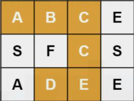

```
Plain Text
输入：board = [["A","B","C","E"],["S","F","C","S"],["A","D","E","E"]], word = "ABCCED"
输出：true
```

```python
from typing import List

class Solution:
    def __init__(self):
        self.res = False
        self.max_row = 0
        self.max_column = 0
        self.dir_x = [1, -1, 0, 0]
        self.dir_y = [0, 0, 1, -1]

    def backtrack(self, index, row, column, board, word):
        if self.res or index == len(word):
            self.res = True
            return
        if (row >= self.max_row or row < 0 or
            column >= self.max_column or column < 0 or
            board[row][column] != word[index]):
            return

        temp = board[row][column]
        board[row][column] = '\0'
        for i in range(4):
            self.backtrack(index + 1, row + self.dir_x[i], column + self.dir_y[i], board, word)
        board[row][column] = temp

    def exist(self, board: List[List[str]], word: str) -> bool:
        self.max_row = len(board)
        self.max_column = len(board[0])
        for row in range(self.max_row):
            for column in range(self.max_column):
                self.backtrack(0, row, column, board, word)
                if self.res:
                    return self.res
        return False

# 测试代码
board = [['A', 'B', 'C', 'E'],
         ['S', 'F', 'C', 'S'],
         ['A', 'D', 'E', 'E']]

word = "ABCCED"

sol = Solution()
result = sol.exist(board, word)
print("Does the word exist in the board?", result)

# 解释：
# 类初始化：
# __init__(self)：将C++构造函数内的变量初始化移动到Python的初始化方法中。初始化类的成员变量 res, max_row, max_column, dir_x 和 dir_y。
# 递归回溯方法：
# backtrack(self, index, row, column, board, word)：

# 检查是否已经找到结果或者是否达到了单词的结尾。
# 检查当前坐标是否越界或当前单元格的字符是否与当前单词字符匹配。
# 保存当前单元格的字符，并将其临时置为 '\0' 以标识已访问。
# 递归调用四个方向。
# 恢复单元格的字符。
```

###### [131. 分割回文串](https://leetcode.cn/problems/palindrome-partitioning/)

给你一个字符串s，请你将s分割成一些子串，使每个子串都是**回文串**。返回s所有可能的分割方案。

**回文串**是正着读和反着读都一样的字符串。

```text
Plain Text
输入：s = "aab"
输出：[["a","a","b"],["aa","b"]]
```

```python
# 纯回溯法
class Solution:
    def __init__(self):
        self.res = []

    def backtrack(self, start, cur, s):
        if start == len(s):
            self.res.append(list(cur))
            return
        for i in range(start, len(s)):
            str_sub = s[start:i+1]
            if self.isValid(str_sub):
                cur.append(str_sub)
                self.backtrack(i+1, cur, s)
                cur.pop()

    def isValid(self, s):
        left, right = 0, len(s) - 1
        while left <= right:
            if s[left] != s[right]:
                return False
            left += 1
            right -= 1
        return True

    def partition(self, s):
        cur = []
        self.backtrack(0, cur, s)
        return self.res

# 测试代码
sol = Solution()
result = sol.partition("aab")
print(result)  # 输出应为 [["a","a","b"],["aa","b"]]

# 解释：
# Solution类的定义：
# __init__(self)：初始化 Solution 类，设定初始结果列表 res 用于存储所有满足条件的分割方案。
# backtrack(self, start, cur, s)：
# 回溯方法，用于生成所有可能的回文分割。
# 如果 start 达到字符串 s 的末尾，说明当前分割方案 cur 是一个满足条件的结果，将其加入 res。
# 遍历从 start 到 s 末尾的每个位置 i，截取子串 s[start:i+1]。
# 如果子串是回文，则将其加入当前分割方案 cur，继续递归调用 backtrack 方法，而起始位置更新为 i+1。递归返回后，从当前分割方案 cur 中移除刚加入的子串。
# isValid(self, s)：
# 检查一个字符串 s 是否是回文字符串。
# 使用双指针方法，left 和 right，从两端向中间靠拢，逐个字符比较，若不同则返回 False，否则继续直到所有字符都被比较完毕，返回 True。
# partition(self, s)：
# 首先清空当前的结果列表 res。
# 调用 backtrack 方法从字符串 s 的起始位置开始生成所有可能的回文分割方案。
# 最终返回所有满足条件的分割方案。
```

```
// 加了动态规划的回溯法
class Solution {
public:
    vector<vector<string>> res;
    vector<vector<int>> dp;
    void backtrack(int start, vector<string> cur, string s) {
        if(start == s.size()) {
            res.push_back(cur);
            return;
        }

        for(int i = start; i < s.size(); i++) {
            string str = s.substr(start, i-start+1);
            if(dp[start][i]) {
                cur.push_back(str);
                backtrack(i+1, cur, s);
                cur.pop_back();
            }
        }
    }
    vector<vector<string>> partition(string s) {
        int n = s.size();
        dp.assign(n, vector<int>(n));
        for(int i = 0; i < n; i++) {
            dp[i][i] = 1;
        }
        for(int i = 0; i < n - 1; i++) {
            dp[i][i+1] = s.at(i) == s.at(i+1);
        }
        for(int i = n-3; i >= 0; i--) {
            for(int j = i+2; j < n; j++) {
                dp[i][j] = dp[i+1][j-1] && s.at(i) == s.at(j);
            }
        }
        vector<string> cur;
        backtrack(0, cur, s);
        return res;
    }
};
```

N皇后这种属于刁难人的题目，用AI更加合适

###### [51. N 皇后](https://leetcode.cn/problems/n-queens/)**⭕**

按照国际象棋的规则，皇后可以攻击与之处在同一行或同一列或同一斜线上的棋子。

**n 皇后问题**研究的是如何将n个皇后放置在n×n的棋盘上，并且使皇后彼此之间不能相互攻击。

给你一个整数n，返回所有不同的**n 皇后问题**的解决方案。

每一种解法包含一个不同的**n 皇后问题**的棋子放置方案，该方案中'Q'和'.'分别代表了皇后和空位。

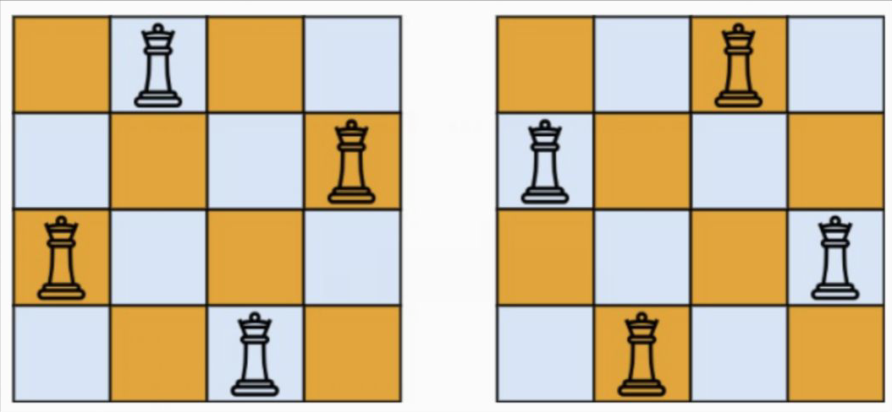

```
Plain Text
示例 1：
输入：n = 4
输出：[[".Q..","...Q","Q...","..Q."],["..Q.","Q...","...Q",".Q.."]]
解释：如上图所示，4 皇后问题存在两个不同的解法。
示例 2：
输入：n = 1
输出：[["Q"]]
```

```python
class Solution:
    def __init__(self):
        self.res = []

    def backtrack(self, cur, first, n):
        if first == n:
            self.res.append(["".join(row) for row in cur])
            return
        for i in range(n):
            if self.isValid(cur, first, i):
                cur[first][i] = 'Q'
                self.backtrack(cur, first + 1, n)
                cur[first][i] = '.'

    def isValid(self, cur, row, column):
        n = len(cur)
        # 检查上方
        for i in range(row):
            if cur[i][column] == 'Q':
                return False
        # 检查左上
        i, j = row, column
        while i >= 0 and j >= 0:
            if cur[i][j] == 'Q':
                return False
            i -= 1
            j -= 1
        # 检查右上
        i, j = row, column
        while i >= 0 and j < n:
            if cur[i][j] == 'Q':
                return False
            i -= 1
            j += 1
        return True

    def solveNQueens(self, n):
        cur = [["." for _ in range(n)] for _ in range(n)]
        self.backtrack(cur, 0, n)
        return self.res

# 测试代码
sol = Solution()
n = 4
solutions = sol.solveNQueens(n)
for solution in solutions:
    for row in solution:
        print(row)
    print()

# 解释：
# 类初始化：
# __init__(self)：初始化 Solution 类，设定初始结果列表 res。
# 回溯算法：
# backtrack(self, cur, first, n)：

# 递归地解决N皇后问题。
# 如果所有行都放置了皇后，将当前解加入结果列表。
# 否则，遍历当前行的每一列，尝试放置皇后并进行下一步回溯。
# 如果有效，继续递归放置下一行的皇后。
# 回溯后，移除当前行的皇后。
# 有效性检查：
# isValid(self, cur, row, column)：

# 检查在当前位置(row, column)放置皇后是否有效。
# 检查上方列是否已有皇后。
# 检查左上方斜线是否已有皇后。
# 检查右上方斜线是否已有皇后。
# 解决N皇后问题：
# solveNQueens(self, n)：

# 初始化当前棋盘 cur，每个位置为 "."。
# 调用 backtrack 方法从第0行开始进行回溯。
# 返回结果列表 res，每个解都表示为字符串的二维列表。
```

## **二分查找**

###### [35. 搜索插入位置](https://leetcode.cn/problems/search-insert-position/)**💚**

给定一个排序数组和一个目标值，在数组中找到目标值，并返回其索引。如果目标值不存在于数组中，返回它将会被按顺序插入的位置。

请必须使用时间复杂度为O(log n)的算法。

```python
class Solution:
    def searchInsert(self, nums, target):
        left = 0
        right = len(nums) - 1
        while left <= right:
            mid = (left + right) // 2
            if target == nums[mid]:
                return mid
            elif target > nums[mid]:
                left = mid + 1
            else:
                right = mid - 1
        return left

# 测试代码
nums = [1, 3, 5, 6]
target = 5
sol = Solution()
print(f"Insert position of {target} in {nums} is {sol.searchInsert(nums, target)}.")


# 解释：
# Solution类的方法：
# searchInsert(self, nums, target)：

# 初始化左右指针 left 为 0，right 为数组的最后一个索引。
# 使用二分查找算法在有序数组 nums 中搜索目标值 target。
# 循环直到 left 超过 right：

# 计算中间索引 mid。
# 如果 target 等于 nums[mid]，返回 mid。
# 如果 target 大于 nums[mid]，调整左指针 left 为 mid + 1。
# 如果 target 小于 nums[mid]，调整右指针 right 为 mid - 1。
# 如果没有找到精确匹配值，返回 left，表示应插入的位置。
```

###### [74. 搜索二维矩阵](https://leetcode.cn/problems/search-a-2d-matrix/)

给你一个满足下述两条属性的m x n整数矩阵：

- •每行中的整数从左到右按非严格递增顺序排列。

- •每行的第一个整数大于前一行的最后一个整数。

给你一个整数target，如果target在矩阵中，返回true；否则，返回false。

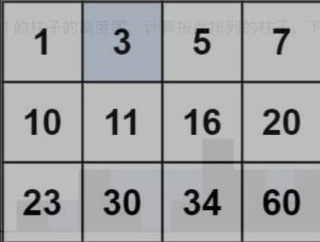

```text
Plain Text
输入：matrix = [[1,3,5,7],[10,11,16,20],[23,30,34,60]], target = 3
输出：true
```

```python
# 将二维数组视为一维数组，进行二分
class Solution:
    def searchMatrix(self, matrix, target):
        if not matrix or not matrix[0]:
            return False

        left = 0
        num = len(matrix[0])
        right = len(matrix) * num - 1

        while left <= right:
            mid = (left + right) // 2
            mid_value = matrix[mid // num][mid % num]

            if target == mid_value:
                return True
            elif target < mid_value:
                right = mid - 1
            else:
                left = mid + 1

        return False

# 测试代码
matrix = [
    [1, 3, 5, 7],
    [10, 11, 16, 20],
    [23, 30, 34, 60]
]
target = 3

sol = Solution()
result = sol.searchMatrix(matrix, target)
print("Is the target in the matrix?", result)

# 解释：
# 输入检查：
# 首先检查输入的矩阵是否为空或矩阵的第一行是否为空，如果是，直接返回 False。
# 初始化变量：
# left：二分查找的左边界，初始化为 0。
# num：矩阵每行的元素数量。
# right：二分查找的右边界，初始化为矩阵总元素数量减 1。
# 二分查找：
# 当 left 小于等于 right 时循环进行二分查找：
# mid：计算中间索引。
# mid_value：获取对应索引 mid 的矩阵元素值，计算方式为 matrix[mid // num][mid % num]。
# 如果目标值 target 等于 mid_value，则返回 True。
# 如果目标值 target 小于 mid_value，则调整右边界 right。
# 如果目标值 target 大于 mid_value，则调整左边界 left。
# 返回结果：
# 如果未找到目标值，返回 False。
```

```
// BST搜索，从右上角开始搜索
class Solution {
public:
    bool searchMatrix(vector<vector<int>>& matrix, int target) {
        int row = matrix.size(), col = matrix[0].size();
        // 右上角开始查找
        for(int i = 0, j = col-1; i < row && j >= 0;) {
            if(matrix[i][j] == target)
                return true;
            else if(matrix[i][j] > target)
                j--;
            else if(matrix[i][j] < target)
                i++;
        }
        return false;
    }
};
```

###### [34. 在排序数组中查找元素的第一个和最后一个位置](https://leetcode.cn/problems/find-first-and-last-position-of-element-in-sorted-array/)

给你一个按照非递减顺序排列的整数数组nums，和一个目标值target。请你找出给定目标值在数组中的开始位置和结束位置。

如果数组中不存在目标值target，返回[-1, -1]。

你必须设计并实现时间复杂度为O(log n)的算法解决此问题。

```text
输入：nums = [5,7,7,8,8,10], target = 8
输出：[3,4]
```

```python
# 两次二分查找
class Solution:
    def searchRange(self, nums, target):
        res = [-1, -1]
        left = 0
        right = len(nums) - 1

        # 找到第一个target的位置
        while left <= right:
            mid = (left + right) // 2
            if target == nums[mid]:
                res[0] = mid
                right = mid - 1  # 找到后继续向左找第一个target
            elif target < nums[mid]:
                right = mid - 1
            else:
                left = mid + 1

        left = 0
        right = len(nums) - 1

        # 找到最后一个target的位置
        while left <= right:
            mid = (left + right) // 2
            if target == nums[mid]:
                res[1] = mid
                left = mid + 1  # 找到后继续向右找最后一个target
            elif target < nums[mid]:
                right = mid - 1
            else:
                left = mid + 1

        return res

# 测试代码
sol = Solution()
nums = [5, 7, 7, 8, 8, 10]
target = 8
print("Search range for target {} in nums: {}".format(target, sol.searchRange(nums, target)))

# 解释：
# Solution类的方法：
# searchRange(self, nums, target) 方法用于查找目标数值在有序数组中的起始位置和结束位置。使用二分查找实现，首先找到起始位置，然后找到结束位置，并将它们分别存储在 res 列表中。
# 查找第一个 target 的位置：
# 使用二分查找法，查找目标值 target 的第一个出现位置。
# 如果 target 找到后，将 res[0] 设为当前中点 mid，然后继续向左搜索以找第一个出现位置。
# 查找最后一个 target 的位置：
# 再次使用二分查找法，查找目标值 target 的最后一个出现位置。
# 如果 target 找到后，将 res[1] 设为当前中点 mid，然后继续向右搜索以找最后一个出现位置。
```

```
// 一次二分查找后，向两边扩张，O(logn+m)，m为数组长度
// 最坏情况：所有数字均为target，要遍历整个数组
class Solution {
public:
    vector<int> searchRange(vector<int>& nums, int target) {
        int left = 0;
        int right = nums.size() - 1;
        int mid;
        bool exists = false;
        while(left <= right) {
            mid = (left + right) / 2;
            if (target == nums[mid]) {
                exists = true;
                break;
            }
            if (target < nums[mid]) {
                right = mid - 1;
            } else {
                left = mid + 1;
            }
        }
        if(!exists) return {-1, -1};
        vector<int> res = {mid, mid};
        while(res[1]+1 < nums.size()) {
            if(nums[res[1]+1] == target) res[1]++;
            else break;
        }
        while(res[0] > 0) {
            if(nums[res[0]-1] == target) res[0]--;
            else break;
        }
        return res;
    }
};
```

###### [33. 搜索旋转排序数组](https://leetcode.cn/problems/search-in-rotated-sorted-array/)

整数数组nums按升序排列，数组中的值**互不相同**。

在传递给函数之前，nums在预先未知的某个下标k（0

给你**旋转后**的数组nums和一个整数target，如果nums中存在这个目标值target，则返回它的下标，否则返回-1。

你必须设计一个时间复杂度为O(log n)的算法解决此问题。

```text
Plain Text
输入：nums = [4,5,6,7,0,1,2], target = 0
输出：4
```

```python
class Solution:
    def search(self, nums, target):
        if len(nums) == 1:
            if target == nums[0]:
                return 0
            else:
                return -1

        left, right = 0, len(nums) - 1
        while left <= right:
            mid = (left + right) // 2
            if nums[mid] == target:
                return mid

            # 左侧部分有序
            if nums[left] <= nums[mid]:
                # target在左侧有序区间内
                if nums[left] <= target < nums[mid]:
                    right = mid - 1
                else:
                    left = mid + 1
            # 右侧部分有序
            else:
                # target在右侧有序区间内
                if nums[mid] < target <= nums[right]:
                    left = mid + 1
                else:
                    right = mid - 1

        return -1

# 测试代码
sol = Solution()
nums = [4, 5, 6, 7, 0, 1, 2]
target = 0
index = sol.search(nums, target)
print(f"Index of target {target} is: {index}")

target = 3
index = sol.search(nums, target)
print(f"Index of target {target} is: {index}")

# 解释：
# Solution类的方法：
# search(self, nums, target)：

# 处理特殊情况，如果数组 nums 只有一个元素。
# 初始化指针 left 和 right 分别指向数组 nums 的左右两端。
# 使用二分查找算法，在 nums 中寻找 target：

# 计算中间指针 mid。
# 如果中间元素 nums[mid] 等于 target，返回 mid。
# 哪一侧是有序的：

# 若左侧部分有序（nums[left] <= nums[mid]），判断 target 是否在左侧区间中（nums[left] <= target < nums[mid]），调整 left 和 right。
# 若右侧部分有序，判断 target 是否在右侧区间中（nums[mid] < target <= nums[right]），调整 left 和 right。
# 如果循环结束仍未找到 target，返回 -1。
```

###### [153. 寻找旋转排序数组中的最小值](https://leetcode.cn/problems/find-minimum-in-rotated-sorted-array/)

已知一个长度为n的数组，预先按照升序排列，经由1到n次**旋转**后，得到输入数组。例如，原数组nums = [0,1,2,4,5,6,7]在变化后可能得到：

- •若旋转4次，则可以得到[4,5,6,7,0,1,2]

- •若旋转7次，则可以得到[0,1,2,4,5,6,7]

注意，数组[a[0], a[1], a[2], ..., a[n-1]]**旋转一次**的结果为数组[a[n-1], a[0], a[1], a[2], ..., a[n-2]]。

给你一个元素值**互不相同**的数组nums，它原来是一个升序排列的数组，并按上述情形进行了多次旋转。请你找出并返回数组中的**最小元素**。

你必须设计一个时间复杂度为O(log n)的算法解决此问题。

```text
Plain Text
输入：nums = [3,4,5,1,2]
输出：1
解释：原数组为 [1,2,3,4,5] ，旋转 3 次得到输入数组。
```

```python
class Solution:
    def findMin(self, nums):
        left = 0
        right = len(nums) - 1
        while left <= right:
            mid = (left + right) // 2
            if nums[left] <= nums[mid]:
                # 左侧有序
                if nums[mid] <= nums[right]:
                    # 整个数组有序
                    return nums[left]
                else:
                    # 左有序右无序
                    left = mid + 1
            else:
                # 左侧无序
                if nums[mid] <= nums[right]:
                    # 左无序右有序
                    right = mid
                else:
                    # 理论上不会出现这个else块，因为正常情况下
                    # 左右两侧必有一侧为有序
                    pass
        return -1

# 测试代码
sol = Solution()
nums = [4, 5, 6, 7, 1, 2, 3]
minimum = sol.findMin(nums)
print("The minimum value in the rotated sorted array is:", minimum)

# 解释：
# 初始化指针：
# left 和 right 分别初始化为数组的左端和右端。
# 循环进行二分搜索：
# 计算当前中间位置的索引 mid。
# 判断左半部分是否有序：if nums[left] <= nums[mid]。

# 如果左半部分有序，再进一步判断整个数组是否有序：if nums[mid] <= nums[right]。

# 如果是，则返回左端的值，nums[left]。
# 否则，说明右半部分存在无序部分，所以将 left 更新为 mid + 1。
# 如果左半部分无序，则进一步判断右半部分是否有序：if nums[mid] <= nums[right]。

# 如果是，将 right 更新为 mid，因为最小值在左侧部分。
# 根据题意，不会进入到else块，因为存在旋转的情况下，左右两部分总有一部分是有序的。
# 返回结果：
# 如果在循环中找到了最小值，则返回最小值。
# 否则返回 -1（实际上不会达到这里，因为按照题意我们总能在循环里找到最小值）。
```

###### [4. 寻找两个正序数组的中位数](https://leetcode.cn/problems/median-of-two-sorted-arrays/)**⭕**

给定两个大小分别为m和n的正序（从小到大）数组nums1和nums2。请你找出并返回这两个正序数组的**中位数**。

算法的时间复杂度应该为O(log (m+n))。

```text
Plain Text
示例 1：
输入：nums1 = [1,3], nums2 = [2]
输出：2.00000
解释：合并数组 = [1,2,3] ，中位数 2
示例 2：
输入：nums1 = [1,2], nums2 = [3,4]
输出：2.50000
解释：合并数组 = [1,2,3,4] ，中位数 (2 + 3) / 2 = 2.5
```

```python
# 归并为新的有序数组，O(m+n)
class Solution:
    def findMedianSortedArrays(self, nums1, nums2):
        l_nums1 = len(nums1)
        l_nums2 = len(nums2)
        nums = [0] * (l_nums1 + l_nums2)
        i = j = index = 0

        # 合并两个有序数组
        while i < len(nums1) and j < len(nums2):
            if nums1[i] <= nums2[j]:
                nums[index] = nums1[i]
                i += 1
            else:
                nums[index] = nums2[j]
                j += 1
            index += 1

        # 处理剩余元素
        while i < len(nums1):
            nums[index] = nums1[i]
            i += 1
            index += 1

        while j < len(nums2):
            nums[index] = nums2[j]
            j += 1
            index += 1

        # 计算中位数
        if (l_nums1 + l_nums2) % 2 == 0:
            mid1 = (l_nums1 + l_nums2) // 2 - 1
            mid2 = (l_nums1 + l_nums2) // 2
            return (nums[mid1] + nums[mid2]) / 2.0
        else:
            mid = (l_nums1 + l_nums2) // 2
            return nums[mid]

# 测试代码
sol = Solution()
nums1 = [1, 3]
nums2 = [2]
print("Median of the sorted arrays is:", sol.findMedianSortedArrays(nums1, nums2))

nums1 = [1, 2]
nums2 = [3, 4]
print("Median of the sorted arrays is:", sol.findMedianSortedArrays(nums1, nums2))

# 解释：
# findMedianSortedArrays方法：
# 计算 nums1 和 nums2 的长度 l_nums1 和 l_nums2。
# 初始化一个长度为 l_nums1 + l_nums2 的新数组 nums，该数组将用于存储合并后的有序数组。
# 初始化指针 i, j, 和 index，分别用于遍历 nums1，nums2，和 nums。
# 合并两个有序数组：
# 使用 while 循环合并两个有序数组 nums1 和 nums2。
# 循环比较 nums1[i] 和 nums2[j] 的大小，将较小的元素放入 nums 中，并适当地增加相应的指针。
# 处理剩余元素：
# 如果 nums1 或 nums2 中有剩余元素，将其放入 nums 中。
# 计算中位数：
# 如果合并后的数组长度为偶数，中间两个数的平均值即为中位数。
# 如果合并后的数组长度为奇数，中间的数即为中位数。
```

## **栈**

###### [20. 有效的括号](https://leetcode.cn/problems/valid-parentheses/)**💚**

给定一个只包括'('，')'，'{'，'}'，'['，']'的字符串s，判断字符串是否有效。

有效字符串需满足：

1. 1.左括号必须用相同类型的右括号闭合。

1. 2.左括号必须以正确的顺序闭合。

1. 3.每个右括号都有一个对应的相同类型的左括号。

```python
class Solution:
    def isValid(self, s: str) -> bool:
        if len(s) == 0:
            return True

        stack = []
        for ch in s:
            if ch in "([{":
                stack.append(ch)
            elif stack:
                if ch == ')' and stack[-1] != '(':
                    return False
                if ch == ']' and stack[-1] != '[':
                    return False
                if ch == '}' and stack[-1] != '{':
                    return False
                stack.pop()
            else:
                return False # ch为右括号，但栈中没有任何左括号

        return not stack

# 测试代码
sol = Solution()
test_cases = ["()", "()[]{}", "(]", "([)]", "{[]}", ""]
results = [sol.isValid(tc) for tc in test_cases]
print("Results:", results)

# 解释：
# 方法定义：
# isValid(self, s: str) -> bool：方法名isValid，用来检查括号字符串是否有效。输入参数 s 是一个字符串，返回值是一个布尔值表示字符串是否有效。
# 代码逻辑：
# 如果字符串长度为0，返回 True。
# 初始化一个空列表 stack，用于模拟栈操作。
# 遍历字符串 s 中的每个字符：
# 如果字符是左括号 (、[、{ 之一，则将其压入栈中。
# 如果字符是右括号 )、]、} 之一，并且栈不为空，检查栈顶字符是否与当前右括号匹配：
# 如果不匹配，返回 False。
# 如果匹配，弹出栈顶字符。
# 如果字符是右括号，但栈为空，返回 False，表示右括号没有匹配的左括号。
# 最后，检查栈是否为空。如果栈为空，返回 True，否则返回 False。
```

###### [155. 最小栈](https://leetcode.cn/problems/min-stack/)

设计一个支持push，pop，top操作，并能在常数时间内检索到最小元素的栈。

实现MinStack类:

- •MinStack()初始化堆栈对象。

- •void push(int val)将元素val推入堆栈。

- •void pop()删除堆栈顶部的元素。

- •int top()获取堆栈顶部的元素。

- •int getMin()获取堆栈中的最小元素。

```python
# 额外空间，辅助栈
class MinStack:

    def __init__(self):
        self.x_stk = []
        self.min_stk = [float('inf')]  # 使用float('inf')表示正无穷大

    def push(self, val):
        self.x_stk.append(val)
        self.min_stk.append(min(val, self.min_stk[-1]))

    def pop(self):
        self.x_stk.pop()
        self.min_stk.pop()

    def top(self):
        return self.x_stk[-1]

    def getMin(self):
        return self.min_stk[-1]

# 测试代码
min_stack = MinStack()
min_stack.push(-2)
min_stack.push(0)
min_stack.push(-3)
print("Minimum value: ", min_stack.getMin())  # 输出 -3
min_stack.pop()
print("Top value: ", min_stack.top())  # 输出 0
print("Minimum value: ", min_stack.getMin())  # 输出 -2

# 解释：
# 初始化：
# __init__(self)：在Python中使用 __init__ 方法来初始化对象。
# 使用两个列表 x_stk 和 min_stk 来分别存储实际值和最小值。
# min_stk 初始化为包含一个正无穷大 float('inf')。
# push 方法：
# push(self, val)：将值 val 压入 x_stk，同时将当前值与 min_stk 栈顶的最小值比较后，将较小的值压入 min_stk。
# pop 方法：
# pop(self)：从 x_stk 和 min_stk 中弹出栈顶元素。
# top 方法：
# top(self)：返回 x_stk 栈顶的值，即 x_stk 列表的最后一个元素。
# getMin 方法：
# getMin(self)：返回 min_stk 栈顶的值，即 min_stk 列表的最后一个元素。
```

```
// 原地，栈存放插值，注意需要long类型
class MinStack {
private:
    stack<long> stk;
    long min_value = -1;
public:
    MinStack() {
        ;
    }

    void push(int val) {
        if(stk.size() == 0) {
            stk.push(0);
            min_value = val;
        } else {
            long diff = val - min_value;
            stk.push(diff);
            min_value = diff > 0 ? min_value : val;
        }
    }

    void pop() {
        long diff = stk.top();
        stk.pop();
        if(diff < 0) {
            min_value -= diff;
        }
    }

    int top() {
        long diff = stk.top();
        if(diff > 0) {
            return min_value + diff;
        } else {
            return min_value;
        }
    }

    int getMin() {
        return min_value;
    }
};
```

###### [394. 字符串解码](https://leetcode.cn/problems/decode-string/)

给定一个经过编码的字符串，返回它解码后的字符串。

编码规则为:k[encoded_string]，表示其中方括号内部的encoded_string正好重复k次。注意k保证为正整数。

你可以认为输入字符串总是有效的；输入字符串中没有额外的空格，且输入的方括号总是符合格式要求的。

此外，你可以认为原始数据不包含数字，所有的数字只表示重复的次数k，例如不会出现像3a或2[4]的输入。

```text
Plain Text
输入：s = "3[a]2[bc]"
输出："aaabcbc"
```

```python
class Solution:
    def __init__(self):
        self.ptr = 0

    def get_digits(self, s):
        ret = ""
        while self.ptr < len(s) and s[self.ptr].isdigit():
            ret += s[self.ptr]
            self.ptr += 1
        return ret

    def get_string(self, sub):
        return "".join(sub)

    def decode_string(self, s):
        stk = []
        self.ptr = 0
        while self.ptr < len(s):
            ch = s[self.ptr]
            if ch.isdigit():
                stk.append(self.get_digits(s))
            elif ch.isalpha() or ch == '[':
                stk.append(ch)
                self.ptr += 1
            else:
                sub = []
                while stk and stk[-1] != "[":
                    sub.append(stk.pop())
                stk.pop()  # '['出栈
                sub.reverse()
                cnt = int(stk.pop())  # 数字出栈
                str_sub = self.get_string(sub)
                repeated_str = str_sub * cnt
                stk.append(repeated_str)
                self.ptr += 1

        return self.get_string(stk)

# 测试代码
sol = Solution()
encoded_string = "3[a]2[bc]"
decoded_string = sol.decode_string(encoded_string)
print("Decoded string:", decoded_string)  # 输出 "aaabcbc"

# 解释：
# Solution类的方法：

# __init__(self)：初始化 Solution 类。设定 ptr 为 0，表示当前字符指针的位置。
# get_digits(self, s)：

# 从字符串 s 中获取连续的数字字符，并返回组成的字符串。
# ret 存储数字字符的结果。
# while 循环判断当前指针位置 ptr 指向的字符是否是数字字符，如果是，就将该字符添加到 ret 中并移动指针。
# get_string(self, sub)：

# 将列表 sub 中的所有字符串拼接成一个字符串返回。
# decode_string(self, s)：

# 主函数，用于解码字符串 s。
# 使用 stk 作为堆栈。
# 遍历字符串 s，根据不同的字符类型进行处理：

# 如果字符是数字，调用 get_digits 获取完整的数字字符串，并压入堆栈。
# 如果字符是字母或 [, 直接将其压入堆栈。
# 如果字符是 ]，则进行解码：

# 弹出堆栈中的元素，直到 [ 为止，将这些元素加入 sub 列表中。
# 弹出 [ 并反转 sub 列表的顺序。
# 弹出堆栈中的数字字符串并转换为整数 cnt。
# 将 sub 列表中的字符串拼接，形成重复字符串。
# 将重复后的字符串压入堆栈。
# 最终返回堆栈中的字符串拼接结果。
```

###### [739. 每日温度](https://leetcode.cn/problems/daily-temperatures/)

给定一个整数数组temperatures，表示每天的温度，返回一个数组answer，其中answer[i]是指对于第i天，下一个更高温度出现在几天后。如果气温在这之后都不会升高，请在该位置用0来代替。

```text
Plain Text
输入: temperatures = [73,74,75,71,69,72,76,73]
输出: [1,1,4,2,1,1,0,0]
```

```python
# 单调栈
class Solution:
    def dailyTemperatures(self, temperatures):
        stack = []  # 存储索引
        ans = [0] * len(temperatures)
        for i in range(len(temperatures)):
            while stack and temperatures[i] > temperatures[stack[-1]]:
                idx = stack.pop()
                ans[idx] = i - idx
            stack.append(i)
        return ans

# 测试代码
temperatures = [73, 74, 75, 71, 69, 72, 76, 73]
sol = Solution()
print("Daily Temperatures:", sol.dailyTemperatures(temperatures))

# 解释：
# 类和方法定义：
# Solution 类包含一个方法 dailyTemperatures。
# dailyTemperatures 方法接收一个温度列表 temperatures 并返回一个列表表示每一天需要等待多少天才能看到更高的温度。
# 栈的使用：
# stack 用于存储当前未处理的温度的索引。
# ans 用于存储结果列表，初始化为全0，长度与 temperatures 相同。
# 循环遍历温度列表：
# 遍历温度列表中的每一个温度。
# 当栈不为空且当前温度大于栈顶索引对应的温度时，弹出栈顶索引。
# 计算当前索引与栈顶弹出索引的差并存储在 ans 列表中。
# 继续保存当前索引：
# 当前索引保存在栈中，以便后续更高温度比较时使用。
```

[84. 柱状图中最大的矩形](https://leetcode.cn/problems/largest-rectangle-in-histogram/)**⭕**

给定*n*个非负整数，用来表示柱状图中各个柱子的高度。每个柱子彼此相邻，且宽度为 1 。

求在该柱状图中，能够勾勒出来的矩形的最大面积。

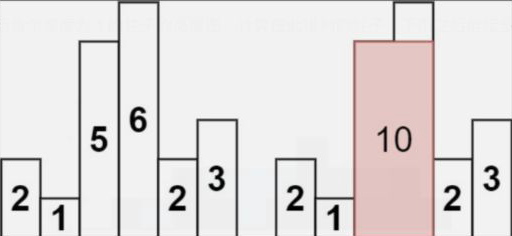

```text
Plain Text
输入：heights = [2,1,5,6,2,3]
输出：10
解释：最大的矩形为图中红色区域，面积为 10
```

```python
# **单调栈**
# 遍历每个高度，以当前高度为基准，寻找最大的宽度
# 组成最大的矩形面积: 要找左边第一个小于当前高度的下标left，再找右边第一个小于当前高度的下标right，那宽度就是这两个下标之间的距离了
# 但是要排除这两个下标 所以是right-left-1
class Solution:
    def largestRectangleArea(self, heights):
        res = 0
        n = len(heights)
        stack = []  # 存储index

        for i in range(n):
            # 循环将左边所有高于heights[i]的弹出
            # heights[i]作为右矮边截断矩形
            # 维护单调（递增）栈
            while stack and heights[i] < heights[stack[-1]]:
                y = heights[stack.pop()]
                if stack:
                    # 左边有更矮的，截断
                    x = i - stack[-1] - 1
                else:
                    # 左边没有更矮的，从开头到i都能使用
                    x = i
                res = max(res, x * y)

            stack.append(i)

        # 最后处理: 右边没有更矮的，即到最右边都可以使用
        while stack:
            y = heights[stack.pop()]
            if stack:
                # 左边有更矮的，截断
                x = n - stack[-1] - 1
            else:
                # 左边没有更矮的（即是数组中最小的）
                x = n
            res = max(res, x * y)

        return res

# 测试代码
sol = Solution()
heights = [2, 1, 5, 6, 2, 3]
print("Largest Rectangle Area:", sol.largestRectangleArea(heights))

# 解释：
# 方法定义：
# largestRectangleArea(self, heights)：计算给定的柱状图中的最大矩形面积。
# 初始化变量：
# res 用于存储最大矩形面积。
# n 是数组 heights 的长度。
# stack 是一个用来存储索引的栈。
# 遍历每个柱子的高度：
# 如果当前高度小于栈顶索引的高度，则弹出栈顶索引，并计算以弹出索引的高度为高度的矩形面积。
# 继续弹出栈顶索引直到栈为空或当前高度大于等于栈顶索引的高度。
# 将当前索引压入栈中。
# 最后处理栈中剩余的索引：
# 弹出栈顶索引，并计算以弹出索引的高度为高度的矩形面积。
# 继续弹出栈顶索引直到栈为空。
```

```
// 优化的单调栈
class Solution {
public:
    int largestRectangleArea(vector<int>& heights) {
        int res = 0;
        stack<int> stk;

        // 哨兵：头尾插入0
        heights.insert(heights.begin(), 0);
        heights.push_back(0);

        for (int i = 0; i < heights.size(); i++) {
            while (stk.size() && heights[i] < heights[stk.top()]) {
                int y = heights[stk.top()];
                stk.pop();
                int x;
                if (stk.size()) {
                    x = i - stk.top() - 1;
                } else {
                    x = i;
                }
                res = max(res, x * y);
            }
            stk.push(i);
        }
        return res;
    }
};
```

## **堆**

###### [215. 数组中的第K个最大元素](https://leetcode.cn/problems/kth-largest-element-in-an-array/)

给定整数数组nums和整数k，请返回数组中第k个最大的元素。

请注意，你需要找的是数组排序后的第k个最大的元素，而不是第k个不同的元素。

你必须设计并实现时间复杂度为O(n)的算法解决此问题。

```python
# stl，优先队列，小顶堆
import heapq

class Solution:
    def findKthLargest(self, nums, k):
        min_heap = []
        for num in nums:
            if len(min_heap) < k:
                heapq.heappush(min_heap, num)
            elif num > min_heap[0]:
                heapq.heappop(min_heap)
                heapq.heappush(min_heap, num)
        return min_heap[0]

# 测试代码
sol = Solution()
nums = [3, 2, 1, 5, 6, 4]
k = 2
result = sol.findKthLargest(nums, k)
print("The {}th largest element is: {}".format(k, result))

# 解释：
# Python的优先队列实现：
# Python使用 heapq 模块来实现优先队列（最小堆）。
# heapq.heappush(heap, item)：将元素加入堆中。
# heapq.heappop(heap)：从堆中弹出并返回最小的元素。
# Solution类的方法：
# findKthLargest(self, nums, k)：

# 创建一个空的最小堆 min_heap。
# 遍历输入数组 nums 的所有元素：

# 如果 min_heap 中的元素数量小于 k，则将当前元素加入堆中。
# 否则，如果当前元素 num 大于堆顶元素（最小元素），弹出堆顶元素并将当前元素加入堆中。
# 最后返回 min_heap 的堆顶元素，即第 k 个最大的元素。
```

```python
# 实现堆排序（大顶堆）
class Solution:
    def maxHeapify(self, A, i, heapSize):
        l = 2 * i + 1
        r = 2 * i + 2
        largest = i
        if l < heapSize and A[l] > A[i]:
            largest = l
        if r < heapSize and A[r] > A[largest]:
            largest = r
        if largest != i:
            A[i], A[largest] = A[largest], A[i]
            self.maxHeapify(A, largest, heapSize)

    def buildMaxHeap(self, A, heapSize):
        for i in range(heapSize // 2, -1, -1):
            self.maxHeapify(A, i, heapSize)

    def findKthLargest(self, nums, k):
        heapSize = len(nums)
        self.buildMaxHeap(nums, heapSize)
        for i in range(len(nums) - 1, len(nums) - k, -1):
            nums[0], nums[i] = nums[i], nums[0]
            heapSize -= 1
            self.maxHeapify(nums, 0, heapSize)
        return nums[0]

# 测试代码
nums = [3, 2, 1, 5, 6, 4]
k = 2
sol = Solution()
result = sol.findKthLargest(nums, k)
print("The {}th largest element is: {}".format(k, result))

# 解释：
# 方法定义：
# maxHeapify(self, A, i, heapSize)：维持最大堆特性。
# buildMaxHeap(self, A, heapSize)：构建最大堆。
# findKthLargest(self, nums, k)：找到第 k 大的元素。
```

###### [347. 前 K 个高频元素](https://leetcode.cn/problems/top-k-frequent-elements/)

给你一个整数数组nums和一个整数k，请你返回其中出现频率前k高的元素。你可以按**任意顺序**返回答案。

```text
Plain Text
输入: nums = [1,1,1,2,2,3], k = 2
输出: [1,2]
```

```python
# 大顶堆
from collections import Counter
import heapq

class Solution:
    def topKFrequent(self, nums, k):
        # 统计每个数字出现的频率
        count = Counter(nums)

        # 使用 max-heap 返回频率最高的 k 个元素
        # Python 的 heapq 默认是 min-heap，因此需要传入负值来实现 max-heap 的效果
        return [item for item, _ in heapq.nlargest(k, count.items(), key=lambda x: x[1])]

# 测试代码
nums = [1, 1, 1, 2, 2, 3]
k = 2
sol = Solution()
result = sol.topKFrequent(nums, k)
print("Top", k, "frequent elements in nums:", result)

# 解释：
# 统计每个数字的频率：
# 使用 collections.Counter 统计 nums 中每个数字出现的频率，得到一个字典 count。
# 优先队列 (堆)：
# 使用 heapq.nlargest 函数获取频率最高的 k 个元素。
# heapq.nlargest(k, iterable, key) 返回一个列表，包含优先级最高的 k 个元素，其中优先级由 key 函数确定。
# 在这里，我们使用 count.items() 作为可迭代对象，key=lambda x: x[1] 用于根据频率排序。
```

```python
# 小顶堆
from collections import Counter
import heapq

class Solution:
    def topKFrequent(self, nums, k):
        # 计算每个元素的频率
        dict_counter = Counter(nums)

        # 使用堆（优先队列）找出频率最高的k个元素
        heap = []

        for num, freq in dict_counter.items():
            if len(heap) < k:
                heapq.heappush(heap, (freq, num))
            else:
                if freq > heap[0][0]:
                    heapq.heappop(heap)
                    heapq.heappush(heap, (freq, num))

        # 拿到频率最高的k个元素
        res = [num for freq, num in heap]

        return res

# 辅助函数：测试代码
nums = [1, 1, 1, 2, 2, 3]
k = 2

sol = Solution()
top_k_frequent = sol.topKFrequent(nums, k)
print("Top K frequent elements:", top_k_frequent)

# 解释：
# Counter：
# Counter 是 Python collections 模块中的一个类，可以用于统计计数。Counter(nums) 会返回一个字典，其中键是 nums 中的元素，值是每个元素出现的次数。
# 使用堆：
# Python 的 heapq 模块提供了一个优先队列实现，也就是堆。用堆来找到频率最高的 k 个元素。
# 元素计数：
# dict_counter = Counter(nums)：统计元素在 nums 中的出现次数，类似于 C++ 中的 unordered_map<int, int>。
# 维护堆：
# 我们用一个固定大小的最小堆来维护频率最高的 k 个元素。
# heapq.heappush(heap, (freq, num))：向堆中插入元素。
# heapq.heappop(heap)：从堆中弹出最小元素。
# 结果：
# 从堆中弹出所有元素，它们就是频率最高的 k 个元素。
```

###### [295. 数据流的中位数](https://leetcode.cn/problems/find-median-from-data-stream/)**⭕**

**中位数**是有序整数列表中的中间值。如果列表的大小是偶数，则没有中间值，中位数是两个中间值的平均值。

- •例如arr = [2,3,4]的中位数是3。

- •例如arr = [2,3]的中位数是(2 + 3) / 2 = 2.5。

实现 MedianFinder 类:

- •MedianFinder()初始化MedianFinder对象。

- •void addNum(int num)将数据流中的整数num添加到数据结构中。

- •double findMedian()返回到目前为止所有元素的中位数。与实际答案相差10-5以内的答案将被接受。

```java
输入
["MedianFinder", "addNum", "addNum", "findMedian", "addNum", "findMedian"]
[[], [1], [2], [], [3], []]
输出
[null, null, null, 1.5, null, 2.0]

解释
MedianFinder medianFinder = new MedianFinder();
medianFinder.addNum(1);    // arr = [1]
medianFinder.addNum(2);    // arr = [1, 2]
medianFinder.findMedian(); // 返回 1.5 ((1 + 2) / 2)
medianFinder.addNum(3);    // arr[1, 2, 3]
medianFinder.findMedian(); // return 2.0
```

```python
import heapq

class MedianFinder:
    def __init__(self):
        # 小顶堆存储较大的一半，大顶堆存储较小的一半
        self.min_heap = []  # 小顶堆，较大的一半
        self.max_heap = []  # 大顶堆，较小的一半

    def addNum(self, num):
        # 将新元素添加到大顶堆，如果长度相同，则将元素移到小顶堆
        heapq.heappush(self.max_heap, -num)  # 模拟大顶堆，将元素取反存储
        heapq.heappush(self.min_heap, -heapq.heappop(self.max_heap))

        # 如果小顶堆的元素比大顶堆多，则将元素移回大顶堆
        if len(self.min_heap) > len(self.max_heap):
            heapq.heappush(self.max_heap, -heapq.heappop(self.min_heap))

    def findMedian(self):
        if len(self.min_heap) != len(self.max_heap):
            return float(self.min_heap[0])
        else:
            return (-self.max_heap[0] + self.min_heap[0]) / 2.0

# 测试代码
medianFinder = MedianFinder()
medianFinder.addNum(1)
medianFinder.addNum(2)
print("Median after adding 1 and 2:", medianFinder.findMedian())  # Output: 1.5
medianFinder.addNum(3)
print("Median after adding 3:", medianFinder.findMedian())  # Output: 2

# 解释：
# 堆的定义：
# self.min_heap：Python中自然支持小顶堆。
# self.max_heap：通过存储数值的负值，我们用小顶堆来模拟大顶堆。
# 构造函数：
# __init__(self)：初始化两堆的结构。
# 添加数字：
# addNum(self, num)：当数量相同的时候，首先添加到大顶堆，然后立即移到小顶堆，以确保大顶堆的大小不超过小顶堆。
# 如果小顶堆比大顶堆多，则将小顶堆的最小值移到大顶堆中。
# 获取中位数：
# findMedian(self)：如果堆的数量不同，则小顶堆的顶部元素为中位数。
# 如果堆的数量相等，则中位数是两堆顶部元素的平均值。
```

## **贪心算法**

###### [121. 买卖股票的最佳时机](https://leetcode.cn/problems/best-time-to-buy-and-sell-stock/)**💚**

给定一个数组prices，它的第i个元素prices[i]表示一支给定股票第i天的价格。

你只能选择**某一天**买入这只股票，并选择在**未来的某一个不同的日子**卖出该股票。设计一个算法来计算你所能获取的最大利润。

返回你可以从这笔交易中获取的最大利润。如果你不能获取任何利润，返回0。

```text
Plain Text
输入：[7,1,5,3,6,4]
输出：5
解释：在第 2 天（股票价格 = 1）的时候买入，在第 5 天（股票价格 = 6）的时候卖出，最大利润 = 6-1 = 5 。
     注意利润不能是 7-1 = 6, 因为卖出价格需要大于买入价格；同时，你不能在买入前卖出股票。
```

```python
class Solution:
    def maxProfit(self, prices):
        res = 0
        cur_min_price = float('inf')

        for price in prices:
            res = max(res, price - cur_min_price)
            cur_min_price = min(cur_min_price, price)

        return res

# 辅助函数：测试代码
prices = [7, 1, 5, 3, 6, 4]
sol = Solution()
max_profit = sol.maxProfit(prices)
print("Max profit:", max_profit)  # Output: 5

# 解释：
# 初始化变量：
# res 用于存储最大利润，初始值为0。
# cur_min_price 用于存储当前的最小价格，初始值设为正无穷 (float('inf'))，这相当于在 C++ 中的 INT_MAX。
# 遍历价格列表：
# 对于每个价格 price：
# 更新 res 为最大利润，计算当前价格 price 减去最小价格 cur_min_price 的差值，并与当前 res 比较取较大值。
# 更新当前最小价格 cur_min_price 为当前价格 price 和当前 cur_min_price 中的较小值。
```

###### [55. 跳跃游戏](https://leetcode.cn/problems/jump-game/)

给你一个非负整数数组nums，你最初位于数组的**第一个下标**。数组中的每个元素代表你在该位置可以跳跃的最大长度。

判断你是否能够到达最后一个下标，如果可以，返回true；否则，返回false。

```text
Plain Text
输入：nums = [2,3,1,1,4]
输出：true
解释：可以先跳 1 步，从下标 0 到达下标 1, 然后再从下标 1 跳 3 步到达最后一个下标。
```

```python
class Solution:
    def canJump(self, nums):
        current_index = 0
        max_reachable = 0

        for i in range(len(nums)):
            if i > max_reachable:
                continue
            max_reachable = max(max_reachable, i + nums[i])
            if max_reachable >= len(nums) - 1:
                return True

        return False

# 辅助函数：测试代码
nums = [2, 3, 1, 1, 4]
sol = Solution()
can_jump = sol.canJump(nums)
print("Can jump to the last index:", can_jump)  # Output: True

# 解释：
# 初始化变量：
# current_index 用于跟踪当前索引，虽然这个在这个实现中实际上并未使用。
# max_reachable 用于存储当前能够到达的最远索引。
# 遍历数组：
# 对于每个索引 i：
# 如果 i 大于当前最远可到达的索引 max_reachable，则退出循环（虽然这里继续下次循环）。
# 更新 max_reachable 为当前最远可到达的位置，即 max(max_reachable, i + nums[i])。
# 如果当前最远可到达的位置已经达到或超过数组的最后一个索引，则返回 True，说明可以跳到最后一个位置。
# 返回结果：
# 如果遍历结束后仍然没有返回 True，则返回 False，说明无法跳到最后一个位置。
```

###### [45. 跳跃游戏 II](https://leetcode.cn/problems/jump-game-ii/)

给定一个长度为n的 0 索引整数数组nums。初始位置为nums[0]。

每个元素nums[i]表示从索引i向前跳转的最大长度。换句话说，如果你在nums[i]处，你可以跳转到任意nums[i + j]处:

- •0

- •i + j

返回到达nums[n - 1]的最小跳跃次数。生成的测试用例可以到达nums[n - 1]。

```text
Plain Text
输入: nums = [2,3,1,1,4]
输出: 2
解释: 跳到最后一个位置的最小跳跃数是 2。
     从下标为 0 跳到下标为 1 的位置，跳 1 步，然后跳 3 步到达数组的最后一个位置。
```

```python
class Solution:
    def jump(self, nums):
        max_far = 0   # 在 [0, end] 中起跳，可达的最远点
        res = 0       # 跳跃次数
        end = 0       # 当前可达点

        for i in range(len(nums) - 1):
            max_far = max(max_far, i + nums[i])
            # 计算完毕 i in [0, end] 的最远点
            if i == end:
                end = max_far  # 更新当前可达点为最远点
                res += 1
                if end >= len(nums) - 1:  # 已经可以达到终点，提前结束
                    break

        return res

# 辅助函数：测试代码
nums = [2, 3, 1, 1, 4]
sol = Solution()
min_jumps = sol.jump(nums)
print("Minimum number of jumps to reach the last index:", min_jumps)  # Output: 2

# 解释：
# 初始化变量：
# max_far 用于记录当前能够达到的最远位置，初始值为0。
# res 用于记录跳跃次数，初始值为0。
# end 用于记录当前能达到的边界位置，初始值为0。
# 遍历数组：
# 对于每个索引 i，从0到 len(nums) - 2（因为我们不需要在最后一位上还要再跳跃）：
# 更新 max_far 为 max(max_far, i + nums[i])，表示当前索引处所能达到的最远点。
# 如果当前索引 i 达到了边界 end，说明需要进行一次跳跃来更新边界：
# 将 end 更新为当前能够达到的最远位置 max_far。
# 跳跃次数 res 自增1。
# 如果更新后的 end 已经可以到达或超过数组的最后一个位置，则提前结束循环。
# 返回结果：
# 返回记录的跳跃次数 res。
```

###### [763. 划分字母区间](https://leetcode.cn/problems/partition-labels/)

给你一个字符串s。我们要把这个字符串划分为尽可能多的片段，同一字母最多出现在一个片段中。

注意，划分结果需要满足：将所有划分结果按顺序连接，得到的字符串仍然是s。

返回一个表示每个字符串片段的长度的列表。

```text
Plain Text
输入：s = "ababcbacadefegdehijhklij"
输出：[9,7,8]
解释：
划分结果为 "ababcbaca"、"defegde"、"hijhklij" 。
每个字母最多出现在一个片段中。
像 "ababcbacadefegde", "hijhklij" 这样的划分是错误的，因为划分的片段数较少。
```

```python
class Solution:
    def partitionLabels(self, s):
        # 每个字母最后出现的位置
        end_index = [0] * 26
        for i in range(len(s)):
            end_index[ord(s[i]) - ord('a')] = i

        res = []
        end = 0
        start = 0

        for i in range(len(s)):
            end = max(end, end_index[ord(s[i]) - ord('a')])
            if i == end:
                res.append(end - start + 1)
                start = i + 1

        return res

# 辅助函数：测试代码
s = "ababcbacadefegdehijhklij"
sol = Solution()
partition_labels = sol.partitionLabels(s)
print("Partition labels:", partition_labels)  # Output: [9, 7, 8]

# 解释：
# 初始化变量：
# end_index 是一个长度为26的列表，用于记录每个字母在字符串中最后出现的位置。我们将其初始值设为0。
# 记录每个字母最后出现的位置：
# for i in range(len(s)) 中的循环遍历字符串的每个字符，并更新该字符在 end_index 中对应位置的值为当前索引 i。ord(s[i]) - ord('a') 将字符转换为对应的索引（从0到25）。
# 遍历字符串并分割区间：
# 初始化 end 和 start 为0。
# 第二个 for 循环再次遍历字符串。对于每个字符，更新 end 为当前字符最后出现的位置。
# 如果当前索引 i 达到 end，则意味着找到了一个完整的区间：
# 将该区间的长度 end - start + 1 添加到结果列表 res 中。
# 更新 start 为当前索引 i 的下一个位置，用于开始下一个区间。
# 返回结果：
# 返回存储分割区间长度的结果列表 res。
```

## **动态规划**

###### [70. 爬楼梯](https://leetcode.cn/problems/climbing-stairs/)**💚**

假设你正在爬楼梯。需要n阶你才能到达楼顶。

每次你可以爬1或2个台阶。你有多少种不同的方法可以爬到楼顶呢？

```text
Plain Text
输入：n = 3
输出：3
解释：有三种方法可以爬到楼顶。
1. 1 阶 + 1 阶 + 1 阶
2. 1 阶 + 2 阶
3. 2 阶 + 1 阶
```

```python
class Solution:
    def climbStairs(self, n):
        # 特殊情况处理
        if n == 1:
            return 1
        elif n == 2:
            return 2

        dp = [0] * n  # 创建一个大小为 n 的列表用于存储子问题的解
        dp[0] = 1  # 第一步只有一种走法
        dp[1] = 2  # 第二步有两种走法

        for i in range(2, n):
            dp[i] = dp[i - 2] + dp[i - 1]  # 状态转移方程，当前楼梯总走法等于前两次走法之和

        return dp[n - 1]  # 返回第 n 个楼梯的走法总数

# 辅助函数：测试代码
sol = Solution()
n = 5
result = sol.climbStairs(n)
print("Number of ways to climb", n, "stairs:", result)  # Output: 8

# 解释：
# 特殊情况处理：
# 如果 n 是 1 或 2，直接返回相应的结果，因为这两种情况的解是已知的:
# 1阶台阶有1种走法。
# 2阶台阶有2种走法（一次1阶，一次2阶）。
# 初始化DP数组：
# dp 列表用于存储每一步的走法总数。大小为 n，并初始化为全0。
# dp[0] 表示只有1个台阶时的走法总数，为1。
# dp[1] 表示2个台阶时的走法总数，为2。
# 状态转移方程：
# 从第3个台阶（即索引为2）开始，每一个台阶的走法总数等于前两个台阶走法总数之和。
# 即 dp[i] = dp[i - 2] + dp[i - 1]。
# 最后结果：
# dp[n - 1] 即为走到第 n 个台阶的总走法数。
```

###### [118. 杨辉三角](https://leetcode.cn/problems/pascals-triangle/)**💚**

给定一个非负整数numRows，生成「杨辉三角」的前*numRows*行。

在「杨辉三角」中，每个数是它左上方和右上方的数的和。

```text
Plain Text
输入: numRows = 5
输出: [[1],[1,1],[1,2,1],[1,3,3,1],[1,4,6,4,1]]
```

```python
class Solution:
    def generate(self, numRows):
        res = []
        for row in range(numRows):
            cur = [1] * (row + 1)  # 初始化当前行，每个元素设为1
            for i in range(1, row):
                cur[i] = res[row - 1][i - 1] + res[row - 1][i]
            res.append(cur)
        return res

# 辅助函数：测试代码
sol = Solution()
numRows = 5
result = sol.generate(numRows)
print("Generated Pascal's Triangle:")
for row in result:
    print(row)

# 输出应为如下的 Pascal 三角形:
# [1]
# [1, 1]
# [1, 2, 1]
# [1, 3, 2, 1]
# [1, 4, 6, 4, 1]

# 解释：
# 初始化结果集：
# 创建一个列表 res 用于存储每一行的值。
# 生成每一行：
# 外层循环遍历每一行（从第0行到第numRows-1行）。对于每一行：
# 初始化当前行的列表 cur，长度为row + 1，每个元素初始化为1。
# 内层循环更新当前行除首尾之外的元素（即从索引1到索引row-1），根据 Pascal 三角形的性质：
# cur[i] = res[row - 1][i - 1] + res[row - 1][i]。
# 这里 res[row - 1] 表示前一行的元素。
# 添加当前行到结果集中：
# 将当前生成的行 cur 添加到结果列表 res 中。
# 返回结果：
# 最后返回生成的 Pascal 三角形 res。
```

###### [198. 打家劫舍](https://leetcode.cn/problems/house-robber/)

你是一个专业的小偷，计划偷窃沿街的房屋。每间房内都藏有一定的现金，影响你偷窃的唯一制约因素就是相邻的房屋装有相互连通的防盗系统，如果两间相邻的房屋在同一晚上被小偷闯入，系统会自动报警。

给定一个代表每个房屋存放金额的非负整数数组，计算你**不触动警报装置的情况下**，一夜之内能够偷窃到的最高金额。

```text
Plain Text
输入：[2,7,9,3,1]
输出：12
解释：偷窃 1 号房屋 (金额 = 2), 偷窃 3 号房屋 (金额 = 9)，接着偷窃 5 号房屋 (金额 = 1)。
     偷窃到的最高金额 = 2 + 9 + 1 = 12 。
```

```python
class Solution:
    def rob(self, nums):
        len_nums = len(nums)
        if len_nums == 0:
            return 0
        if len_nums == 1:
            return nums[0]

        dp = [0] * len_nums
        dp[0] = nums[0]
        if len_nums > 1:
            dp[1] = max(nums[0], nums[1])

        for i in range(2, len_nums):
            dp[i] = max(nums[i] + dp[i - 2], dp[i - 1])

        return dp[len_nums - 1]

# 辅助函数：测试代码
sol = Solution()
nums = [2, 7, 9, 3, 1]
result = sol.rob(nums)
print("Maximum amount of money you can rob:", result)  # Output: 12

# 解释：
# 处理特殊情况：
# 如果 nums 为空，返回 0。
# 如果 nums 只有一个元素，直接返回该元素的值。
# 初始化 DP 数组：
# 创建一个列表 dp，长度与 nums 相同，用于存储到达每个位置的最大金额。
# dp[0] 为 nums[0]，表示抢劫第一个房子的最大金额。
# 当房子数量大于1时，dp[1] 为 max(nums[0], nums[1])，表示抢劫前两个房子的最大金额。
# 动态规划：
# 从第三个房子开始遍历（索引从2开始），对于每个房子，计算两个选择的最大值：
# 抢劫当前房子并加上前两个房子的最大金额，即 nums[i] + dp[i - 2]。
# 不抢劫当前房子，保持前一个房子的最大金额，即 dp[i - 1]。
# dp[i] = max(nums[i] + dp[i - 2], dp[i - 1])。
# 返回结果：
# 最后返回 dp[len_nums - 1]，即到达最后一个位置的最大金额。
```

###### [279. 完全平方数](https://leetcode.cn/problems/perfect-squares/)

给你一个整数n，返回 和为n的完全平方数的最少数量。

**完全平方数**是一个整数，其值等于另一个整数的平方；换句话说，其值等于一个整数自乘的积。例如，1、4、9和16都是完全平方数，而3和11不是。

```text
Plain Text
输入：n = 12
输出：3
解释：12 = 4 + 4 + 4
```

状态转移：f[i]=1+j=1minif[i−j2]

```python
class Solution:
    def numSquares(self, n):
        dp = [0] * (n + 1)
        for i in range(1, n + 1):
            min_num = float('inf')
            # 遍历所有小于等于i的平方数
            j = 1
            while j * j <= i:
                min_num = min(min_num, dp[i - j * j])
                j += 1
            dp[i] = min_num + 1
        return dp[n]

# 辅助函数：测试代码
sol = Solution()
n = 12
result = sol.numSquares(n)
print("Minimum number of perfect squares that sum to {}: {}".format(n, result))  # Output: 3 (12 = 4 + 4 + 4)

# 解释：
# 初始化 DP 数组：
# 创建一个大小为 n + 1 的列表 dp，用于存储数字 i 的最少平方数个数。
# 遍历每个数字 i：
# 从 1 到 n 遍历，每个数字 i 计算其最少平方数个数。
# 初始化 min_num 为正无穷，表示当前数字 i 的最少平方数个数。
# 遍历所有小于等于 i 的平方数：
# 对于每个数字 j, 从 1 开始，只要 j * j 小于等于 i，更新 min_num 为 min(min_num, dp[i - j * j])。
# 其中 dp[i - j * j] 表示去掉一个平方数 j * j 后，剩余数字的最少平方数个数。
# 更新 DP 数组：
# 对于当前数字 i，其最少平方数个数为 min_num + 1。
# 最终结果：
# dp[n] 表示数字 n 的最少平方数个数。
```

###### [322. 零钱兑换](https://leetcode.cn/problems/coin-change/)

给你一个整数数组coins，表示不同面额的硬币；以及一个整数amount，表示总金额。

计算并返回可以凑成总金额所需的**最少的硬币个数**。如果没有任何一种硬币组合能组成总金额，返回-1。

你可以认为每种硬币的数量是无限的。

```text
Plain Text
输入：coins = [1, 2, 5], amount = 11
输出：3
解释：11 = 5 + 5 + 1
```

状态转移：f[i]=j=0minn−1f(i−coinj)+1

```python
Python
class Solution:
    def coinChange(self, coins, amount):
        # 使用一个较大的数来标记无法组成的金额
        MAX = float('inf')
        dp = [MAX] * (amount + 1)
        dp[0] = 0  # 总金额为0，需要0个硬币

        for i in range(1, amount + 1):
            for coin in coins:
                if i - coin >= 0:
                    dp[i] = min(dp[i], dp[i - coin] + 1)

        return -1 if dp[amount] == MAX else dp[amount]

# 辅助函数：测试代码
sol = Solution()
coins = [1, 2, 5]
amount = 11
result = sol.coinChange(coins, amount)
print("Fewest number of coins needed:", result)  # Output: 3 (11 = 5 + 5 + 1)

# 解释：
# 初始化 DP 数组：
# 创建一个大小为 amount + 1 的列表 dp，用于存储每个金额所需的最少硬币数。
# 使用 float('inf') 来标记无法组成的金额。
# 初始条件：
# dp[0] 为 0，表示总金额为0时需要0个硬币。
# 遍历每个金额 i：
# 从 1 到 amount 遍历每个金额 i，计算其最少硬币数。
# 遍历所有硬币：
# 对于每个硬币 coin，如果 i 大于等于 coin，更新 dp[i] 为 min(dp[i], dp[i - coin] + 1)。
# 其中 dp[i - coin] + 1 表示当前金额 i 减去一个硬币 coin 后剩余金额的最少硬币数，再加上一个当前硬币。
# 最终结果：
# 如果 dp[amount] 仍然是初始的最大值，表示无法组成该金额，返回 -1。
# 否则，返回 dp[amount]，表示组成该金额所需的最少硬币数。
```

###### [139. 单词拆分](https://leetcode.cn/problems/word-break/)

给你一个字符串s和一个字符串列表wordDict作为字典。如果可以利用字典中出现的一个或多个单词拼接出s则返回true。

注意：不要求字典中出现的单词全部都使用，并且字典中的单词可以重复使用。

```
Plain Text
输入: s = "leetcode", wordDict = ["leet", "code"]
输出: true
解释: 返回 true 因为 "leetcode" 可以由 "leet" 和 "code" 拼接成。
```

```python
Python
class Solution:
    def wordBreak(self, s, wordDict):
        wordDictSet = set(wordDict)  # 将单词字典转换为集合以提高查询效率
        dp = [False] * (len(s) + 1)  # 动态规划数组，用于记录从0到i的子字符串是否可以成功拼接
        dp[0] = True  # 空字符串可以成功拼接

        for i in range(1, len(s) + 1):
            for j in range(i):
                if dp[j] and s[j:i] in wordDictSet:
                    dp[i] = True
                    break

        return dp[len(s)]

# 辅助函数：测试代码
sol = Solution()
s = "leetcode"
wordDict = ["leet", "code"]
result = sol.wordBreak(s, wordDict)
print("Can the string be segmented into a space-separated sequence of dictionary words?", result)  # Output: True

# 解释：
# 初始化：
# 使用集合 wordDictSet 存储单词字典，以提高在查找单词时的查询效率。
# 初始化动态规划数组 dp，长度为 len(s) + 1，并将所有元素设为 False。dp[i] 表示字符串 s 的前 i 个字符是否能够被成功拆分成字典中的单词。
# dp[0] 被设为 True，表示空字符串可以被成功拆分。
# 填充 dp 数组：
# 外层循环遍历字符串的每个位置 i，从 1 到 len(s)。
# 内层循环遍历位置 j，从 0 到 i-1，并检查从 j 到 i 的子字符串 s[j:i] 是否在字典中，同时检查 dp[j] 是否为 True。
# 如果满足条件，则将 dp[i] 设为 True，并跳出内层循环。
# 返回结果：
# 最终返回 dp[len(s)]，表示字符串 s 是否能够被成功拆分成字典中的单词序列。
```

###### [300. 最长递增子序列](https://leetcode.cn/problems/longest-increasing-subsequence/)

给你一个整数数组nums，找到其中最长严格递增子序列的长度。

**子序列**是由数组派生而来的序列，删除（或不删除）数组中的元素而不改变其余元素的顺序。例如，[3,6,2,7]是数组[0,3,1,6,2,2,7]的子序列。

```text
Plain Text
输入：nums = [10,9,2,5,3,7,101,18]
输出：4
解释：最长递增子序列是 [2,3,7,101]，因此长度为 4 。
```

```python
Python
# 纯dp
class Solution:
    def lengthOfLIS(self, nums):
        if not nums:
            return 0

        dp = [1] * len(nums)  # 以 i 结尾的最长递增子序列长度
        res = 1

        for i in range(1, len(nums)):
            for j in range(i):
                if nums[i] > nums[j]:
                    dp[i] = max(dp[i], dp[j] + 1)
            res = max(res, dp[i])

        return res

# 辅助函数：测试代码
sol = Solution()
nums = [10, 9, 2, 5, 3, 7, 101, 18]
result = sol.lengthOfLIS(nums)
print("Length of the longest increasing subsequence:", result)  # Output: 4

# 解释：
# 初始化：
# 如果 nums 列表为空，直接返回 0。
# 初始化动态规划数组 dp，长度为 len(nums)，所有元素均为1。dp[i] 表示以索引 i 结尾的最长递增子序列的长度。
# 初始化结果变量 res 为1，用于存储最长递增子序列的长度。
# 填充 dp 数组：
# 外层循环遍历数组 nums 的每个元素，从索引 1 到 len(nums)-1。
# 内层循环遍历当前元素之前的所有元素，从索引 0 到 i-1，并检查 nums[i] 是否大于 nums[j]。
# 如果条件满足，则更新 dp[i] 为 max(dp[i], dp[j] + 1)，表示以当前元素为结尾的最长递增子序列的长度。
# 同时更新结果变量 res 为当前 dp[i] 和 res 的最大值。
# 返回结果：
# 最终返回结果变量 res，表示整个数组的最长递增子序列的长度。
```

```
C++
// 二分查找+贪心
class Solution {
public:
    int binarySearch(vector<int>& sub, int target) {
        int left = 0;
        int right = sub.size() - 1;
        while (left <= right) {
            int mid = (left + right) / 2;
            if (sub[mid] == target) {
                return mid;
            } else if (sub[mid] < target) {
                left = mid + 1;
            } else {
                right = mid - 1;
            }
        }
        return left;
    }

    int lengthOfLIS(vector<int>& nums) {
        vector<int> sub;
        sub.push_back(nums[0]);
        for (int i = 0; i < nums.size(); i++) {
            if (nums[i] > sub.back()) {
                sub.push_back(nums[i]);
            } else {
                // 找sub中第一个比nums[i]大的(>=)，替换
                sub[binarySearch(sub, nums[i])] = nums[i];
            }
        }
        return sub.size();
    }
};
```

###### [152. 乘积最大子数组](https://leetcode.cn/problems/maximum-product-subarray/)

给你一个整数数组nums，请你找出数组中乘积最大的非空连续子数组（该子数组中至少包含一个数字），并返回该子数组所对应的乘积。

测试用例的答案是一个**32-位**整数。

**子数组**是数组的连续子序列。

```text
Plain Text
输入: nums = [2,3,-2,4]
输出: 6
解释: 子数组 [2,3] 有最大乘积 6。
```

```python
Python
# 注意和最大子数组和区分（正负号也有影响）
class Solution:
    def maxProduct(self, nums):
        if not nums:
            return 0

        maxF = nums[:]  # 便捷地复制数组
        minF = nums[:]

        for i in range(1, len(nums)):
            maxF[i] = max(maxF[i - 1] * nums[i], nums[i], minF[i - 1] * nums[i])
            minF[i] = min(minF[i - 1] * nums[i], nums[i], maxF[i - 1] * nums[i])

        return max(maxF)

# 辅助函数：测试代码
sol = Solution()
nums = [2, 3, -2, 4]
result = sol.maxProduct(nums)
print("Maximum product of subarray:", result)  # Output: 6

# 解释：
# 初始化 maxF 和 minF 数组：
# maxF 和 minF 分别用来保存到目前为止的最大乘积和最小乘积，因此直接用 nums[:] 来进行初始化。
# 遍历数组：
# 从索引 1 开始遍历数组（因为索引 0 初始化已经完成）。
# 对于每个元素 i，更新 maxF[i] 为三者中的最大值：maxF[i - 1] * nums[i], nums[i], minF[i - 1] * nums[i]。
# 同样，更新 minF[i] 为三者中的最小值：minF[i - 1] * nums[i], nums[i], maxF[i - 1] * nums[i]。
# 返回结果：
# 最后返回 maxF 数组中的最大值，即 max(maxF)。
```

###### [416. 分割等和子集](https://leetcode.cn/problems/partition-equal-subset-sum/)

给你一个**只包含正整数**的**非空**数组nums。请你判断是否可以将这个数组分割成两个子集，使得两个子集的元素和相等。

```text
Plain Text
输入：nums = [1,5,11,5]
输出：true
解释：数组可以分割成 [1, 5, 5] 和 [11] 。
```

```python
Python
# 对照0-1背包
# 转换为：背包容量是sum/2，选一些物品
class Solution:
    def canPartition(self, nums):
        length = len(nums)
        total_sum = sum(nums)

        # 若总和为奇数，直接返回 False
        if total_sum % 2 != 0:
            return False

        target = total_sum // 2

        # dp[i][j]: 从数组的[0, i]子区间挑选一些数，是否能够满足和恰好等于j
        dp = [[False] * (target + 1) for _ in range(length)]

        # 第 1 个数只能让容积为它自己的背包恰好装满
        if nums[0] <= target:
            dp[0][nums[0]] = True

        for i in range(1, length):
            for j in range(target + 1):
                # 直接继承上一行的值
                dp[i][j] = dp[i-1][j]

                # 如果 nums[i] == j，只选 nums[i] 就可以满足
                if nums[i] == j:
                    dp[i][j] = True
                    continue

                # 如果 nums[i] < j，分两种情况考虑：不选 nums[i] 或选 nums[i]
                if nums[i] < j:
                    dp[i][j] = dp[i-1][j] or dp[i-1][j-nums[i]]

        return dp[length-1][target]

# 辅助函数：测试代码
sol = Solution()
nums = [1, 5, 11, 5]
result = sol.canPartition(nums)
print("Can partition:", result)  # Output: True

# 解释：
# 计算总和：
# total_sum = sum(nums) 计算数组元素的总和。
# 检查总和是否为奇数：
# 如果 total_sum 为奇数，则直接返回 False，因为奇数不能平分为两个相等的整数。
# 初始化目标值：
# target = total_sum // 2，计算出我们需要找到的目标和。
# 初始化 dp 数组：
# dp[i][j] 表示从数组的 [0, i] 子区间挑选一些数，是否能够恰好满足和等于 j。
# 使用列表生成式初始化 dp 数组大小为 length x (target + 1)，且所有值为 False。
# 处理第一个数：
# 如果第一个数 nums[0] 小于等于 target，则只有 nums[0] 单独一个数可以满足这个和。
# 填充 dp 数组：
# 遍历数组的每个元素和每个目标和，更新 dp 数组。
# 如果当前数 nums[i] 正好等于目标和 j，则直接设为 True。
# 如果当前数 nums[i] 小于目标和 j，则检查两种情况：不选 nums[i] 或选 nums[i]。
# 返回结果：
# 最终返回 dp[length-1][target]，表示是否可以找到一些数的和恰好等于 target。
```

[32. 最长有效括号](https://leetcode.cn/problems/longest-valid-parentheses/)**⭕**

给你一个只包含'('和')'的字符串，找出最长有效（格式正确且连续）括号子串的长度。

```text
Plain Text
输入：s = ")()())"
输出：4
解释：最长有效括号子串是 "()()"
```

```python
Python
class Solution:
    def longestValidParentheses(self, s: str) -> int:
        res = 0
        length = len(s)
        # dp[i]: 以i结尾的最长有效括号长度
        dp = [0] * length

        for i in range(1, length):
            if s[i] == ')':
                if s[i - 1] == '(':
                    dp[i] = dp[i - 2] + 2 if i >= 2 else 2
                elif i - dp[i - 1] > 0 and s[i - dp[i - 1] - 1] == '(':
                    dp[i] = dp[i - 1] + (dp[i - dp[i - 1] - 2] if i - dp[i - 1] >= 2 else 0) + 2

                res = max(res, dp[i])

        return res

# 辅助函数：测试代码
sol = Solution()
s = "(()))())("
result = sol.longestValidParentheses(s)
print("Length of the longest valid parentheses substring:", result)  # Output: 4

# 解释：
# 初始化：
# res 用于存储最长有效括号的长度。
# length 是字符串的长度。
# dp 数组大小为 length，用于存储以索引 i 结尾的最长有效括号的长度，初始值全为 0。
# 遍历字符串：
# 从索引 1 开始遍历字符串，检查字符是否为右括号 )。
# 更新 dp 数组：
# 如果当前字符 s[i] 为右括号 )，进行以下操作：
# 情况1：如果前一个字符 s[i - 1] 为左括号 (，则组成一个新的有效括号子串：
# dp[i] = dp[i - 2] + 2，如果 i >= 2；否则为 2。
# 情况2：如果前一个字符 s[i - 1] 为右括号 )，且存在 s[i - dp[i - 1] - 1] 为左括号 (，则形成更长的有效括号子串：
# dp[i] = dp[i - 1] + (dp[i - dp[i - 1] - 2] if i - dp[i - 1] >= 2 else 0) + 2。
# 更新 res 为当前最大值。
# 返回结果：
```

## **多维动态规划**

###### [62. 不同路径](https://leetcode.cn/problems/unique-paths/)

一个机器人位于一个m x n网格的左上角 （起始点在下图中标记为 “Start” ）。

机器人每次只能向下或者向右移动一步。机器人试图达到网格的右下角（在下图中标记为 “Finish” ）。

问总共有多少条不同的路径？

```python
# 基础dp
class Solution:
    def uniquePaths(self, m, n):
        dp = [[0] * n for _ in range(m)]

        # 初始化第一行和第一列
        for i in range(n):
            dp[0][i] = 1
        for i in range(m):
            dp[i][0] = 1

        # 计算动态规划数组
        for i in range(1, m):
            for j in range(1, n):
                dp[i][j] = dp[i - 1][j] + dp[i][j - 1]

        return dp[m - 1][n - 1]

# 辅助函数：测试代码
sol = Solution()
m = 3
n = 7
result = sol.uniquePaths(m, n)
print("Unique Paths:", result)  # Output: 28

# 解释：
# 初始化DP数组：
# 使用列表生成式创建一个大小为 m * n 的二维列表 dp，初始值全为 0。
# 初始化第一行和第一列：
# 第一行 dp[0][i] 全部设为 1，表示从起点（0, 0）到任何位置 (0, i) 只有一种路径。
# 第一列 dp[i][0] 全部设为 1，表示从起点（0, 0）到任何位置 (i, 0) 只有一种路径。
# 填充 dp 数组：
# 从索引 1 开始遍历二维数组 dp 的每个位置 (i, j)。
# 动态规划转移方程：dp[i][j] = dp[i - 1][j] + dp[i][j - 1]，表示当前格子的路径数为从上方格子和左侧格子的路径数之和。
# 返回结果：
# 最后返回 dp[m - 1][n - 1]，即到达终点 (m - 1, n - 1) 的路径数量。
```

```python
# 空间优化
class Solution:
    def uniquePaths(self, m, n):
        dp = [1] * n

        for i in range(1, m):
            for j in range(1, n):
                dp[j] = dp[j] + dp[j - 1]

        return dp[n - 1]

# 辅助函数：测试代码
sol = Solution()
m = 3
n = 7
result = sol.uniquePaths(m, n)
print("Unique Paths:", result)  # Output: 28

# 解释：
# 初始化 DP 数组：
# 使用列表初始化一个长度为 n 的一维数组 dp，并将所有元素设为 1。这代表始终有一条路径初始化第一行的元素。
# 填充 DP 数组：
# 在外部循环遍历 1 到 m-1，表示每一行。
# 在内部循环遍历 1 到 n-1，更新 dp[j] 为其当前值与左侧值之和：dp[j] = dp[j] + dp[j - 1]。
# 这样做的目的是利用前一行的数据来计算当前行的位置 (i, j)的路径数量。
# 返回结果：
# 最后返回 dp[n - 1]，即终点 (m - 1, n - 1) 的路径数量。
```

###### [64. 最小路径和](https://leetcode.cn/problems/minimum-path-sum/)

给定一个包含非负整数的m x n网格grid，请找出一条从左上角到右下角的路径，使得路径上的数字总和为最小。

说明：每次只能向下或者向右移动一步。

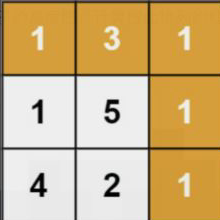

```text
输入：grid = [[1,3,1],[1,5,1],[4,2,1]]
输出：7
解释：因为路径 1→3→1→1→1 的总和最小。
```

```python
# 基础dp
class Solution:
    def minPathSum(self, grid):
        m = len(grid)
        n = len(grid[0])
        dp = [[0] * n for _ in range(m)]

        dp[0][0] = grid[0][0]

        # 初始化第一行
        for i in range(1, n):
            dp[0][i] = dp[0][i - 1] + grid[0][i]

        # 初始化第一列
        for i in range(1, m):
            dp[i][0] = dp[i - 1][0] + grid[i][0]

        # 填充其余的 dp 数组
        for i in range(1, m):
            for j in range(1, n):
                dp[i][j] = min(dp[i - 1][j], dp[i][j - 1]) + grid[i][j]

        return dp[m - 1][n - 1]

# 辅助函数：测试代码
sol = Solution()
grid = [
    [1, 3, 1],
    [1, 5, 1],
    [4, 2, 1]
]
result = sol.minPathSum(grid)
print("Minimum path sum:", result)  # Output: 7

# 解释：
# 初始化：
# m 和 n 分别表示矩阵的行数和列数。
# 使用列表生成式创建一个大小为 m * n 的二维列表 dp，初始值全为 0。
# 设置起点：
# dp[0][0] 初始化为 grid[0][0]，表示起点。
# 初始化第一行：
# 遍历第一行的每个元素，dp[0][i] 等于左边元素的和加上当前 grid 值。
# 初始化第一列：
# 遍历第一列的每个元素，dp[i][0] 等于上边元素的和加上当前 grid 值。
# 填充 dp 数组：
# 遍历每个位置 (i, j)，更新 dp[i][j] 为从上方或者左方过来的路径和的最小值加上当前 grid 值。
# 动态规划转移方程：dp[i][j] = min(dp[i - 1][j], dp[i][j - 1]) + grid[i][j]。
# 返回结果：
# 最后返回 dp[m - 1][n - 1]，即到达右下角 (m - 1, n - 1) 的最小路径和。
```

```
// 空间优化
class Solution {
public:
    int minPathSum(vector<vector<int>>& grid) {
        int m = grid.size();
        int n = grid[0].size();
        vector<int> dp(n, INT_MAX);
        dp[0] = 0;
        for (int i = 0; i < m; i++) {
            dp[0] = grid[i][0] + dp[0];
            for (int j = 1; j < n; j++) {
                dp[j] = min(dp[j - 1], dp[j]);
                dp[j] += grid[i][j];
            }
        }
        return dp[n - 1];
    }
};
```

###### [5. 最长回文子串](https://leetcode.cn/problems/longest-palindromic-substring/)

给你一个字符串s，找到s中最长的回文子串。

如果字符串的反序与原始字符串相同，则该字符串称为回文字符串。

```text
输入：s = "babad"
输出："bab"
解释："aba" 同样是符合题意的答案。
```

```python
class Solution:
    def longestPalindrome(self, s: str) -> str:
        n = len(s)
        if n < 2:
            return s

        index_start = 0
        index_end = 0
        maxlen = 1

        dp = [[False] * n for _ in range(n)]

        # 单个字符肯定是回文
        for i in range(n):
            dp[i][i] = True

        for i in range(1, n):  # i 是右边界
            for j in range(i):  # j 是左边界
                if s[i] == s[j] and (i - j <= 2 or dp[j + 1][i - 1]):
                    dp[j][i] = True
                    if i - j + 1 > maxlen:
                        maxlen = i - j + 1
                        index_start = j
                        index_end = i

        return s[index_start:index_end + 1]

# 辅助函数：测试代码
sol = Solution()
s = "babad"
result = sol.longestPalindrome(s)
print("Longest palindromic substring:", result)  # Output: "bab" or "aba"

# 解释：
# 初始化：
# n 是字符串的长度。如果 n 小于2，直接返回字符串本身。
# index_start 和 index_end 分别表示最长回文子串的起始和结束索引。
# maxlen 记录最长回文子串的长度，初始值为1。
# 使用列表生成式初始化 dp 二维数组，dp[i][j] 表示字符串 s 的子串 s[i:j+1] 是否为回文。
# 设置单字符回文：
# 单个字符肯定是回文，所以 dp[i][i] 全部设为 True。
# 填充 dp 数组：
# 遍历右边界 i 从1到 n-1。
# 遍历左边界 j 从0到 i-1。
# 如果 s[i] == s[j] 且 (i - j <= 2 或者 dp[j + 1][i - 1] 为 True)，则 dp[j][i] = True。
# 更新最长回文子串的长度和起始结束索引。
# 返回结果：
# 最后返回 s[index_start:index_end + 1]，即最长回文子串。
```

###### [1143. 最长公共子序列](https://leetcode.cn/problems/longest-common-subsequence/)

给定两个字符串text1和text2，返回这两个字符串的最长**公共子序列**的长度。如果不存在**公共子序列**，返回0。

一个字符串的**子序列**是指这样一个新的字符串：它是由原字符串在不改变字符的相对顺序的情况下删除某些字符（也可以不删除任何字符）后组成的新字符串。

- •例如，"ace"是"abcde"的子序列，但"aec"不是"abcde"的子序列。

两个字符串的**公共子序列**是这两个字符串所共同拥有的子序列。

```text
输入：text1 = "abcde", text2 = "ace"
输出：3
解释：最长公共子序列是 "ace" ，它的长度为 3 。
```

```python
class Solution:
    def longestCommonSubsequence(self, text1: str, text2: str) -> int:
        m = len(text1)
        n = len(text2)
        # dp[i][j]: text1[0:i]与text2[0:j]的LCS
        dp = [[0] * (n + 1) for _ in range(m + 1)]

        for i in range(1, m + 1):
            for j in range(1, n + 1):
                if text1[i - 1] == text2[j - 1]:
                    dp[i][j] = dp[i - 1][j - 1] + 1
                else:
                    dp[i][j] = max(dp[i - 1][j], dp[i][j - 1])

        return dp[m][n]

# 辅助函数：测试代码
sol = Solution()
text1 = "abcde"
text2 = "ace"
result = sol.longestCommonSubsequence(text1, text2)
print("Longest common subsequence length:", result)  # Output: 3

# 解释：
# 初始化：
# m 和 n 分别表示字符串 text1 和 text2 的长度。
# 使用列表生成式创建一个大小为 (m + 1) * (n + 1) 的二维列表 dp，初始值全为 0。dp[i][j] 表示 text1[0:i] 和 text2[0:j] 的最长公共子序列的长度。
# 填充 DP 数组：
# 遍历 text1 和 text2 的每个字符。
# 如果 text1[i - 1] 和 text2[j - 1] 相等，则 dp[i][j] = dp[i - 1][j - 1] + 1。
# 如果不相等，则取 dp[i - 1][j] 和 dp[i][j - 1] 的最大值，即 dp[i][j] = max(dp[i - 1][j], dp[i][j - 1])。
# 返回结果：
# 最后返回 dp[m][n]，即 text1 和 text2 的最长公共子序列的长度。
```

###### [72. 编辑距离](https://leetcode.cn/problems/edit-distance/)

给你两个单词word1和word2， *请返回将 **word1** 转换成 **word2** 所使用的最少操作数* 。

你可以对一个单词进行如下三种操作：

- •插入一个字符

- •删除一个字符

- •替换一个字符

```text
Plain Text
输入：word1 = "horse", word2 = "ros"
输出：3
解释：
horse -> rorse (将 'h' 替换为 'r')
rorse -> rose (删除 'r')
rose -> ros (删除 'e')
```

```python
Python
# 当word1[i]!=word2[j]时:
#      dp[i-1][j-1]+1: word1的[0,i-1]位置与word2的[0,j-1]位置的字符已匹配, 加1代表执行word1[i]->word2[j]的替换操作
#      dp[i-1][j]+1:   word1的[0,i-1]位置与word2的[0,j]位置的字符已匹配, 加1代表执行word1[i]的删除操作
#      dp[i][j-1]+1：  word1的[0,i]位置与word2的[0,j-1]位置的字符已匹配, 加1代表执行word1[i]的插入操作
#
# (一)、当word1[i]==word2[j]时,由于遍历到了i和j,说明word1的0~i-1和word2的0~j-1的匹配结果已经生成,
# 由于当前两个字符相同,因此无需做任何操作,dp[i][j]=dp[i-1][j-1]
# (二)、当word1[i]!=word2[j]时,可以进行的操作有3个:
#       ① 替换操作:可能word1的0~i-1位置与word2的0~j-1位置的字符都相同,
#            只是当前位置的字符不匹配,进行替换操作后两者变得相同,
#            所以此时dp[i][j]=dp[i-1][j-1]+1(这个加1代表执行替换操作)
#       ②删除操作:若此时word1的0~i-1位置与word2的0~j位置已经匹配了,
#          此时多出了word1的i位置字符,应把它删除掉,才能使此时word1的0~i(这个i是执行了删除操作后新的i)
#          和word2的0~j位置匹配,因此此时dp[i][j]=dp[i-1][j]+1(这个加1代表执行删除操作)
#       ③插入操作:若此时word1的0~i位置只是和word2的0~j-1位置匹配,
#           此时只需要在原来的i位置后面插入一个和word2的j位置相同的字符使得
#           此时的word1的0~i(这个i是执行了插入操作后新的i)和word2的0~j匹配得上,
#           所以此时dp[i][j]=dp[i][j-1]+1(这个加1代表执行插入操作)
#       ④由于题目所要求的是要最少的操作数:所以当word1[i] != word2[j] 时,
#           需要在这三个操作中选取一个最小的值赋格当前的dp[i][j]
# (三)总结:状态方程为:
#  if(word1[i] == word2[j]):
#        dp[i][j] = dp[i-1][j-1]
#  else:
#         min(dp[i-1][j-1],dp[i-1][j],dp[i][j-1])+1
class Solution:
    def minDistance(self, word1: str, word2: str) -> int:
        m = len(word1)
        n = len(word2)

        if m == 0 or n == 0:
            return m + n

        # dp[i][j]: word1的前i个字母和word2的前j个字母之间的minDistance
        dp = [[0] * (n + 1) for _ in range(m + 1)]

        # 初始化第一列
        for i in range(m + 1):
            dp[i][0] = i
        # 初始化第一行
        for j in range(n + 1):
            dp[0][j] = j

        # 填充dp数组
        for i in range(1, m + 1):
            for j in range(1, n + 1):
                if word1[i - 1] == word2[j - 1]:
                    dp[i][j] = dp[i - 1][j - 1]
                else:
                    dp[i][j] = min(dp[i - 1][j], dp[i][j - 1], dp[i - 1][j - 1]) + 1

        return dp[m][n]

# 辅助函数：测试代码
sol = Solution()
word1 = "horse"
word2 = "ros"
result = sol.minDistance(word1, word2)
print("Minimum edit distance:", result)  # Output: 3

# 解释：
# 初始化：
# m 和 n 分别表示字符串 word1 和 word2 的长度。
# 使用列表生成式创建一个大小为 (m + 1) * (n + 1) 的二维列表 dp，初始值全为 0。
# 如果其中一个字符串为空，则需要的编辑距离是另一个字符串的长度。
# 初始化第一行和第一列：
# dp[i][0] = i，表示将 word1 的前 i 个字母转换为空字符串所需要的编辑距离是 i。
# dp[0][j] = j，表示将 word2 的前 j 个字母转换为空字符串所需要的编辑距离是 j。
# 填充 dp 数组：
# 遍历 word1 和 word2 的每个字符。
# 如果 word1[i - 1] 和 word2[j - 1] 相等，则 dp[i][j] = dp[i - 1][j - 1]。
# 如果不相等，则 dp[i][j] = min(dp[i - 1][j], dp[i][j - 1], dp[i - 1][j - 1]) + 1，其中：
# dp[i - 1][j] + 1 表示删除 word1[i - 1] 的操作。
# dp[i][j - 1] + 1 表示插入一个字符使其与 word2[j - 1] 匹配的操作。
# dp[i - 1][j - 1] + 1 表示将 word1[i - 1] 替换成 word2[j - 1] 的操作。
# 返回结果：
# 最后返回 dp[m][n]，即两个字符串之间的最小编辑距离。
```

## **技巧**

###### [136. 只出现一次的数字](https://leetcode.cn/problems/single-number/)**💚**

给你一个**非空**整数数组nums，除了某个元素只出现一次以外，其余每个元素均出现两次。找出那个只出现了一次的元素。

你必须设计并实现线性时间复杂度的算法来解决此问题，且该算法只使用常量额外空间。

```text
Plain Text
输入：nums = [4,1,2,1,2]
输出：4
```

```python
Python
# 哈希表
class Solution:
    def singleNumber(self, nums):
        count = {}

        # 统计每个数字出现的次数
        for num in nums:
            if num in count:
                count[num] += 1
            else:
                count[num] = 1

        # 找到出现一次的数字并返回
        for num in nums:
            if count[num] == 1:
                return num

        return 0

# 辅助函数：测试代码
sol = Solution()
nums = [4, 1, 2, 1, 2]
result = sol.singleNumber(nums)
print("Single number:", result)  # Output: 4

# 解释：
# 初始化：
# 创建一个空的字典 count 用于存储每个数字出现的次数。
# 统计次数：
# 遍历 nums 列表，对于每个数字 num，如果 num 已经在 count 字典中，则增加其计数器，否则将其计数器初始化为 1。
# 寻找单一数字：
# 再次遍历 nums 列表，查找 count 字典中计数器为 1 的数字并返回。该数字即为出现一次的数字。
# 返回结果：
# 如果所有数字都找不到匹配条件，返回 0。
```

```
C++
//  异或运算有以下三个性质：
//   任何数和 0 做异或运算，结果仍然是原来的数。
//   任何数和其自身做异或运算，结果是 0。
//   异或运算满足交换律和结合律。
class Solution {
public:
    int singleNumber(vector<int>& nums) {
        int result = 0;
        for (int num : nums) {
            result ^= num;
        }
        return result;
    }
};
```

###### [169. 多数元素💚](https://leetcode.cn/problems/majority-element/)

给定一个大小为n的数组nums，返回其中的多数元素。多数元素是指在数组中出现次数**大于**⌊ n/2 ⌋的元素。

你可以假设数组是非空的，并且给定的数组总是存在多数元素。

```text
Plain Text
输入：nums = [2,2,1,1,1,2,2]
输出：2
```

```python
Python
# 哈希表
class Solution:
    def majorityElement(self, nums):
        count = {}
        n = len(nums) // 2

        # 统计每个数字出现的次数并检查是否超过一半
        for num in nums:
            if num in count:
                count[num] += 1
            else:
                count[num] = 1

            if count[num] > n:
                return num

        # 如果没有找到多数元素，默认返回None（实际上不会发生，因为题目保证多数元素存在）
        return None

# 辅助函数：测试代码
sol = Solution()
nums = [3, 2, 3]
result = sol.majorityElement(nums)
print("Majority element:", result)  # Output: 3

# 解释：
# 初始化：
# 创建一个空的字典 count 用于存储每个数字出现的次数。
# 计算 n 为列表 nums 的长度的一半，用于比较是否有数字的出现次数超过 n。
# 统计次数并检查：
# 遍历 nums 列表，对于每个数字 num，如果 num 已经在 count 字典中，则增加其计数器，否则将其计数器初始化为 1。
# 每次增加计数器时，检查 count[num] 是否大于 n，如果是则返回该 num。
# 返回结果：
# 如果所有数字都找不到满足条件的多数元素，默认返回 None。实际上不会发生这种情况，因为题目保证多数元素存在。
```

```
C++
// Boyer-Moore 投票算法 “同归于尽消杀法” ：

// 由于多数超过50%, 比如100个数，那么多数至少51个，剩下少数是49个。

// 第一个到来的士兵，直接插上自己阵营的旗帜占领这块高地，此时领主 winner 就是这个阵营的人，现存兵力 count = 1。

// 如果新来的士兵和前一个士兵是同一阵营，则集合起来占领高地，领主不变，winner 依然是当前这个士兵所属阵营，现存兵力 count++；

// 如果新来到的士兵不是同一阵营，则前方阵营派一个士兵和它同归于尽。 此时前方阵营兵力count --。（即使双方都死光，这块高地的旗帜 winner 依然不变，因为已经没有活着的士兵可以去换上自己的新旗帜）

// 当下一个士兵到来，发现前方阵营已经没有兵力，新士兵就成了领主，winner 变成这个士兵所属阵营的旗帜，现存兵力 count ++。

// 就这样各路军阀一直以这种以一敌一同归于尽的方式厮杀下去，直到少数阵营都死光，那么最后剩下的几个必然属于多数阵营，winner 就是多数阵营。（多数阵营 51个，少数阵营只有49个，死剩下的2个就是多数阵营的人）
class Solution {
public:
    int majorityElement(vector<int>& nums) {
        int candidate = -1;
        int count = 0;
        for (int num : nums) {
            if (num == candidate)
                ++count;
            else if (--count < 0) {
                candidate = num;
                count = 1;
            }
        }
        return candidate;
    }
};
```

###### [75. 颜色分类](https://leetcode.cn/problems/sort-colors/)

给定一个包含红色、白色和蓝色、共n个元素的数组nums，**[原地](https://baike.baidu.com/item/%E5%8E%9F%E5%9C%B0%E7%AE%97%E6%B3%95)**对它们进行排序，使得相同颜色的元素相邻，并按照红色、白色、蓝色顺序排列。

我们使用整数0、1和2分别表示红色、白色和蓝色。

必须在不使用库内置的 sort 函数的情况下解决这个问题。

```text
Plain Text
输入：nums = [2,0,2,1,1,0]
输出：[0,0,1,1,2,2]
```

```python
Python
# 计数
class Solution:
    def sortColors(self, nums):
        red = 0
        white = 0
        blue = 0

        # 统计每种颜色的数量
        for num in nums:
            if num == 0:
                red += 1
            elif num == 1:
                white += 1
            else:
                blue += 1

        # 重新排列数组
        for i in range(len(nums)):
            if i < red:
                nums[i] = 0
            elif i < red + white:
                nums[i] = 1
            else:
                nums[i] = 2

# 辅助函数：测试代码
sol = Solution()
nums = [2, 0, 2, 1, 1, 0]
sol.sortColors(nums)
print("Sorted colors:", nums)  # Output: [0, 0, 1, 1, 2, 2]

# 解释：
# 初始化：
# red、white 和 blue 分别用于统计0（红色）、1（白色）和2（蓝色）出现的次数，初始值均为0。
# 统计颜色数量：
# 遍历 nums 列表，对于每个数字 num，根据其值分别增加对应的计数器。
# 重新排列数组：
# 遍历 nums 的索引 i，根据 red、white 的计数重新设置 nums 中的值：
# i < red 部分设置为0。
# red <= i < red + white 部分设置为1。
# i >= red + white 部分设置为2。
```

```
C++
// 双指针
class Solution {
public:
    void sortColors(vector<int>& nums) {
        if (nums.size() == 1)
            return;
        int left = 0;
        int right = nums.size() - 1;
        int i = 0;
        while (i <= right) {
            if (nums[i] == 1) {
                i++;
            } else if (nums[i] == 0) {
                swap(nums[i++], nums[left++]);
            } else {
                swap(nums[i], nums[right--]);
            }
        }
    }
};
```

###### [31. 下一个排列](https://leetcode.cn/problems/next-permutation/)

整数数组的一个**排列**就是将其所有成员以序列或线性顺序排列。

- •例如，arr = [1,2,3]，以下这些都可以视作arr的排列：[1,2,3]、[1,3,2]、[3,1,2]、[2,3,1]。

整数数组的**下一个排列**是指其整数的下一个字典序更大的排列。更正式地，如果数组的所有排列根据其字典顺序从小到大排列在一个容器中，那么数组的**下一个排列**就是在这个有序容器中排在它后面的那个排列。如果不存在下一个更大的排列，那么这个数组必须重排为字典序最小的排列（即，其元素按升序排列）。

- •例如，arr = [1,2,3]的下一个排列是[1,3,2]。

- •类似地，arr = [2,3,1]的下一个排列是[3,1,2]。

- •而arr = [3,2,1]的下一个排列是[1,2,3]，因为[3,2,1]不存在一个字典序更大的排列。

给你一个整数数组nums，找出nums的下一个排列。

必须[原地](https://baike.baidu.com/item/%E5%8E%9F%E5%9C%B0%E7%AE%97%E6%B3%95)修改，只允许使用额外常数空间。

```python
Python
# 以排列[4,5,2,6,3,1]为例：
# 1. 找到较小数2，较大数3，交换后为[4,5,3,6,2,1]
# 2. 对较小数右边序列倒序，[4,5,3,1,2,6]
class Solution:
    def nextPermutation(self, nums):
        # 从右到左寻找较小数
        left = len(nums) - 1
        for i in range(len(nums) - 2, -1, -1):
            if nums[i] < nums[i + 1]:
                left = i
                break
        else:
            nums.reverse()
            return

        # 从右到左寻找第一个大于nums[left]的数
        right = len(nums) - 1
        for j in range(len(nums) - 1, left, -1):
            if nums[j] > nums[left]:
                right = j
                break

        # 交换left和right位置的元素
        nums[left], nums[right] = nums[right], nums[left]

        # 反转left+1到结尾的部分
        nums[left + 1:] = reversed(nums[left + 1:])

# 辅助函数：测试代码
sol = Solution()
nums = [1, 2, 3]
sol.nextPermutation(nums)
print("Next permutation:", nums)  # Output: [1, 3, 2]

# 解释：
# 寻找较小数：
# 从右向左遍历 nums 列表，找到第一个比其后一个元素小的位置 left。如果找不到，表示整个数组是降序排列的，下一排列就应该是升序排列。
# 找第一个大于 nums[left] 的数：
# 从右向左遍历 nums 列表，找到第一个大于 nums[left] 的数，记作 right。
# 交换 left 和 right 位置的元素：
# 交换位置 left 和 right 的元素，使得下一个更大的排列有序。
# 反转从 left + 1 到结尾的部分：
# 反转 left + 1 到结尾的部分，以使得其成为字典序的最小排列。
```

###### [287. 寻找重复数](https://leetcode.cn/problems/find-the-duplicate-number/)

给定一个包含n + 1个整数的数组nums，其数字都在[1, n]范围内（包括1和n），可知至少存在一个重复的整数。

假设nums只有**一个重复的整数**，返回**这个重复的数**。

你设计的解决方案必须**不修改**数组nums且只用常量级O(1)的额外空间。

```text
Plain Text
输入：nums = [1,3,4,2,2]
输出：2
```

```python
Python
# 快慢指针（环形链表）
class Solution:
    def findDuplicate(self, nums):
        slow = fast = 0

        # 首先找到相遇点
        while True:
            slow = nums[slow]
            fast = nums[nums[fast]]
            if slow == fast:
                break

        # 找到环的入口点
        slow = 0
        while slow != fast:
            slow = nums[slow]
            fast = nums[fast]

        return slow

# 辅助函数：测试代码
sol = Solution()
nums = [1, 3, 4, 2, 2]
result = sol.findDuplicate(nums)
print("Duplicate number:", result)  # Output: 2

# 解释：
# 初始化：
# slow 和 fast 两个指针都初始化为 0，即从第一个元素开始。
# 寻找相遇点：
# 使用 while True 循环，slow 指针每次走一步 nums[slow]，fast 指针每次走两步 nums[nums[fast]]。
# 当 slow 等于 fast 时，跳出循环，相遇点即在环内。
# 寻找环的入口点：
# 将 slow 重新初始化为 0。
# 使用 while slow != fast 循环，slow 和 fast 每次都走一步 nums[slow] 和 nums[fast]。
# 当 slow 等于 fast 时，slow 即为环的入口点，也就是重复的数字。
# 返回结果：
# 返回 slow，即找到的重复数字。
```

## **排序**

### **冒泡排序**

```python
Python
# 两两比较 交换
# O(n^2)
# 稳定（相等的两个数 相对位置会不会发生改变）
def bubble_sort(arr):
    n = len(arr)
    # 遍历数组的每个元素
    for i in range(n):
        # 标志位，用于检测是否发生了交换
        swapped = False
        # 内层循环比较相邻元素
        for j in range(0, n - i - 1):
            # 如果前一个元素大于后一个元素，则交换
            if arr[j] > arr[j + 1]:
                arr[j], arr[j + 1] = arr[j + 1], arr[j]
                swapped = True
        # 如果在一轮比较中没有交换发生，说明已经排序完成
        if not swapped:
            break
    return arr

# 测试代码
arr = [64, 34, 25, 12, 22, 11, 90]
sorted_arr = bubble_sort(arr)
print("排序后的数组:", sorted_arr)
```

### **插入排序**

```python
Python
# O(n^2)
# 稳定
def insertion_sort(arr):
    # 从第二个元素开始，因为第一个元素默认是排序好的
    for i in range(1, len(arr)):
        key = arr[i]
        # 将当前元素与已经排序好的部分进行比较
        j = i - 1
        # 如果前面的元素比当前元素大，就把前面的元素往后移
        while j >= 0 and arr[j] > key:
            arr[j + 1] = arr[j]
            j -= 1
        # 把当前元素插入到合适的位置
        arr[j + 1] = key
    return arr

# 测试代码
arr = [12, 11, 13, 5, 6]
sorted_arr = insertion_sort(arr)
print("排序后的数组:", sorted_arr)
```

### **选择排序**

```python
Python
# O(n^2)
# 不稳定
def selection_sort(arr):
    # 遍历数组的每一个元素
    for i in range(len(arr)):
        # 假设当前元素为最小值
        min_idx = i
        # 从当前位置之后的元素中寻找最小值
        for j in range(i+1, len(arr)):
            if arr[j] < arr[min_idx]:
                min_idx = j
        # 将找到的最小值与当前位置元素交换
        arr[i], arr[min_idx] = arr[min_idx], arr[i]
    return arr

# 测试代码
arr = [64, 25, 12, 22, 11]
sorted_arr = selection_sort(arr)
print("排序后的数组:", sorted_arr)
```

### **快速排序**

```python
Python
# O(n*logn)
# 不稳定
def quick_sort(arr):
    # 基础条件：如果数组长度为1或0，则已经排序
    if len(arr) <= 1:
        return arr
    else:
        # 选择一个基准元素
        pivot = arr[len(arr) // 2]
        # 小于基准的元素
        left = [x for x in arr if x < pivot]
        # 等于基准的元素
        middle = [x for x in arr if x == pivot]
        # 大于基准的元素
        right = [x for x in arr if x > pivot]
        # 递归排序左右两边
        return quick_sort(left) + middle + quick_sort(right)

# 测试代码
arr = [10, 7, 8, 9, 1, 5]
sorted_arr = quick_sort(arr)
print("排序后的数组:", sorted_arr)
```

### **归并排序**

```python
Python
# O(n*logn)
# 稳定
def merge_sort(arr):
    # 基础条件：如果数组长度小于等于1，则无需排序
    if len(arr) <= 1:
        return arr

    # 找到数组的中点
    mid = len(arr) // 2

    # 递归地对左右两半进行排序
    left_half = merge_sort(arr[:mid])
    right_half = merge_sort(arr[mid:])

    # 合并两个已排序的数组
    return merge(left_half, right_half)

def merge(left, right):
    result = []
    i = j = 0

    # 合并两个有序数组
    while i < len(left) and j < len(right):
        if left[i] <= right[j]:
            result.append(left[i])
            i += 1
        else:
            result.append(right[j])
            j += 1

    # 将剩余的元素加入结果数组
    result.extend(left[i:])
    result.extend(right[j:])

    return result

# 测试代码
arr = [38, 27, 43, 3, 9, 82, 10]
sorted_arr = merge_sort(arr)
print("排序后的数组:", sorted_arr)
```
